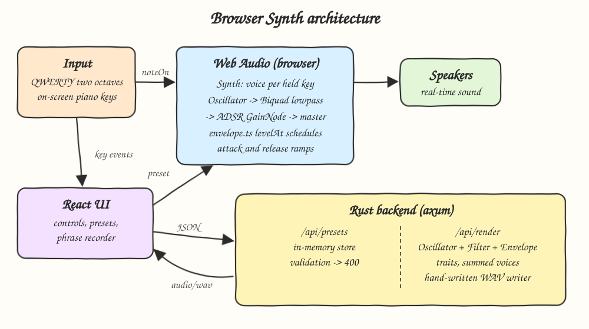
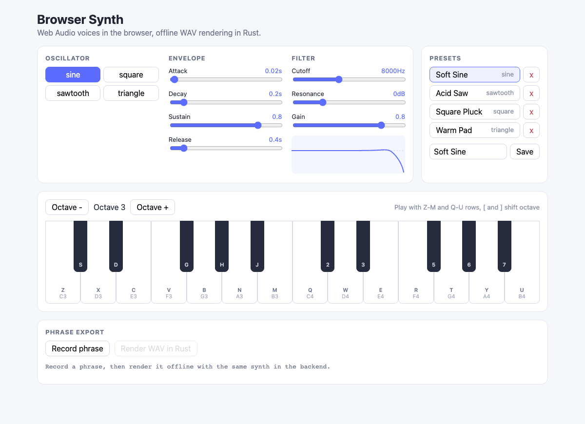
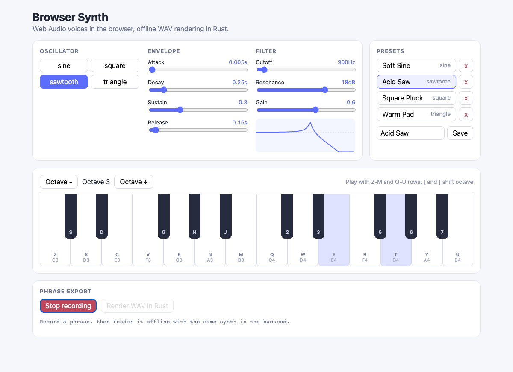
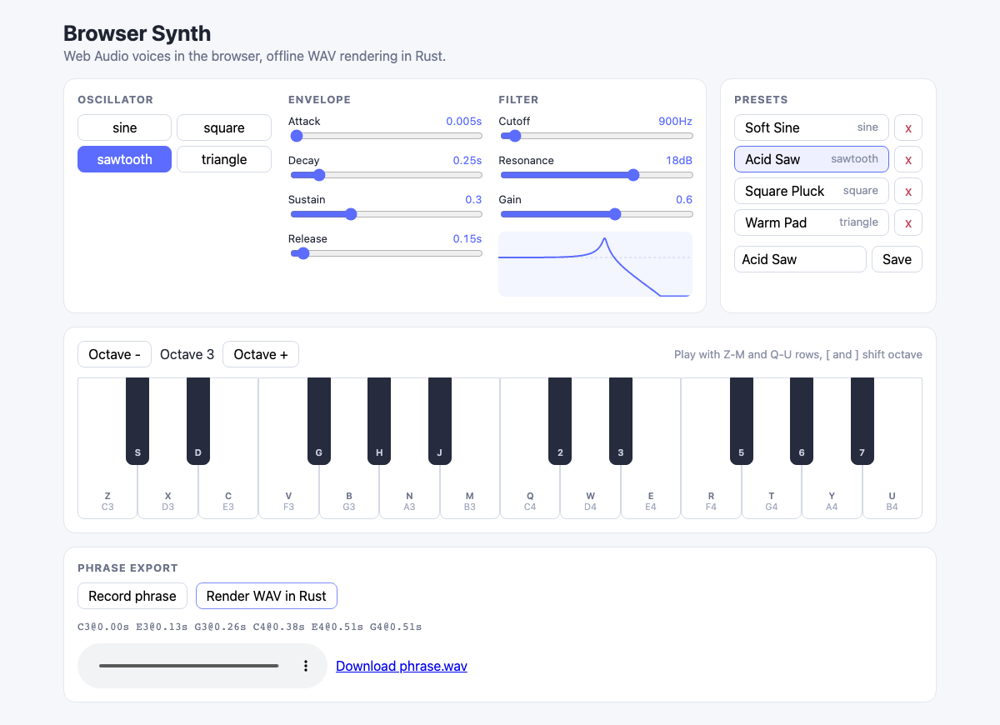

# 04 - Browser Synth

A polyphonic synthesizer that plays in real time in the browser through Web Audio, with a Rust backend
that stores presets and renders a recorded phrase offline with the same synth math into a WAV file.

## How it Works

1. Each key you hold (QWERTY or on-screen piano) starts a `Voice`: `OscillatorNode -> BiquadFilterNode (lowpass) -> GainNode`.
2. The `GainNode` gain follows an ADSR envelope scheduled with linear ramps from `audio/envelope.ts`.
3. On key up, `levelAt` computes the exact current envelope level so release starts from there without a click.
4. All voices sum into a master gain (`0.3`) and go to the speakers.
5. Presets (waveform, ADSR, cutoff, resonance, gain) live in the Rust backend, validated on save.
6. "Record phrase" captures note on/off times; "Render WAV in Rust" posts `{preset, notes}` to `/api/render`.
7. Rust renders each note with `Oscillator`, `Filter` (RBJ biquad lowpass, same formula as Web Audio) and `Envelope` traits, sums voices and writes a 16-bit mono WAV.

Real-time sound stays in TypeScript on purpose: live playing needs sub-10ms latency, which a round trip to the backend cannot give. The offline export is the heavy, deterministic part and lives in Rust.

## Architecture



## Features

* Four waveforms (sine, square, sawtooth, triangle): the classic subtractive synth palette.
* ADSR envelope per voice: shapes plucks, pads and leads from the same oscillator.
* Lowpass filter with cutoff and resonance plus a live response curve: shows what the knobs do to the spectrum.
* Polyphony: one voice per held key, chords just work.
* QWERTY mapping for two octaves (Z row and Q row) plus clickable piano keys: play without a MIDI device.
* Octave shift with buttons or `[` and `]`: reach the full range from octave 1 to 6.
* Preset storage with built-ins and server-side validation: invalid ADSR/filter values come back as readable errors.
* Phrase export rendered offline in Rust: get a WAV of what you played, independent of the browser audio stack.

## Stack

* Rust 1.99.1, edition 2024: fast, safe DSP for offline rendering.
* axum + tokio: small async HTTP server for the JSON and WAV endpoints.
* serde / serde_json: typed JSON for presets and render requests.
* tower-http: CORS layer.
* React 19.3.1 + TypeScript strict: typed UI components.
* Vite: dev server with `/api` proxy and production build.
* bun: package manager and test runner for pure TS logic.
* Web Audio API: native real-time oscillators, filters and gain automation.

No audio crates and no audio npm packages: oscillator, biquad, ADSR and WAV writer are hand-written.

## API

| Method | Path | Body | Response |
|---|---|---|---|
| GET | `/api/presets` | - | `200` `Preset[]` |
| POST | `/api/presets` | `Preset` | `201` saved `Preset` (replaces same name), `400 {error}` when invalid |
| DELETE | `/api/presets/{name}` | - | `204`, `404 {error}` when unknown |
| POST | `/api/render` | `{ preset: Preset, notes: Note[] }` | `200 audio/wav`, `400 {error}` when preset or notes are invalid |

```json
{
  "name": "Acid Saw",
  "waveform": "sawtooth",
  "attack": 0.005,
  "decay": 0.25,
  "sustain": 0.3,
  "release": 0.15,
  "cutoff": 900,
  "resonance": 18,
  "gain": 0.6
}
```

Validation ranges: attack 0-5 s, decay 0-5 s, sustain 0-1, release 0-10 s, cutoff 20-20000 Hz, resonance -10 to 30 dB, gain 0-1, name 1-40 characters. Notes: `midi` 0-127, `start >= 0`, `duration > 0`, the phrase must fit in 60 seconds.

## Key data structures and design decisions

* `Preset` is the single shape shared by UI, store and renderer, so what you hear live is what gets exported.
* `Note { midi, start, duration }` is produced by `PhraseRecorder`, re-based to the first key press.
* Rust traits: `Oscillator::next_sample`, `Envelope::level(t, gate)`, `Filter::process`, with `WaveOscillator`, `Adsr` and `BiquadLowpass` as implementations.
* ADSR math is identical in `audio/envelope.ts` and `dsp/envelope.rs` (linear attack, decay, release from the current level), and both are tested at the same stage times.
* Resonance is in dB because Web Audio's lowpass interprets `Q` in dB; the Rust biquad uses the same `alpha = sin(w0) / (2 * 10^(Q/20))` formula.
* Each voice has its own filter, matching the browser graph, so chords render the same way in both places.
* Rust oscillators are naive (not band-limited) while Web Audio ones are band-limited, so bright waveforms at high pitch differ slightly in the export.
* Errors are an `AppError` enum mapped to HTTP status codes; no `unwrap` outside tests.

## Run

```bash
./scripts/setup.sh
./scripts/start-all.sh
./scripts/test-all.sh
./scripts/stop-all.sh
```

Manual: `cd backend && cargo test && cargo run`, `cd frontend && bun install && bun test src && bun run dev`.

## Printscreens

Initial state with the built-in presets loaded from the backend and the filter response curve.



The Acid Saw preset loaded, recording a phrase while E4 and G4 are held: highlighted piano keys show active voices and the curve shows the resonant peak at 900 Hz.



After stopping the recording the phrase notes are listed and the Rust renderer returned a WAV that can be played inline or downloaded.



## Scripts

All scripts live in `scripts/` and run from any directory of the repository.

| Script | What it does |
|---|---|
| `./scripts/setup.sh` | Installs dependencies and prepares the app |
| `./scripts/start-all.sh` | Starts every service and prints the full link of each one |
| `./scripts/status.sh` | Shows every service port as UP or DOWN |
| `./scripts/test-all.sh` | Runs every test suite |
| `./scripts/ui.sh` | Opens the UI in the browser |
| `./scripts/stop-all.sh` | Stops every service |

Ports are declared in `scripts/ports.env`.

```bash
./scripts/setup.sh
./scripts/start-all.sh
./scripts/status.sh
./scripts/ui.sh
./scripts/stop-all.sh
```
