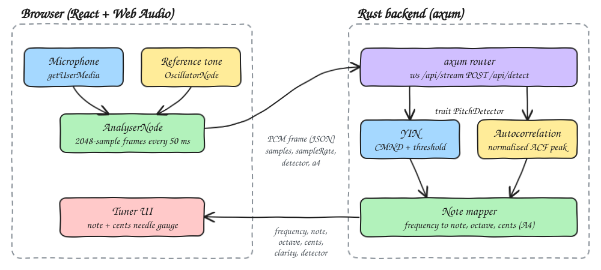
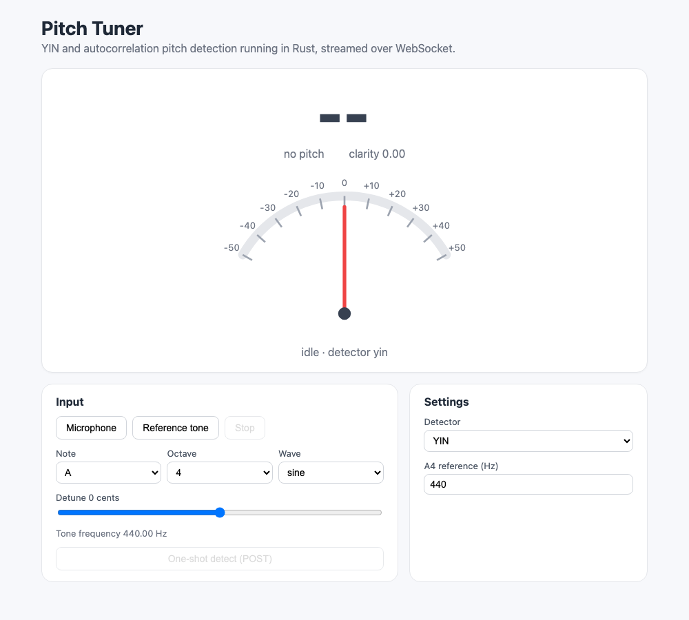
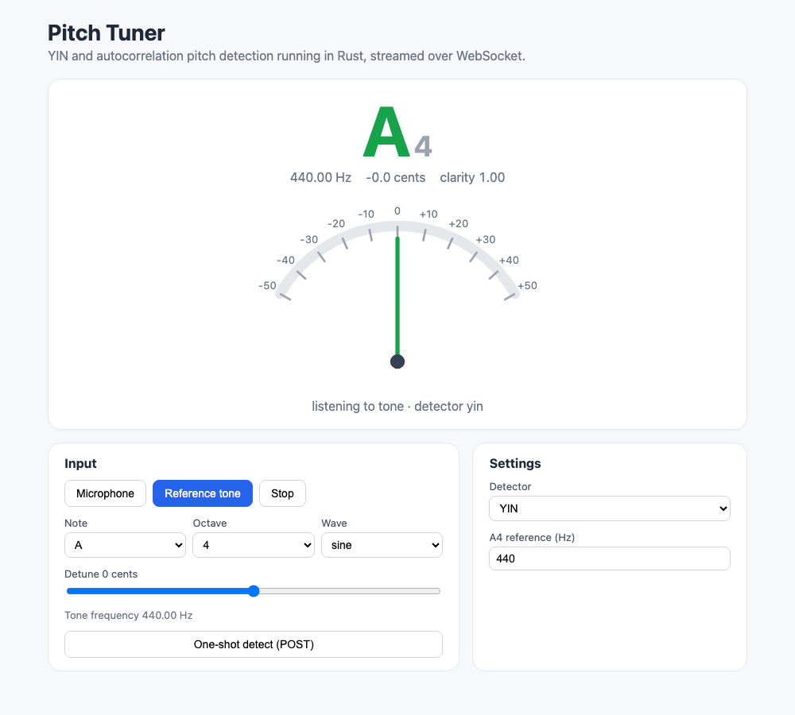
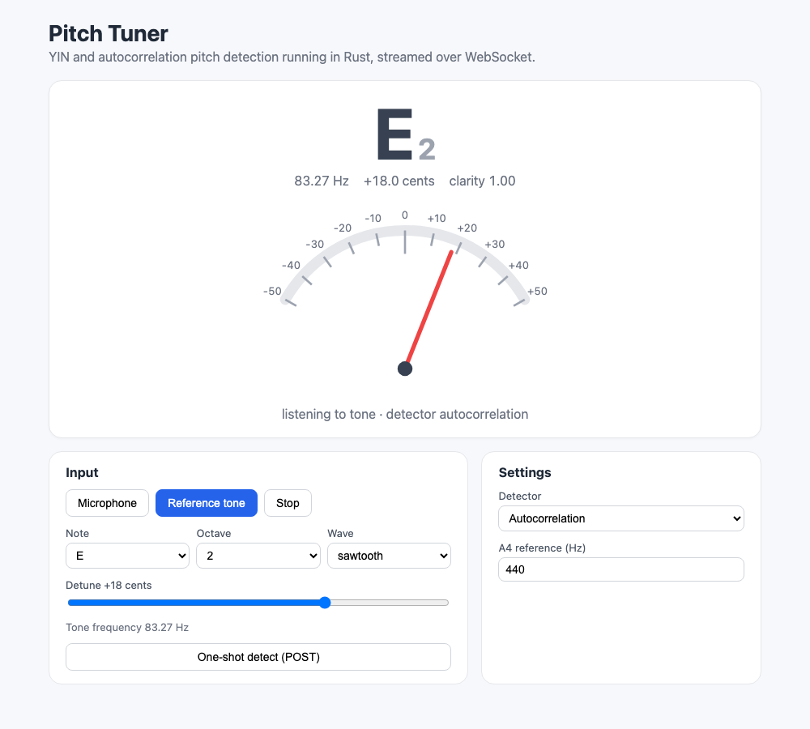
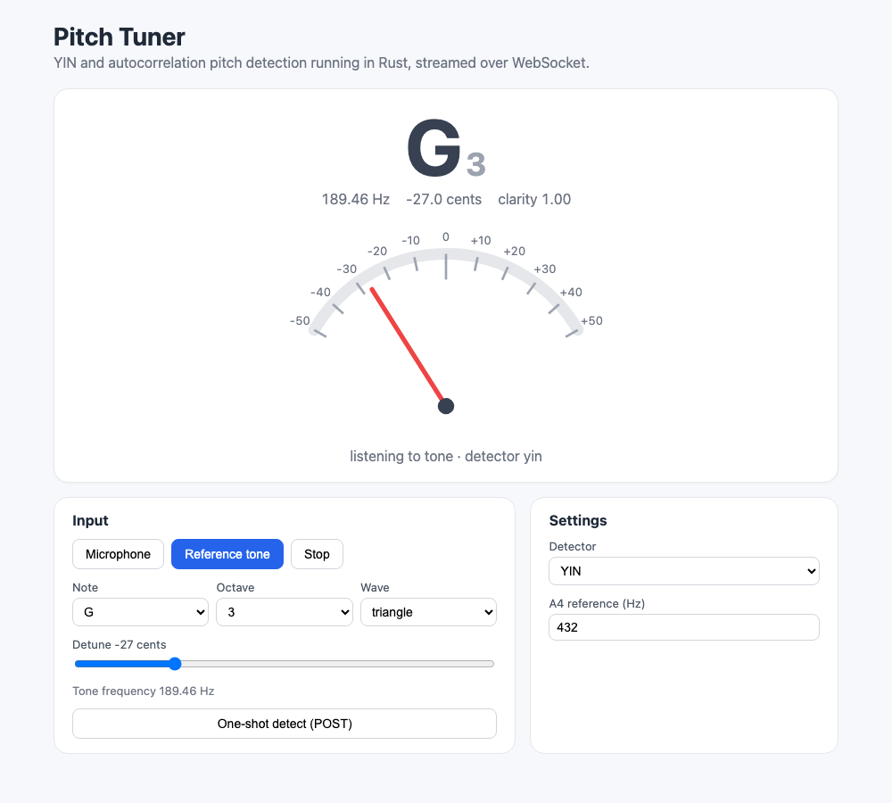

# 06 - Pitch Tuner

A chromatic tuner. The browser captures the microphone (or a built-in reference tone), sends PCM frames to a Rust backend over a WebSocket, and the backend runs one of two hand-written pitch detectors, YIN or autocorrelation. It replies with the frequency, note name, octave and cents offset, and the UI shows them on a needle gauge.

## How it Works

1. The Web Audio `AnalyserNode` holds the last 2048 samples from the mic or from an `OscillatorNode` reference tone.
2. Every 50 ms the frontend sends `{samples, sampleRate, detector, a4}` as JSON over `ws /api/stream`. It sends one frame at a time and waits for the reply before sending the next.
3. The backend picks a `PitchDetector` by name. Frames below an RMS of 0.001 count as silence and return no pitch.
4. **YIN**: difference function `d(τ)`, cumulative mean normalized difference `d'(τ)`, absolute threshold (0.15) with a walk to the local minimum, then parabolic interpolation for sub-sample precision.
5. **Autocorrelation**: normalized autocorrelation, skip the zero-lag lobe, take the first peak within 90% of the strongest one (this avoids octave-down errors), then parabolic interpolation.
6. The note mapper computes `midi = 69 + 12·log2(f/A4)`, rounds it to the nearest note and reports cents against that note's exact frequency. A4 is configurable.
7. The UI shows the note, a needle at ±50 cents, and turns green within ±5 cents.

## Architecture



## Features

* **Two detectors behind one trait**: switch between YIN and autocorrelation live to compare their accuracy and stability.
* **WebSocket streaming**: low-overhead, continuous tuning without an HTTP round trip per frame.
* **One-shot POST `/api/detect`**: the same analysis as a plain request, useful for scripts and tests.
* **Configurable A4 reference**: tune to 432 Hz, 442 Hz or any other reference; cents follow it.
* **Reference tone generator**: note, octave, waveform and ±50 cent detune, so the tuner works without a mic.
* **Silence and noise rejection**: an RMS gate plus clarity thresholds return "no pitch" instead of a random note.

## Stack

* **Rust 1.99.1 (edition 2024)**: all the DSP runs here, fast and testable.
* **axum (with `ws`)**: HTTP and WebSocket routing in one small crate.
* **tokio**: async runtime for axum.
* **serde / serde_json**: request and response JSON.
* **tower-http**: permissive CORS.
* **React 19.3.1 + TypeScript (strict) + Vite**: UI and dev proxy (`/api` including WebSocket upgrade).
* **bun**: package manager and test runner for the frontend.
* **Web Audio API**: mic capture and the reference oscillator, no audio libraries.

No other crates are used. The detectors, interpolation and note math are hand-written.

## API

### `POST /api/detect`

Request:

```json
{ "samples": [0.0, 0.12, 0.24], "sampleRate": 48000, "detector": "yin", "a4": 440 }
```

`detector` is `"yin"` or `"autocorrelation"`.

Response `200`:

```json
{ "frequency": 329.63, "note": "E", "octave": 4, "cents": 0.01, "clarity": 0.9998, "detector": "yin" }
```

When no pitch is found (silence, noise), `frequency`, `note`, `octave` and `cents` are `null` and `clarity` is `0`.

Response `400` for an empty frame, a zero sample rate, a non-positive A4 or an unknown detector:

```json
{ "error": "unknown detector fft" }
```

### `GET /api/stream` (WebSocket)

Each text message the client sends has the same shape as the `/api/detect` request. The server replies to each one with a text message shaped like the `/api/detect` response, or `{ "error": "..." }`.

### `GET /api/health`

Returns `ok`.

## Key Data Structures and Design Decisions

* `trait PitchDetector { fn name(); fn estimate(samples, rate) -> Option<Pitch>; fn detect(...) -> Result<Option<Pitch>, TunerError> }`. `detect` is a default method that validates input and applies the silence gate once, so every detector shares it.
* `Pitch { frequency, clarity }`. For YIN, clarity is `1 - d'(τ)`; for autocorrelation, it is the normalized peak height.
* `Note { name, octave, cents }`. Octaves start at C (scientific pitch notation), so C4 is 261.63 Hz and B3 sits just below it.
* `TunerError` is a single enum implementing `std::error::Error`. It maps to HTTP 400 (500 for IO errors). There is no `unwrap` outside tests.
* YIN uses `d'(τ)` only to choose the period. Parabolic interpolation then runs on the raw difference `d(τ)` around that lag, which stays close to a true parabola near the minimum. Without interpolation, 440 Hz is off by about 4 cents; with it, errors stay under 1 cent from 82 Hz to 1 kHz.
* Lag search range is 40 Hz to 2000 Hz. With 2048-sample frames at 44.1/48 kHz, the longest usable period is half the frame, which still covers the low E string (82.41 Hz).
* Note math lives only in Rust. The frontend has one small helper, note to frequency, for the tone generator, plus needle geometry; both are pure functions covered by `bun test`.

## Tests

Rust (`cargo test`, 24 tests). These include:

* Sines at 82.41, 110, 440 and 1000 Hz are detected by YIN within 1 cent.
* Saw waves (full of harmonics) still report the fundamental, not a harmonic or a subharmonic.
* Silence and white noise return no pitch for both detectors.
* Cents math: 49 cents flat stays on A while 51 cents flat flips to G#, an octave equals 1200 cents, and A4=432 shifts the offset by 31.77 cents.
* `d'(0) = 1`, so lag zero is never picked.

Frontend (`bun test`, 8 tests): note frequencies for the tone generator, needle direction and clamping, and the in-tune window.

## How to Run

```bash
./scripts/setup.sh
./scripts/start-all.sh
./scripts/ui.sh
./scripts/test-all.sh
./scripts/stop-all.sh
```

Frontend: http://localhost:5106, backend: http://localhost:8106/api.

## Printscreens

### Idle



Nothing is playing. The gauge is parked at center and the note shows `--`.

### Reference tone A4, in tune



A 440 Hz sine from the reference tone generator. YIN reports A4 at 440.00 Hz and 0 cents, so the note and needle turn green.

### Low E saw, 18 cents sharp, autocorrelation



A harmonic-rich sawtooth at E2 detuned by +18 cents, analyzed by the autocorrelation detector. It still finds the 83.27 Hz fundamental and the needle sits at +18.

### YIN with A4 = 432 Hz, 27 cents flat



The A4 reference is set to 432 Hz and a triangle G3 is detuned by -27 cents. Both the tone and the note mapping follow the new reference, so YIN reports G3 at -27.0 cents.

## Scripts

All scripts live in `scripts/` and run from any directory of the repository.

| Script | What it does |
|---|---|
| `./scripts/setup.sh` | Installs dependencies and prepares the app |
| `./scripts/start-all.sh` | Starts every service and prints the full link of each one |
| `./scripts/status.sh` | Shows every service port as UP or DOWN |
| `./scripts/test-all.sh` | Runs every test suite |
| `./scripts/ui.sh` | Opens the UI in the browser |
| `./scripts/stop-all.sh` | Stops every service |

Ports are declared in `scripts/ports.env`.

```bash
./scripts/setup.sh
./scripts/start-all.sh
./scripts/status.sh
./scripts/ui.sh
./scripts/stop-all.sh
```
