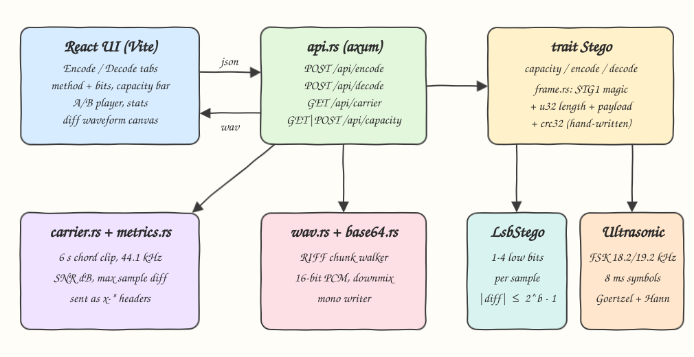
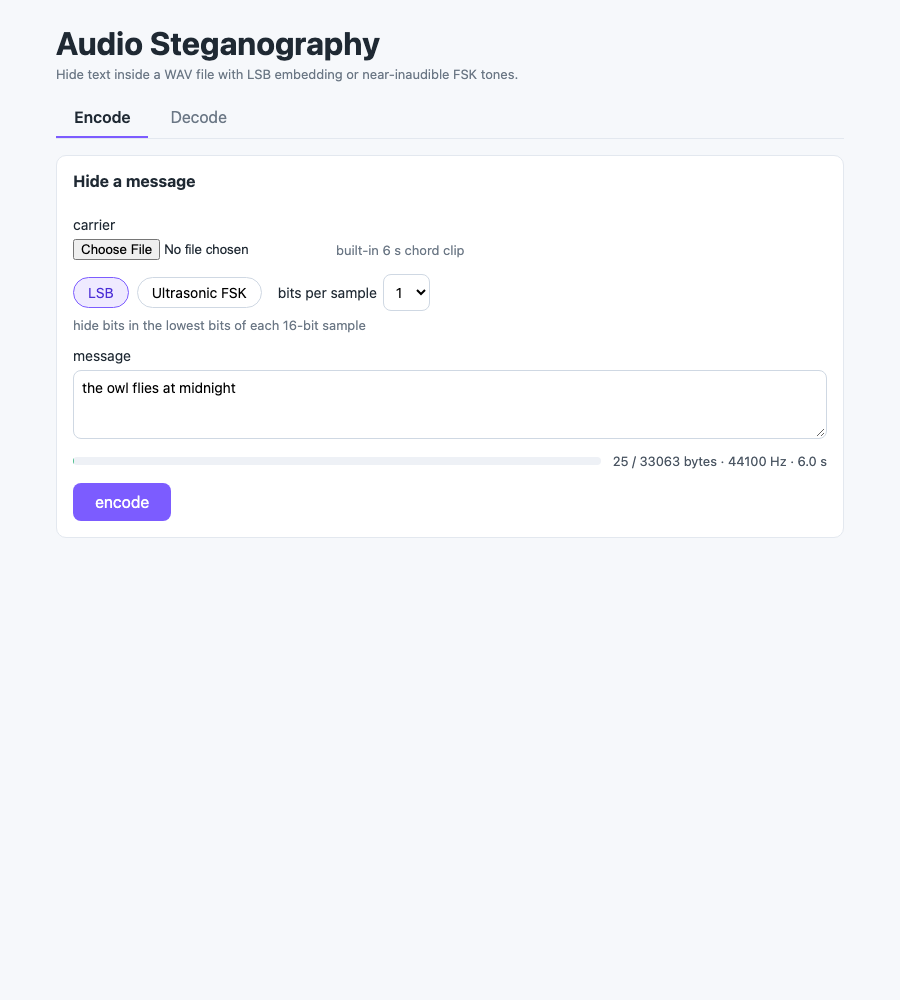
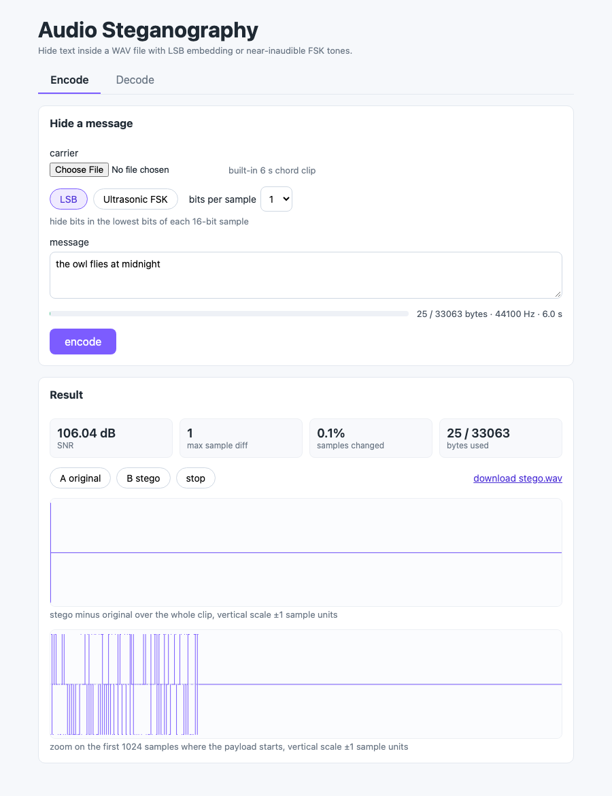
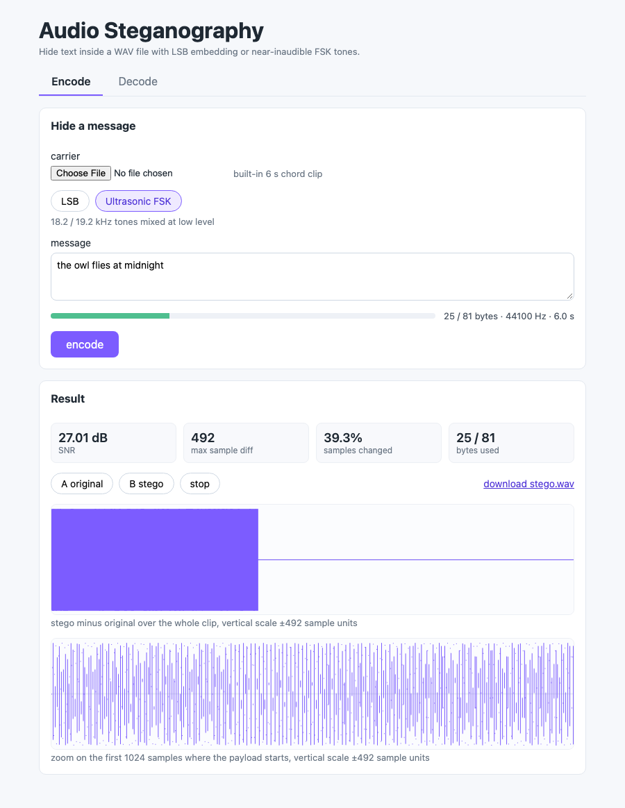
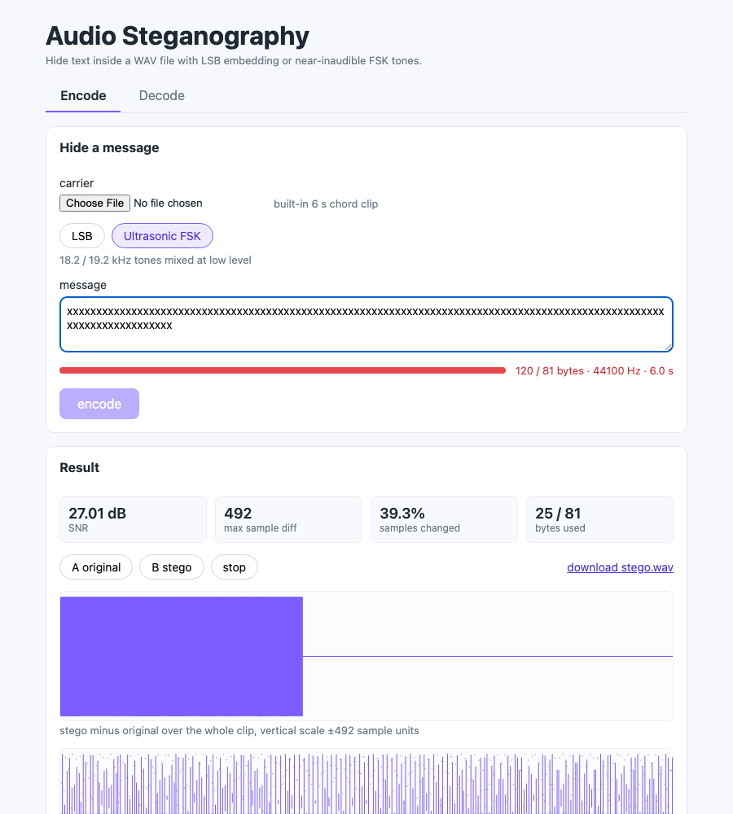
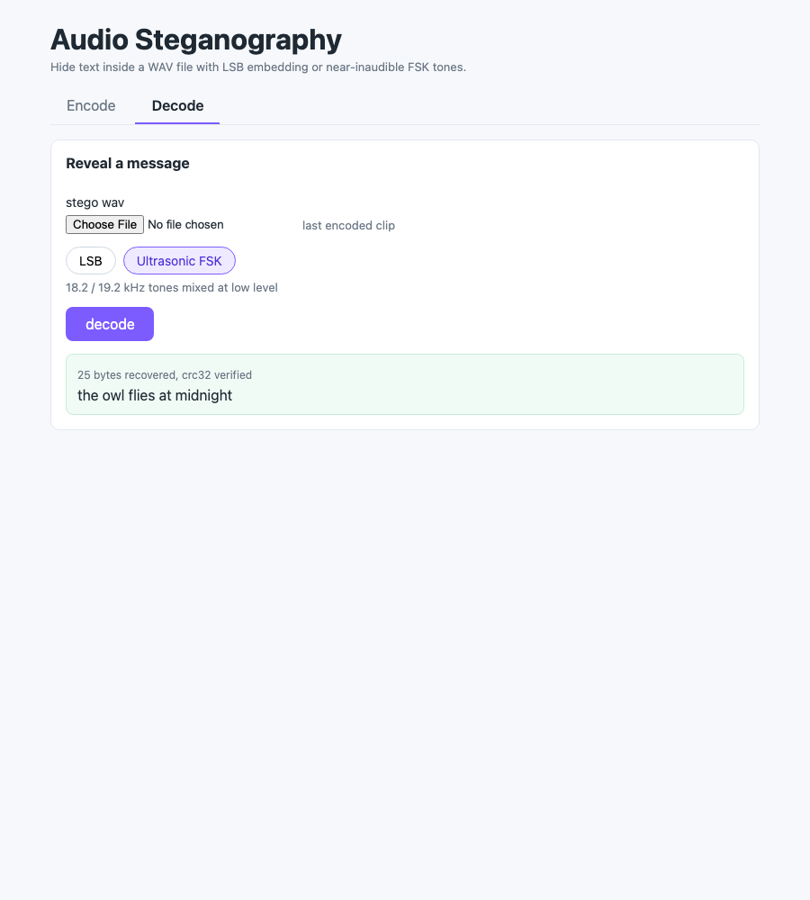
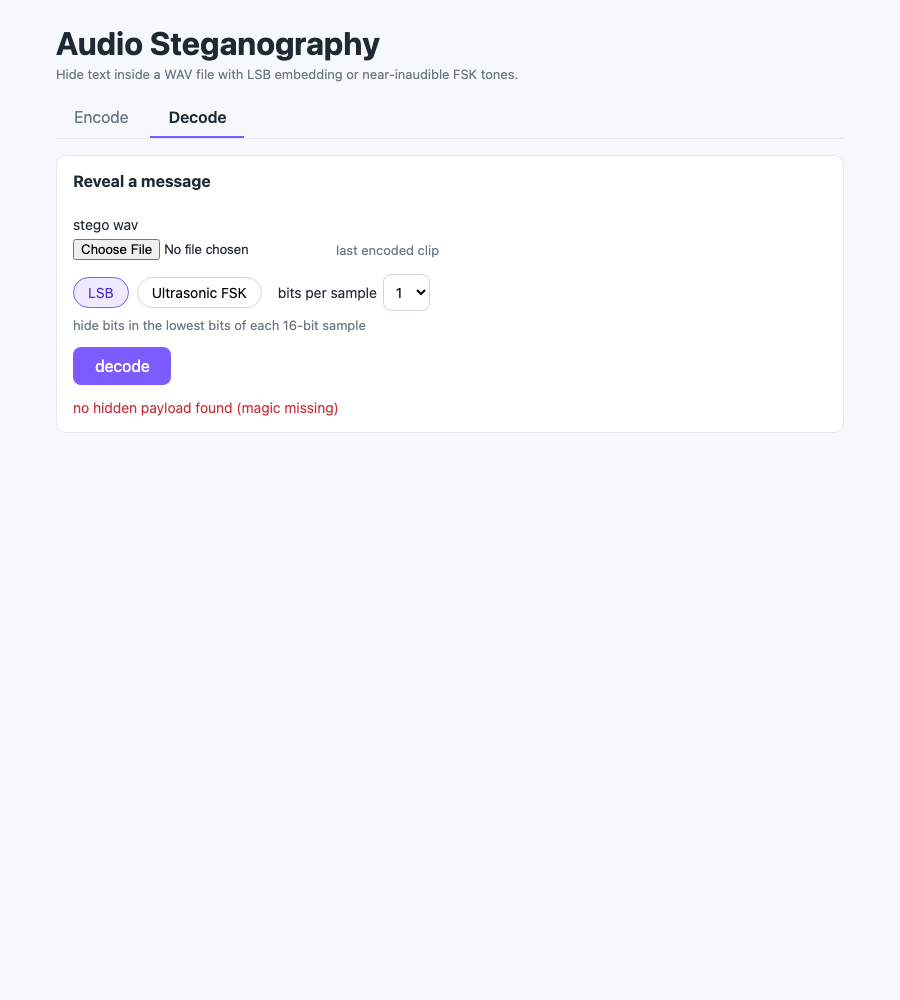

# 10 - Audio Steganography

Hide a text message inside a WAV file and get it back later. A Rust backend has two interchangeable
embedding methods behind one trait. `LsbStego` writes the bits into the lowest 1-4 bits of each
16-bit sample. `UltrasonicStego` mixes quiet FSK tones at 18-19.5 kHz into the audio, where most people
cannot hear them. A React UI lets you encode, A/B the original against the stego file, see SNR and the
largest sample change, look at the difference waveform, and decode it again.

## How it Works

1. The message is UTF-8 encoded and wrapped in a frame: `STG1` magic, 32-bit big-endian length, payload, CRC32 of the payload.
2. The frame is turned into a bit stream, most significant bit first.
3. **LSB**: each sample's lowest `b` bits (1-4) are replaced by the next `b` bits of the stream. No sample moves by more than `2^b - 1`.
4. **Ultrasonic**: each bit becomes an 8 ms symbol, 18.2 kHz for `0` and 19.2 kHz for `1`, with continuous phase. The tone is added at 1.5% of full scale and clipped to 16-bit.
5. Decoding reads the bits back. LSB masks the low bits. Ultrasonic applies a Hann window to each symbol and compares the Goertzel power at the two tones.
6. The decoder checks the magic, then the length against what the carrier can hold, then the CRC32, so a missing, truncated or damaged payload fails with an error instead of returning garbage.
7. The backend also returns SNR and max sample difference. The UI parses both WAVs to draw `stego - original`.

## Architecture



## Features

* **Two methods behind `trait Stego`**: LSB holds a lot of data at very high SNR. Ultrasonic FSK holds much less but has a different trade-off, and you can switch between them with one parameter.
* **LSB bits per sample 1-4**: trade capacity for noise. Each extra bit doubles the largest possible sample change.
* **Framed payload with magic + length + CRC32**: decoding a clean file, using the wrong method or a damaged file gives a clear error.
* **Capacity endpoint and live capacity bar**: you know before encoding whether the message fits. The encode button is disabled when it does not.
* **Built-in carrier**: a generated 6 s chord clip with a little noise, so there is always something to encode into. You can also upload your own 16-bit PCM WAV.
* **A/B playback**: switch between original and stego at the same playback position to listen for differences.
* **SNR, max sample diff, samples changed**: numbers that show how much each method costs.
* **Diff waveform canvas**: one view over the whole clip and one zoomed on the first 1024 samples, where the payload starts.

## Stack

* **Rust 1.99.1 (edition 2024)**: all DSP, WAV I/O, CRC32, base64 and the stego methods, written by hand.
* **axum + tokio**: small async HTTP server for the JSON and `audio/wav` API.
* **serde**: request and response JSON.
* **React 19.3.1 + TypeScript (strict)**: UI with typed API calls and components.
* **Vite + bun**: dev server with an `/api` proxy, build and `bun test`.

No audio, CRC or base64 crates are used. The only dependencies are `axum`, `tokio` and `serde`.

## API

| Method | Path | Body | Response |
|---|---|---|---|
| GET | `/api/carrier` | - | `audio/wav` built-in carrier (44.1 kHz mono, 6 s) |
| GET | `/api/capacity?method=lsb&bits=2` | - | capacity JSON for the built-in carrier |
| POST | `/api/capacity?method=ultrasonic` | raw WAV (empty = built-in carrier) | capacity JSON for that WAV |
| POST | `/api/encode` | JSON `{ "message": "...", "method": "lsb" \| "ultrasonic", "bits": 1-4, "wav": "<base64 or data URL, optional>" }` | `audio/wav` with headers `x-snr-db`, `x-max-diff`, `x-capacity`, `x-payload-bytes` |
| POST | `/api/decode?method=lsb&bits=1` | raw WAV | `{ "message": "...", "bytes": 25 }` |

Capacity JSON:

```json
{ "method": "lsb", "bits": 2, "bytes": 66138, "samples": 264600, "sampleRate": 44100, "seconds": 6.0 }
```

Errors return `{ "error": "..." }`:

| Status | When |
|---|---|
| 400 | bad WAV, unsupported format, bits outside 1-4, sample rate too low for the ultrasonic band, bad base64, unknown method |
| 413 | message larger than the carrier capacity |
| 422 | no payload (magic missing), declared length too large, CRC32 mismatch, payload not UTF-8 |

## Key Data Structures and Design Decisions

* `Audio { sample_rate: u32, samples: Vec<i16> }` is the only audio type. Stereo input is downmixed to mono so both methods see one stream. The ultrasonic method needs one continuous channel for its frequencies to stay correct.
* `trait Stego { capacity, encode, decode }`. Every method returns `Result<_, StegoError>`. `stego::build(method, bits)` is the single factory the API uses.
* Frame layout: `[S T G 1][len u32 BE][payload][crc32 u32 BE]`, a fixed 12-byte overhead. The same framing is used by both methods, so integrity checks behave the same way.
* LSB works on the `u16` bit pattern of the sample (`(s & !mask) | bits`). Only the low bits change, so the change is bounded by `mask` even for negative samples.
* Ultrasonic uses continuous phase between symbols to avoid clicks that would spread energy into the audible band. The decoder applies a Hann window so low-frequency music does not leak into the 18-19 kHz bins.
* Capacity: LSB = `samples * bits / 8 - 12` bytes. Ultrasonic = `samples / symbol / 8 - 12` bytes, which is 81 bytes for the 6 s carrier.
* The backend calculates SNR and max diff and sends them as response headers, so it is the one place these numbers come from. The TS side only computes the per-sample diff, which the canvas needs anyway.
* Limits: both methods assume the file stays lossless. MP3 or AAC re-encoding, resampling or volume changes destroy LSB data, and lossy codecs usually remove content above 16 kHz.

## How to Run

```bash
./scripts/setup.sh
./scripts/start-all.sh
./scripts/ui.sh
./scripts/test-all.sh
./scripts/stop-all.sh
```

The backend runs on port 8110 and the frontend on port 5110, both declared in `scripts/ports.env`.

Tests:

* `cargo test` (29 tests): round trip for LSB at 1-4 bits and for ultrasonic, capacity overflow errors for both, a corrupted payload caught by CRC for both, LSB moving each sample by at most `2^bits - 1`, more than 99% of the ultrasonic diff energy above 17 kHz, the CRC32 check value, WAV round trip and format rejection, base64, SNR maths.
* `bun test` (7 tests): WAV parsing and stereo downmix matching the backend, diff stats, the peak-preserving column reduction used by the canvas, UTF-8 byte counting for capacity.

## Printscreens

**Encode form**: built-in carrier, LSB with 1 bit per sample, and the capacity bar (25 of 33063 bytes).



**LSB result**: SNR is above 100 dB and the max sample diff is 1. The whole-clip diff is only a spike at the start, and the zoom shows the ±1 bit pattern of the payload.



**Ultrasonic result**: the same message costs about 27 dB SNR and a max diff of 492. The whole-clip view shows the FSK burst across the first part of the clip, and the zoom shows the high-frequency carrier.



**Capacity exceeded**: 120 bytes do not fit into the 81-byte ultrasonic capacity. The bar turns red and encoding is disabled.



**Decode**: the last encoded clip decoded with the ultrasonic method. The message is recovered and its CRC32 is verified.



**Decode with the wrong method**: decoding the ultrasonic file as LSB finds no `STG1` magic and reports it instead of showing garbage.



## Scripts

All scripts live in `scripts/` and run from any directory of the repository.

| Script | What it does |
|---|---|
| `./scripts/setup.sh` | Installs dependencies and prepares the app |
| `./scripts/start-all.sh` | Starts every service and prints the full link of each one |
| `./scripts/status.sh` | Shows every service port as UP or DOWN |
| `./scripts/test-all.sh` | Runs every test suite |
| `./scripts/ui.sh` | Opens the UI in the browser |
| `./scripts/stop-all.sh` | Stops every service |

Ports are declared in `scripts/ports.env`.

```bash
./scripts/setup.sh
./scripts/start-all.sh
./scripts/status.sh
./scripts/ui.sh
./scripts/stop-all.sh
```
