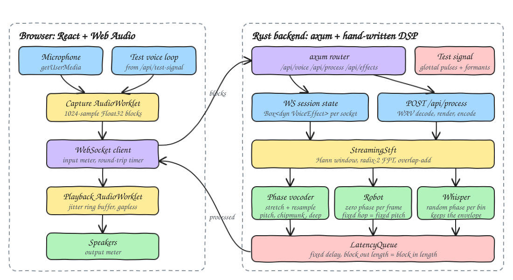
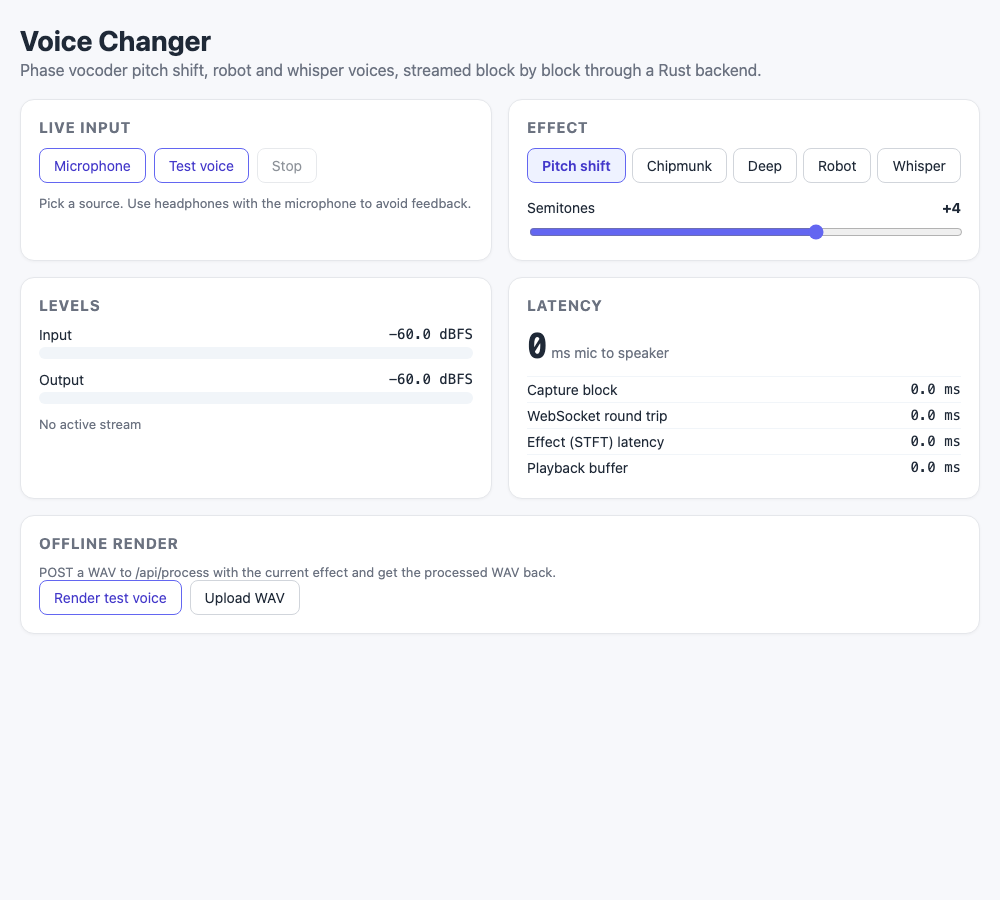
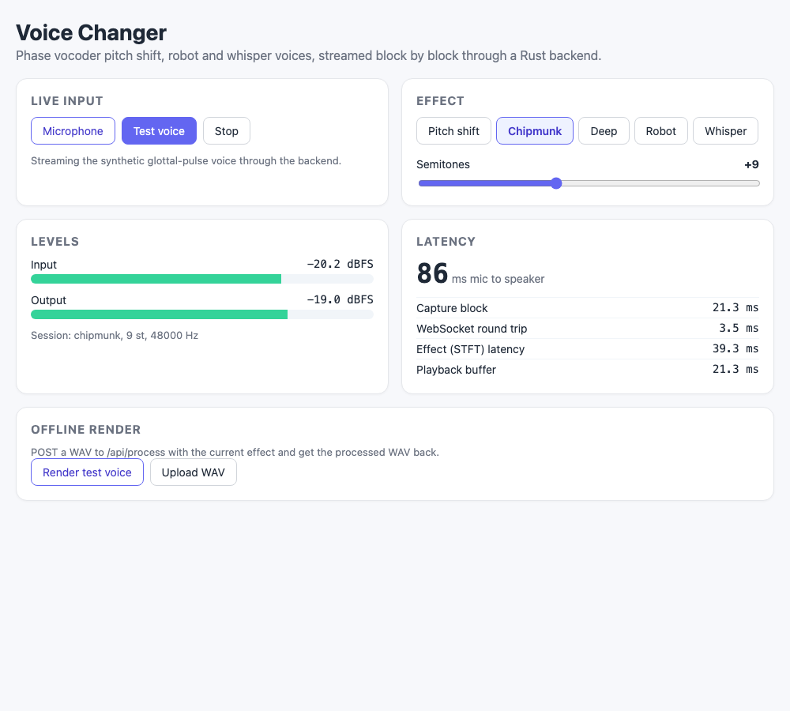
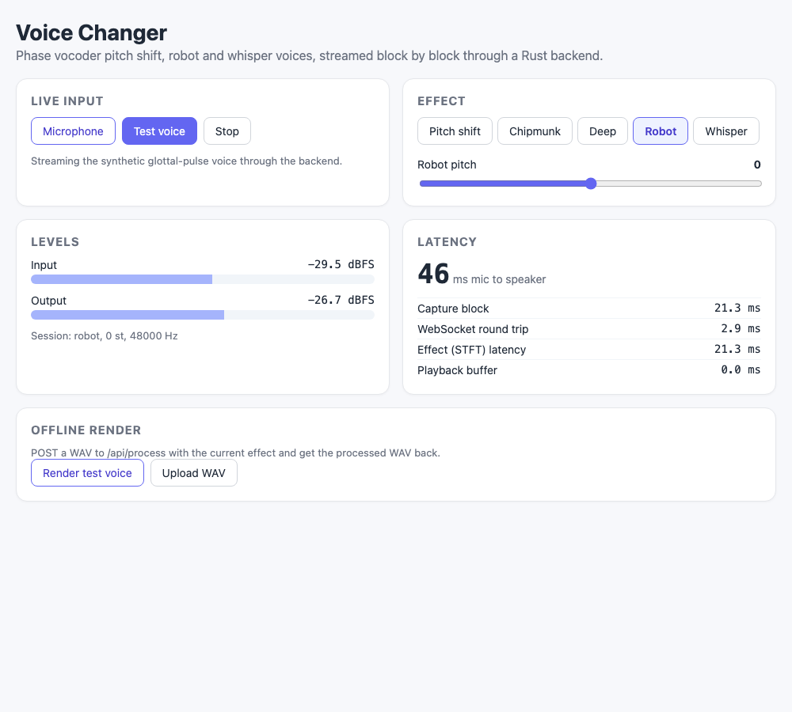
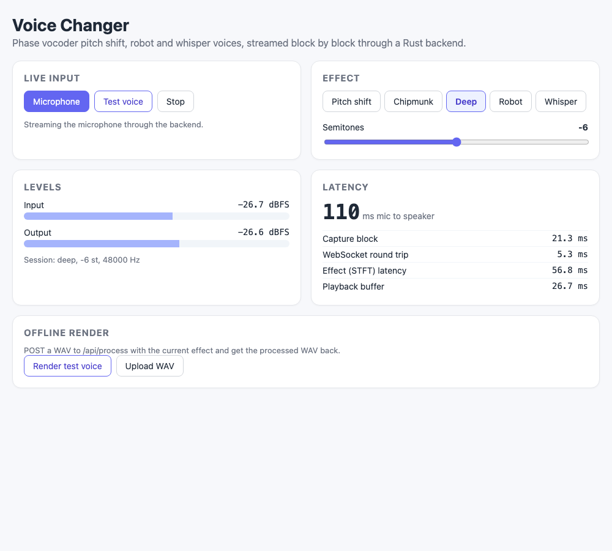
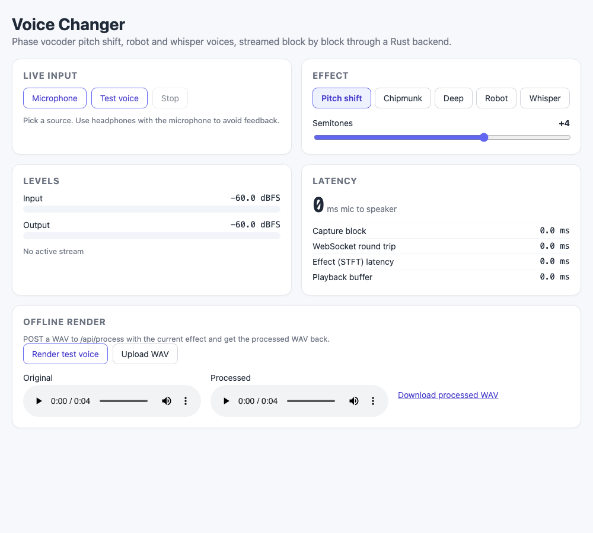

# 13 - Voice Changer

A real-time voice changer. The browser captures the microphone (or a built-in synthetic voice) with an AudioWorklet, streams Float32 blocks over a WebSocket to a Rust backend, and plays the processed blocks back gaplessly through a second AudioWorklet. The backend runs a hand-written phase vocoder (STFT, Hann window, overlap-add, true-frequency estimation) for pitch shifting, plus Chipmunk, Deep, Robot and Whisper voices. Each WebSocket session keeps its own effect state, so blocks stream continuously with no seams.

## How it Works

1. The capture AudioWorklet collects 1024-sample blocks and posts them to the main thread, which sends each one as a binary WebSocket message to `/api/voice?effect=&semitones=&rate=`.
2. On connect the backend builds a `Box<dyn VoiceEffect>` for that socket and replies with session info, including the effect's latency in samples. After that it answers every binary block with a processed block of the same length.
3. `StreamingStft` buffers input, cuts Hann-windowed frames every analysis hop, runs a radix-2 FFT, lets a `SpectralProcessor` change the half spectrum, mirrors it back to Hermitian form, runs the inverse FFT, windows the result again and overlap-adds it at the synthesis hop.
4. **Pitch shift**: analysis hop 256, synthesis hop `round(256 * 2^(st/12))`. Per bin, `true advance = expected + wrap(Δphase - expected)`, and the synthesis phase advances by `true advance * ratio`. Identity phase locking keeps the bins around each spectral peak coherent. The resulting time-stretched signal is resampled by the same ratio, which gives the original duration at the new pitch.
5. **Chipmunk** and **Deep** are pitch-shift presets clamped to +7..+12 and -7..-5 semitones.
6. **Robot** sets every bin's phase to zero (centered at mid-frame) and uses a fixed hop of `rate / f`. Each frame becomes one pulse, so the output is a pulse train at a fixed pitch `f = 110 Hz * 2^(st/12)` that keeps the voice's spectral envelope.
7. **Whisper** gives every bin a random phase from a seeded xorshift generator. This removes the pitch but keeps the formants.
8. A `LatencyQueue` pre-fills a fixed delay, so every `process_block` call returns exactly `input.len()` samples. The playback worklet's jitter buffer primes with 2 blocks, plays gaplessly, re-primes after an underrun and drops audio when more than 250 ms piles up.

## Architecture



## Features

* **Live WebSocket streaming**: mic in, processed voice out, block by block, with state kept per session.
* **Five effects behind one trait**: pitch shift (-12..+12), Chipmunk, Deep, Robot (pitch adjustable) and Whisper.
* **Hand-written DSP**: FFT, Hann STFT, phase vocoder, resampler and formant resonators. No audio crates.
* **Level meters**: input and output RMS in dBFS, so you can see the effect is alive and not clipping.
* **Latency breakdown**: capture block, measured WebSocket round trip, the effect's STFT latency and the playback buffer.
* **Built-in test voice**: a glottal pulse train with pitch glide and vibrato through vowel formant filters, so everything works without a mic.
* **Offline render**: POST any WAV to `/api/process` and get the processed WAV back. You can play or download it from the UI.

## Stack

* **Rust 1.99.1 (edition 2024)**: all the DSP runs here, fast and unit-tested.
* **axum (with `ws`)**: HTTP and WebSocket routing.
* **tokio**: async runtime for axum.
* **serde / serde_json**: JSON for the effect list, session info and errors.
* **tower-http**: permissive CORS.
* **React 19.3.1 + TypeScript (strict) + Vite**: UI. The dev proxy forwards `/api`, including the WebSocket upgrade, and bundles the AudioWorklets with `?worker&url`.
* **bun**: package manager and test runner.
* **Web Audio API (AudioWorklet)**: capture and gapless playback, no audio libraries.

No other crates are used. WAV parsing and writing, FFT, windows, resampling and filters are hand-written.

## API

### `GET /api/voice?effect=pitch&semitones=4&rate=48000` (WebSocket)

* `effect`: `pitch`, `chipmunk`, `deep`, `robot` or `whisper`. `semitones` is clamped to the effect's range. `rate` is the client sample rate (8000 to 192000).
* The first server message is text:

```json
{ "effect": "pitch", "semitones": 4.0, "rate": 48000, "latencySamples": 2092 }
```

* After that, each client binary message is little-endian Float32 mono samples. The server replies with a binary message of the same length holding the processed samples, in order. A malformed block gets a text `{ "error": "..." }` reply.
* An unknown effect or a bad rate fails the upgrade with `400`.

### `POST /api/process?effect=robot&semitones=3`

The body is a WAV file (PCM 8/16/24/32-bit or float32, any channel count, mixed down to mono). The response is an `audio/wav` file, 16-bit mono, with the same sample rate and length. The output is aligned to the input because the effect latency is compensated. Errors return `400 { "error": "..." }`.

### `GET /api/test-signal?rate=48000&seconds=4`

Returns the synthetic voice as an `audio/wav` file (16-bit mono, at most 30 s).

### `GET /api/effects`

```json
[{ "name": "pitch", "label": "Pitch shift", "minSemitones": -12.0, "maxSemitones": 12.0, "defaultSemitones": 4.0 }]
```

### `GET /api/health`

Returns `ok`.

## Key Data Structures and Design Decisions

* `trait VoiceEffect: Send { fn process_block(&mut self, input: &[f32]) -> Vec<f32>; fn latency(&self) -> usize }`. Implementations: `PhaseVocoderPitchShift`, `Chipmunk`, `Deep`, `Robot`, `Whisper`.
* `trait SpectralProcessor { fn process(&mut self, bins: &mut [Complex]) }` gets bins `0..=N/2` only. `StreamingStft<P>` owns the framing, the FFT, Hermitian mirroring and overlap-add, so each effect only writes its per-frame spectral rule.
* Pitch shift is time-stretch then resample, with the synthesis hop rounded to an integer and the resample step set to exactly `Hs/Ha`. That keeps the output length equal to the input length, and the rounding costs at most 5 cents across the integer semitones from -12 to +12. The frame is 2048 and the hop 256, so the synthesis hop is at most N/4 and squared-Hann overlap-add has flat gain.
* The expected phase advance `2πk·Ha/N` must not be reduced mod 2π before it is scaled by the stretch ratio. Doing that dropped `2πn·ratio` terms and cancelled whole sinusoids. The loudness test caught this bug.
* Gains: coherent effects use `Hs / Σw²`. Robot uses `sqrt(H / Σw²)` because its pulses do not overlap. Whisper uses `sqrt(H·N) / Σw²` because frames with random phase add in power, not amplitude.
* `render()` runs the stream, flushes `latency()` zeros, then drops the leading delay. The offline render is therefore aligned with the input and has the same length, and streaming in any block size gives the same output as one large block.
* The synthetic voice uses a Rosenberg glottal pulse, a lip-radiation difference, and three cascaded two-pole formant resonators that blend between vowels. Each resonator's center frequency is capped at 0.45·rate, below Nyquist.
* The AudioWorklets live in TypeScript (`src/audio/*.worklet.ts`) and share the `JitterBuffer` and `RingBuffer` code that `bun test` covers. Only capture, playback and metering run in TS. All voice DSP runs in Rust.
* `VoiceError` is one enum implementing `std::error::Error`. It maps to HTTP 400 (500 for IO errors). There is no `unwrap` outside tests.

## Tests

Rust (`cargo test`, 35 tests). These include:

* Pitch-shifting a 440 Hz sine by +12 semitones gives an 880 Hz dominant frequency, measured by FFT. -12 gives 220 Hz and +7 gives 659 Hz.
* 0 semitones keeps 440 Hz and the waveform (max error < 0.01).
* Output length equals input length, and RMS stays within 0.8 to 1.25 of the input from -12 to +12.
* Streaming in 128-sample blocks matches processing the whole signal at once (max difference < 1e-4), and every block out has the length of its block in.
* Robot turns the gliding test voice (pitch spread over 15%) into a constant 110 Hz in every segment. +12 gives 220 Hz.
* Whisper drops the normalized autocorrelation from above 0.8 to below 0.5 and keeps the loudness.
* Chipmunk and Deep clamp to their preset ranges. The FFT, STFT identity reconstruction, squared-Hann COLA, resampler, WAV round trip and stereo downmix, and the API session and WAV processing are also covered.

Frontend (`bun test`, 12 tests): ring buffer order across the wrap point, overwrite on overflow, silence on underrun, jitter buffer priming, re-priming and latency cap, dBFS math, round-trip pairing and smoothing, and the WebSocket URL.

## How to Run

```bash
./scripts/setup.sh
./scripts/start-all.sh
./scripts/ui.sh
./scripts/test-all.sh
./scripts/stop-all.sh
```

Frontend: http://localhost:5113, backend: http://localhost:8113/api. Use headphones with the microphone to avoid feedback.

## Printscreens

### Idle



Nothing is streaming. Choose a live source and an effect. Meters sit at -60 dBFS.

### Test voice through Chipmunk



The synthetic voice streams through the backend at +9 semitones. The input and output meters move together, and the latency card breaks down roughly 87 ms total: a 21 ms capture block, a 5 ms WebSocket round trip, 39 ms of STFT latency and the playback buffer.

### Robot



The same stream after switching to Robot, which reconnects with a new session. The STFT latency drops to 21 ms because Robot uses a 1024-sample frame.

### Microphone through Deep



The microphone path (fed by a recorded voice file in the headless browser) is pitched down 6 semitones.

### Offline render



"Render test voice" fetches a 4 s test voice, POSTs it to `/api/process` with the current effect, and shows the original and processed WAVs side by side with a download link.

## Scripts

All scripts live in `scripts/` and run from any directory of the repository.

| Script | What it does |
|---|---|
| `./scripts/setup.sh` | Installs dependencies and prepares the app |
| `./scripts/start-all.sh` | Starts every service and prints the full link of each one |
| `./scripts/status.sh` | Shows every service port as UP or DOWN |
| `./scripts/test-all.sh` | Runs every test suite |
| `./scripts/ui.sh` | Opens the UI in the browser |
| `./scripts/stop-all.sh` | Stops every service |

Ports are declared in `scripts/ports.env`.

```bash
./scripts/setup.sh
./scripts/start-all.sh
./scripts/status.sh
./scripts/ui.sh
./scripts/stop-all.sh
```
