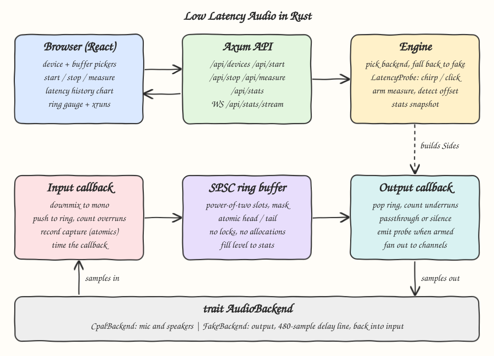
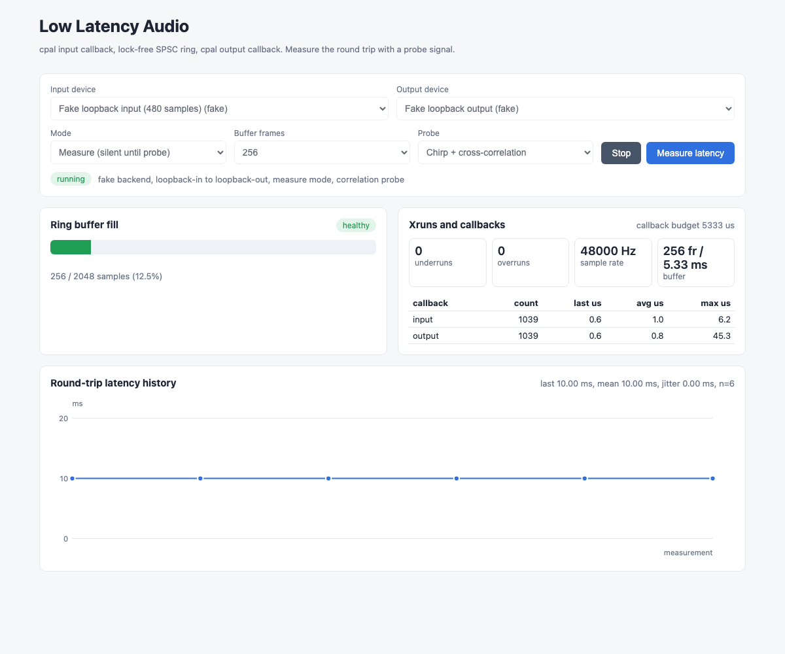

# 15 - Low Latency Rust

Low-latency audio I/O in Rust. The mic input callback and the speaker output callback (both from `cpal`) are joined by a hand-written lock-free single-producer single-consumer ring buffer. The engine can monitor the mic on the speakers (passthrough) and measure the real round-trip latency by playing a probe signal and finding it again in the captured input. An axum server controls the engine, and a React UI shows device pickers, buffer size, live ring fill, xrun counters, callback timing and a latency history chart.

## How it Works

1. `GET /api/devices` lists `cpal` devices plus a fake loopback device pair. Listing devices never opens them.
2. `POST /api/start` picks a backend from the device ids, negotiates sample rate and buffer size, builds a ring buffer (power of two, 8 buffers deep) and primes it with one buffer of silence.
3. The input callback downmixes to mono and pushes every sample into the ring. The output callback pops samples and writes them to every channel.
4. A failed push is an **overrun** and a failed pop is an **underrun**. Both callbacks record their own run time.
5. `POST /api/measure` arms a measurement. The output callback swaps in the probe stimulus (a 1024-sample chirp or a 32-sample click) and from then on the input callback copies samples into a preallocated atomic capture buffer.
6. When the capture fills up (0.5 s), the `LatencyProbe` finds where the stimulus starts (cross-correlation peak, or a threshold onset with the click's own onset subtracted). `round_trip_ms = samples / sample_rate * 1000`.
7. If the real devices fail (missing, no permission, unsupported format), the engine falls back to the fake backend and reports `fallback_reason`. Device errors come back as error JSON. The server does not crash on them.

## Architecture



## Features

* **Lock-free SPSC ring** - atomic head/tail with Acquire/Release ordering and power-of-two masking. No locks and no allocations in the audio callbacks.
* **Passthrough mode** - monitors the mic on the speakers through the ring, so you can hear the buffer size you picked.
* **Measure mode** - output stays silent except for the probe, so speaker bleed from passthrough does not get into the measurement.
* **Two probes** - chirp + cross-correlation holds up against hum and noise. Click + threshold is simpler and cheaper.
* **Xrun and timing stats** - underruns, overruns, ring fill, and last/avg/max callback time against the buffer budget.
* **Live stats stream** - a WebSocket pushes the engine status every 100 ms to the gauge and the counters.
* **Fake backend** - an output to delay line to input loop with a known delay (480 samples = 10 ms at 48 kHz), used by tests, CI and machines without audio devices.
* **Safe fallback** - a broken or missing real device falls back to the fake backend, and the UI shows why.

## Stack

* **Rust 1.99.1 (edition 2024)** - real-time callbacks without a GC and with control over memory ordering.
* **cpal** - cross-platform mic and speaker streams (the one audio crate this POC allows).
* **axum + tokio** - HTTP and WebSocket control plane. Engine calls run in `spawn_blocking`.
* **serde / serde_json** - JSON contracts.
* **React 19 + TypeScript + Vite + bun** - typed UI with a hand-drawn SVG chart and no chart library.

## API

| Method | Path | Body | Response |
|---|---|---|---|
| GET | `/api/devices` | - | `{inputs:[{id,name,backend}], outputs:[...], default_input, default_output}` |
| POST | `/api/start` | `{mode:"passthrough"\|"measure", buffer_frames:16..4096, input?:id, output?:id, probe?:"correlation"\|"threshold"}` | engine status |
| POST | `/api/stop` | - | engine status |
| POST | `/api/measure` | - | `{round_trip_ms, samples, sample_rate, buffer_frames}` |
| GET | `/api/stats` | - | engine status |
| WS | `/api/stats/stream` | - | engine status as JSON every 100 ms |

Engine status:

```json
{
  "running": true, "mode": "measure", "probe": "correlation",
  "stream": {"backend": "fake", "sample_rate": 48000, "buffer_frames": 256,
             "input_device": "loopback-in", "output_device": "loopback-out",
             "input_channels": 1, "output_channels": 1},
  "buffer_ms": 5.33, "ring_capacity": 2048, "ring_fill_ratio": 0.125,
  "counters": {"underruns": 0, "overruns": 0, "ring_fill": 256,
               "input_callbacks": {"count": 1039, "last_us": 0.6, "avg_us": 1.0, "max_us": 6.2},
               "output_callbacks": {"count": 1039, "last_us": 0.6, "avg_us": 0.8, "max_us": 45.3}},
  "fallback_reason": null,
  "last_measure": {"round_trip_ms": 10.0, "samples": 480, "sample_rate": 48000, "buffer_frames": 256}
}
```

Errors are `{"error": "..."}` with status 400 (bad config), 409 (not running), 422 (probe not detected or timed out) or 503 (device error).

## Key Data Structures and Design Decisions

* `ring::ring::<T>(capacity) -> (Producer<T>, Consumer<T>)` - the ring is split into two owned halves, so only one thread can push and one can pop. Slots are `UnsafeCell<T>`. Monotonic `head`/`tail` counters wrap with `wrapping_sub`, so full (`tail - head == capacity`) and empty (`head == tail`) can always be told apart.
* `trait AudioBackend { devices, negotiate, start }` - `CpalBackend` and `FakeBackend`. `start` takes ownership of the two `Sides` and returns a `RunningStream` guard. Dropping the guard stops the audio.
* `trait LatencyProbe { stimulus, detect }` - `CorrelationProbe` and `ThresholdProbe`.
* `MeasureState` - phase `IDLE -> ARMED -> CAPTURING -> DONE` in an `AtomicU8`, with a capture buffer of `AtomicU32` (f32 bits) that is allocated before the stream starts. The output callback moves ARMED to CAPTURING when it emits the probe, which lines up capture start with emission.
* Stats are plain atomics (`fetch_add`, `fetch_max`) written by the callbacks and read by the HTTP side.
* Precision: the fake backend runs output then input in one thread, so it measures the injected delay exactly. With `cpal` the input and output callbacks run on their own schedules, so the result can be off by up to one buffer.
* Set `AUDIO_BACKEND=fake` to hide real devices entirely, for CI.

## How to Run

```bash
./scripts/setup.sh
./scripts/start-all.sh
./scripts/ui.sh
./scripts/test-all.sh
./scripts/stop-all.sh
```

`test-all.sh` runs `cargo test` (ring buffer two-thread stress test, wraparound, full/empty, probe detection, fake-loop latency 480 samples = 10 ms, real-device fallback), `cargo clippy -D warnings`, `bun test` and `bun run build`. None of them need audio hardware.

## Printscreens



The engine is running on the fake loopback pair in measure mode with 256-frame buffers (5.33 ms at 48 kHz). The ring holds one buffer of priming (12.5% of 2048 slots) and the badge says healthy. There are no underruns or overruns, and the callbacks take about 1 us against a 5333 us budget. Six measurements in the history chart all found the injected 480-sample loop at 10.00 ms with zero jitter.

## Scripts

All scripts live in `scripts/` and run from any directory of the repository.

| Script | What it does |
|---|---|
| `./scripts/setup.sh` | Installs dependencies and prepares the app |
| `./scripts/start-all.sh` | Starts every service and prints the full link of each one |
| `./scripts/status.sh` | Shows every service port as UP or DOWN |
| `./scripts/test-all.sh` | Runs every test suite |
| `./scripts/ui.sh` | Opens the UI in the browser |
| `./scripts/stop-all.sh` | Stops every service |

Ports are declared in `scripts/ports.env`.

```bash
./scripts/setup.sh
./scripts/start-all.sh
./scripts/status.sh
./scripts/ui.sh
./scripts/stop-all.sh
```
