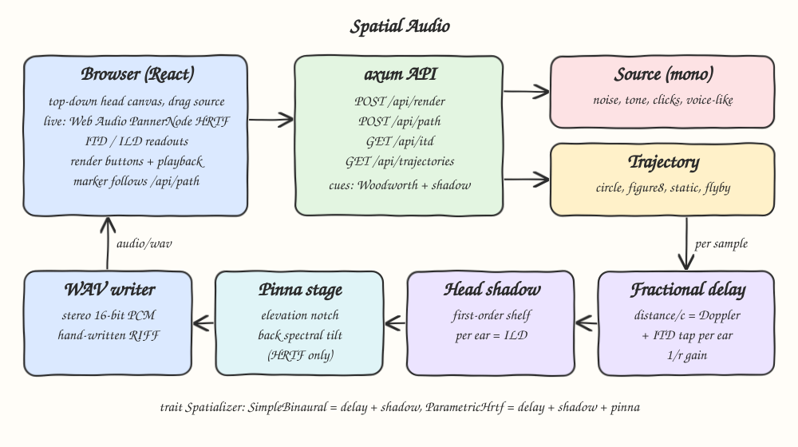
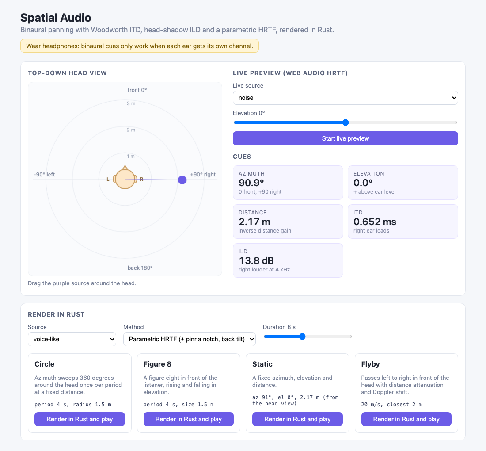
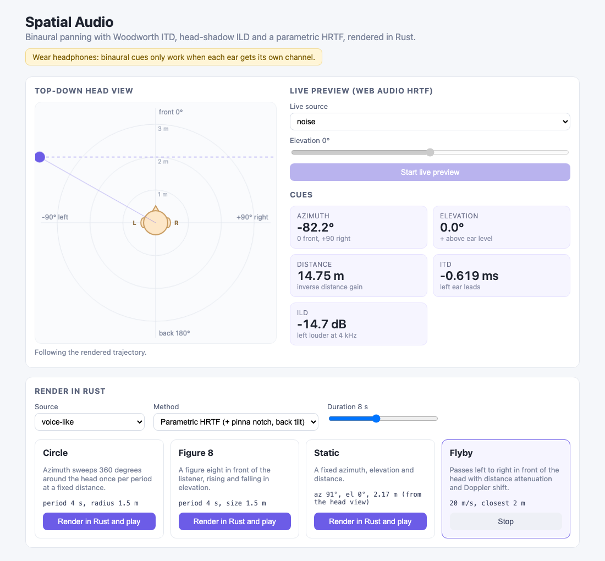
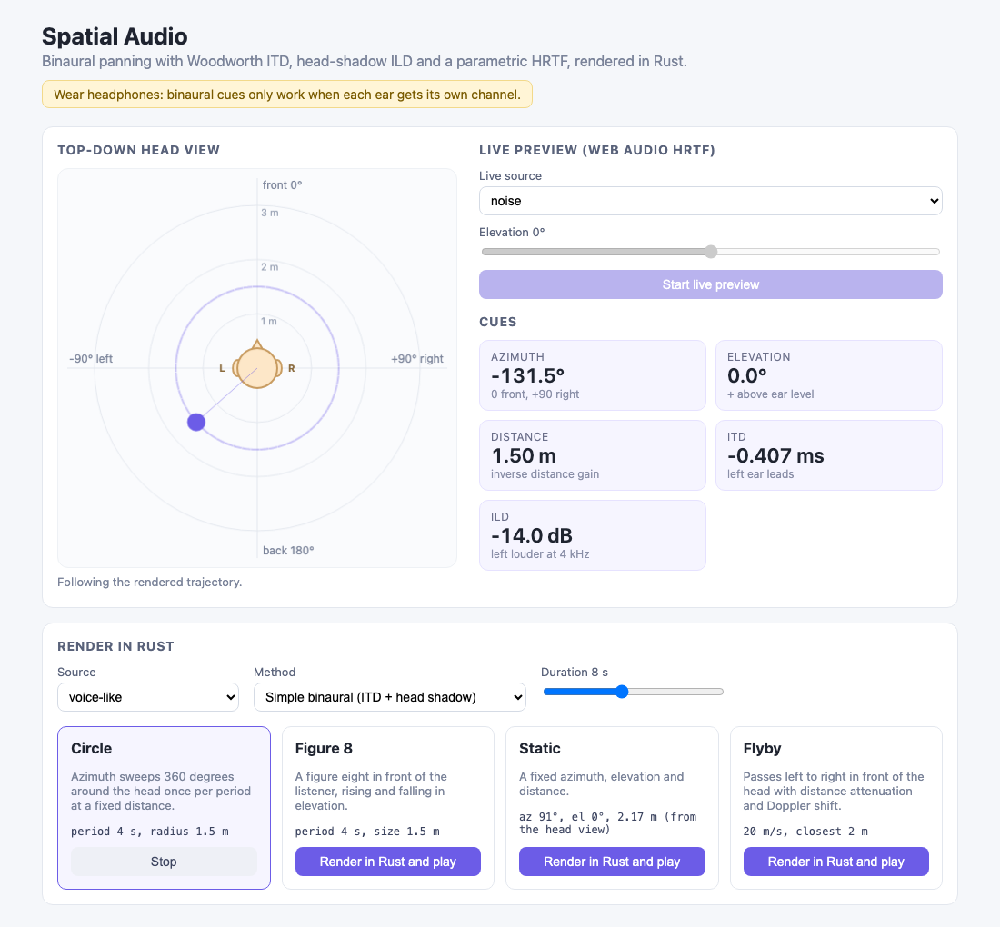

# 16 Spatial Audio

Binaural panning for headphones. Drag a sound source around a top-down view of a head and hear it move live
through the browser's Web Audio HRTF panner, then render circle, figure eight, static and flyby trajectories with
a hand-written Rust spatializer (Woodworth ITD, head-shadow ILD, parametric pinna notch, Doppler) and play the
stereo WAV back while the UI follows the source and shows its azimuth, elevation, distance, ITD and ILD.
Wear headphones: binaural cues only work when each ear gets its own channel.

## How it Works

1. The backend generates a mono source (noise, tone, clicks or a formant-filtered voice-like pulse train).
2. A `Trajectory` gives the source position (azimuth, elevation, distance) for every output sample.
3. The mono signal goes into one fractional delay line with linear interpolation, scaled by `1/r`.
4. Each ear reads its own tap: `distance / c` plus the Woodworth ITD `r/c (theta + sin theta)` on the far ear.
   Because the distance delay changes over time, the read pointer speeds up on approach and slows down on recede, which is Doppler.
5. Each ear then runs a first-order head-shadow shelf (Brown-Duda style): the near ear gets a high-frequency boost,
   the far ear a cut, which is the frequency-dependent ILD.
6. The parametric HRTF adds a pinna notch whose center climbs with elevation (4 to 13 kHz, capped below Nyquist)
   and a gentle high-frequency tilt for sources behind the head, so front and back stop sounding identical.
7. A hand-written RIFF writer emits 16-bit stereo PCM as `audio/wav`.
8. `/api/path` samples the same trajectory at 30 Hz with ITD/ILD so the canvas marker and readouts follow playback.

## Architecture



## Features

* `trait Spatializer` with two impls: `SimpleBinaural` (ITD + head shadow) and `ParametricHrtf` (adds pinna and back tilt).
* Woodworth ITD from an 8.75 cm head radius: about 0.656 ms at the side, zero in front.
* Head-shadow ILD as a hand-written bilinear first-order shelf, so level difference grows with frequency like a real head.
* Pinna notch moving with elevation gives a vertical cue the ITD/ILD pair cannot.
* Front/back spectral tilt breaks the cone of confusion (front and back have the same ITD and ILD).
* Flyby with inverse distance attenuation and Doppler from a time-varying fractional delay.
* Circle, Figure 8, Static and Flyby trajectories behind one serde-tagged enum, validated (no supersonic flybys).
* Live drag preview with Web Audio `PannerNode` `panningModel: "HRTF"` for instant feedback, no round trip.
* ITD/ILD readouts from `GET /api/itd` while dragging, and from `/api/path` while a render plays.

## Stack

* Rust 1.99.1 (edition 2024): all DSP, trajectories, cue math and the WAV writer, hand-written.
* axum + tokio: small HTTP JSON/WAV API.
* serde: request and response types, tagged trajectory enum.
* React 19.3.1 + TypeScript strict + Vite: UI, canvas head view, playback.
* Web Audio API: live HRTF panning and WAV playback (browser built-in, no library).
* bun: install, test and build the frontend.

No audio crates and no extra libraries beyond the allowed list.

## API

| Method | Path | Body / Query | Response |
|---|---|---|---|
| POST | `/api/render` | `{source, trajectory, duration, method}` | `audio/wav` stereo 16-bit, 44.1 kHz |
| GET | `/api/trajectories` | | `[{label, description, defaults}]` |
| GET | `/api/itd` | `?azimuth=90&elevation=0&distance=1` | `{azimuth, elevation, distance, itd_ms, ild_db, ild_probe_hz}` |
| POST | `/api/path` | `{trajectory, duration}` | `[{t, azimuth, elevation, distance, itd_ms, ild_db, ild_probe_hz}]` at 30 Hz |

* `source`: `noise` | `tone` | `clicks` | `voice-like`
* `method`: `binaural` | `hrtf`
* `duration`: 0.5 to 20 seconds
* `trajectory` (missing fields take defaults):
  * `{"type":"circle","period":4,"distance":1.5}`
  * `{"type":"figure8","period":4,"size":1.5}`
  * `{"type":"static","azimuth":90,"elevation":0,"distance":1}`
  * `{"type":"flyby","speed":20,"closest":2}`
* Errors: `400 {"error":"invalid parameter: ..."}`.

`/api/path` is an addition to the original contract so the UI marker follows the exact positions Rust used,
instead of re-implementing the trajectories in TypeScript.

```bash
curl -s -X POST localhost:8116/api/render -H 'content-type: application/json' \
  -d '{"source":"voice-like","trajectory":{"type":"flyby"},"duration":6,"method":"hrtf"}' -o flyby.wav
curl -s 'localhost:8116/api/itd?azimuth=90'
```

## Key Data Structures and Design Decisions

* `Mono` / `Stereo` (`audio.rs`): sample rate plus `Vec<f32>` per channel.
* `Position { azimuth, elevation, distance }`: azimuth 0 front, +90 right, +-180 back; elevation positive up.
  The frontend uses the same convention and maps it to Web Audio coordinates (listener faces -z).
* `Trajectory` enum (`trajectory.rs`): `position(t, duration)` per sample, `validate()`, `max_distance()` to size the delay line.
* `FractionalDelay` (`dsp/delay.rs`): ring buffer, linear interpolation. One line, two taps (left, right), so
  distance delay, ITD and Doppler come from the same mechanism.
* `FirstOrderShelf` (`dsp/shelf.rs`): `H(s) = (alpha s + beta) / (s + beta)` via bilinear transform, `beta = 2c/r`.
  Reused for the head shadow (alpha from ear angle) and the back tilt (alpha from how far behind the source is).
* `NotchFilter` (`dsp/notch.rs`): biquad peaking cut, -12 dB, Q 2, center clamped to 45% of the sample rate.
* `EarStage` trait (`spatial/engine.rs`): the shared binaural engine calls it after ITD/ILD; `Bypass` for
  `SimpleBinaural`, `PinnaStage` for `ParametricHrtf`.
* Errors: `AppError` enum implementing `std::error::Error`, no `unwrap` outside tests.

## Tests

Rust (`cargo test`, 30 tests) checks the behaviour that makes the cues work:

* Source at +90 degrees: right channel leads left by 0.6 to 0.7 ms, measured by cross-correlation with sub-sample peak, and right RMS is higher.
* Source at 0 degrees: zero lag and equal RMS. Source at -90 degrees: exactly mirrored lead and level.
* Flyby with an 880 Hz tone: pitch above 3% higher on approach and 3% lower on recede, within 10 Hz of the Doppler formula.
* Distance attenuation strictly monotonic over 1 to 16 m; flyby loudest at the closest point.
* HRTF darkens a source behind the head while `SimpleBinaural` cannot tell front from back.
* Pinna notch carves its center by more than 10 dB and leaves 1 kHz alone; notch frequency climbs with elevation.
* Shelf filter matches its analytic magnitude; fractional delay interpolates; WAV header fields are correct.

Frontend (`bun test`, 10 tests): canvas to azimuth mapping matches the Rust convention, Web Audio coordinate mapping,
path interpolation going the short way through 180 degrees.

## How to Run

```bash
./scripts/setup.sh
./scripts/start-all.sh
./scripts/ui.sh
./scripts/test-all.sh
./scripts/stop-all.sh
```

Backend on `http://localhost:8116/api`, UI on `http://localhost:5116`.

## Printscreens

### Dragging the source



The source was dragged to the right of the head (about +91 degrees, 2.2 m). The readouts show the right ear leading
by 0.652 ms and 13.8 dB louder at 4 kHz. Pressing "Start live preview" plays it through the Web Audio HRTF panner.

### Flyby rendered in Rust



A voice-like flyby with the parametric HRTF is playing. The source approaches from the far left (marker clamped to
the canvas edge, dashed line is the path), 14.9 m away, so the left ear leads and is louder. You hear the pitch drop
as it passes the front.

### Circle rendered in Rust



A circle with the simple binaural method. The dashed ring is the 1.5 m path and the marker is behind and to the left
(-131.5 degrees), with ITD and ILD following it frame by frame.

## Scripts

All scripts live in `scripts/` and run from any directory of the repository.

| Script | What it does |
|---|---|
| `./scripts/setup.sh` | Installs dependencies and prepares the app |
| `./scripts/start-all.sh` | Starts every service and prints the full link of each one |
| `./scripts/status.sh` | Shows every service port as UP or DOWN |
| `./scripts/test-all.sh` | Runs every test suite |
| `./scripts/ui.sh` | Opens the UI in the browser |
| `./scripts/stop-all.sh` | Stops every service |

Ports are declared in `scripts/ports.env`.

```bash
./scripts/setup.sh
./scripts/start-all.sh
./scripts/status.sh
./scripts/ui.sh
./scripts/stop-all.sh
```
