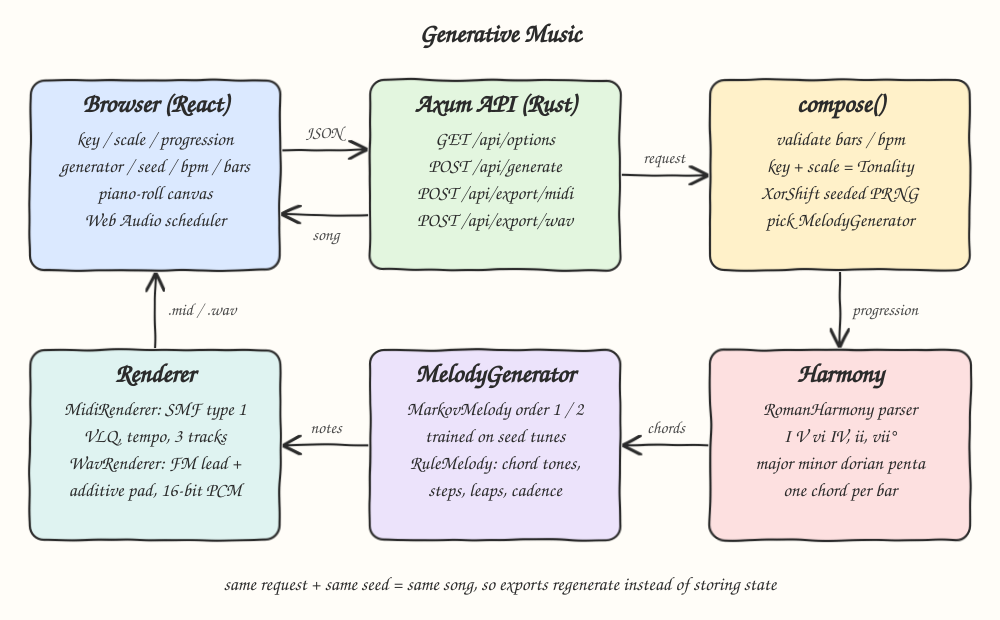
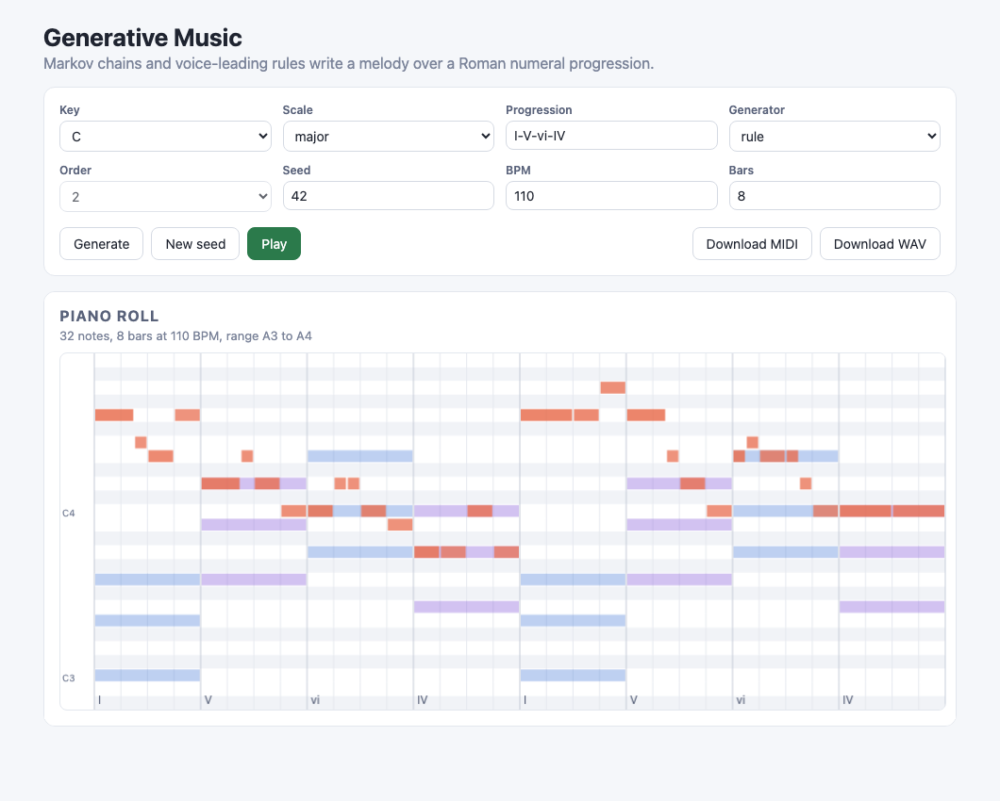
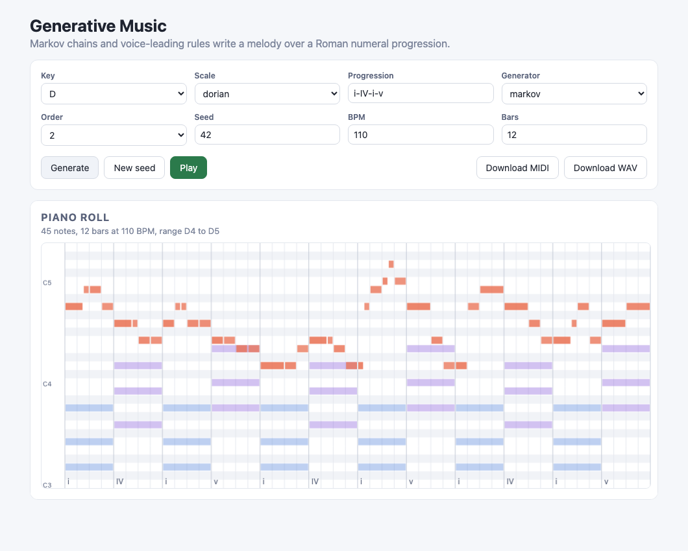
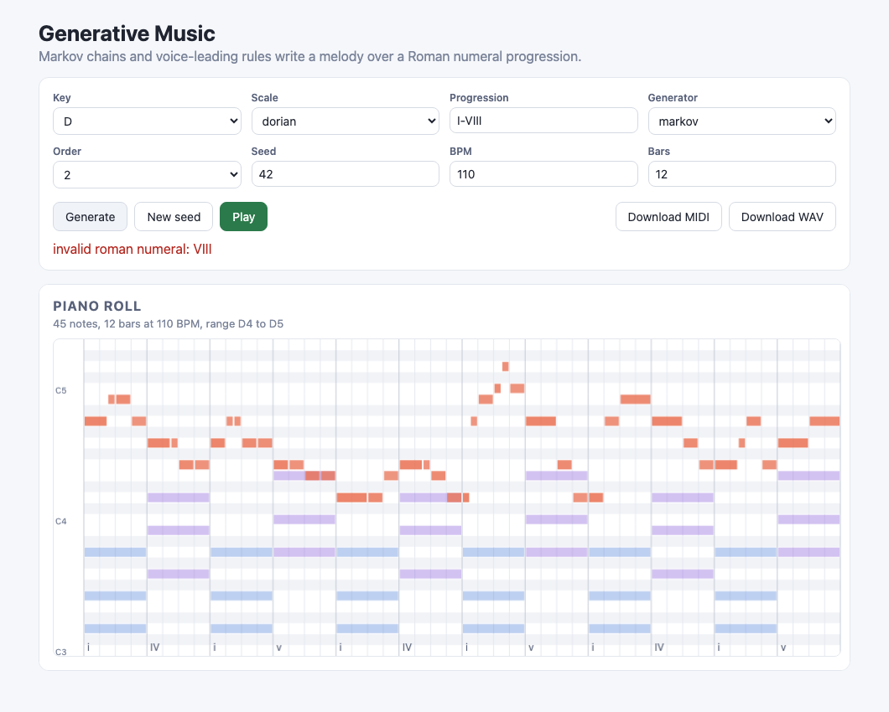

# 17 Generative Music

Generative music composer: pick a key, a scale and a Roman numeral chord progression, and a Rust backend writes a melody over it with either a Markov chain trained on a few seed tunes or a rule based voice-leading generator. The result is drawn as a piano roll, played in the browser with Web Audio, and exported as a hand-written Standard MIDI File or a synthesized WAV.

## How it Works

1. The UI sends `{key, scale, progression, bars, bpm, generator, seed, order}` to `POST /api/generate`.
2. `RomanHarmony` parses the progression (`I-V-vi-IV`, `ii-V-I`, `vii°`) into triads in the chosen key and scale and lays one chord per bar.
3. A hand-written `XorShift` PRNG is seeded with `seed`, so the same request always produces the same song.
4. A shared rhythm picker fills each 4/4 bar with a duration pattern; the final bar always has at least two notes.
5. `MarkovMelody` walks a first or second order chain over scale degrees learned from built-in seed melodies.
6. `RuleMelody` places chord tones on beat 1 of every bar, prefers stepwise motion, resolves leaps by a step in the opposite direction, approaches the tonic on the penultimate note and ends on the tonic.
7. The browser draws melody notes over chord blocks and schedules oscillators on an `AudioContext` timeline.
8. Export endpoints re-run the same deterministic composition and render it with `MidiRenderer` (type 1 SMF) or `WavRenderer` (FM lead plus additive pad).

## Architecture



## Features

* Two melody generators behind one `MelodyGenerator` trait, so the same harmony can be heard with statistical or rule based writing.
* Markov order 1 or 2, with fallback from order 2 to order 1 to random when a state was never seen in training.
* Reproducible output from a seeded hand-written PRNG, so a seed number is enough to share or re-export a song.
* Roman numeral parser with case for quality (upper major, lower minor, `°`/`o` diminished) that rejects anything it cannot read.
* Four scales: major, natural minor, dorian and major pentatonic (pentatonic melodies over parent major harmony).
* Piano-roll canvas with chord blocks, chord labels, octave markers and a live playhead.
* In-browser playback with Web Audio scheduling, no audio files involved.
* MIDI export with tempo meta event, time signature, a melody track and a chord track.
* WAV export with an FM lead, an additive pad, ADSR envelopes and peak normalization.

## Stack

* Rust 1.99.1, edition 2024: composition, harmony, PRNG, MIDI and WAV writers, all hand-written.
* axum + tokio: small JSON and binary HTTP API.
* serde: request and response (de)serialization.
* React 19.3.1 + TypeScript strict: controls, piano roll and transport.
* Vite: dev server with `/api` proxy to the backend.
* bun: package manager and test runner for the pure TS helpers.

No audio, MIDI, music theory or random crates are used.

## API

| Method | Path | Body | Response |
|---|---|---|---|
| GET | `/api/options` | none | keys, scales, generators, orders, preset progressions, limits |
| POST | `/api/generate` | GenerateRequest | `{notes, chords, bpm, bars}` |
| POST | `/api/export/midi` | GenerateRequest | `audio/midi` file |
| POST | `/api/export/wav` | GenerateRequest | `audio/wav` file |

GenerateRequest:

```json
{
  "key": "D",
  "scale": "dorian",
  "progression": "i-IV-i-v",
  "bars": 8,
  "bpm": 110,
  "generator": "markov",
  "seed": 7,
  "order": 2
}
```

Response from `/api/generate` (times are in beats, pitches are MIDI numbers):

```json
{
  "notes": [{ "pitch": 62, "start": 0.0, "duration": 1.0, "velocity": 100 }],
  "chords": [{ "symbol": "i", "root": 50, "pitches": [50, 53, 57], "start": 0.0, "duration": 4.0 }],
  "bpm": 110.0,
  "bars": 8
}
```

Errors return HTTP 400 with `{"error": "invalid roman numeral: VIII"}`. Limits: `bars` 1..64, `bpm` 40..240, `order` 1 or 2, `generator` `markov` or `rule`.

## Key Data Structures and Design Decisions

* `Tonality { root, scale }` maps a scale degree (any integer, wrapping into octaves) to a MIDI pitch. Melodies are generated as degrees, so every note is in the scale by construction.
* `trait Harmony` with `RomanHarmony`: `chord(numeral)` builds a triad on the scale degree root, `progression(text)` splits on `-`, `–`, `,`, `|` or spaces.
* `trait MelodyGenerator { generate(&Context, &mut XorShift) -> Vec<Note> }` with `MarkovMelody` and `RuleMelody`.
* `MarkovMelody` stores `HashMap<Vec<usize>, Vec<u32>>` of transition counts for every context length up to the order; sampling is a weighted pick over counts. Lookups never iterate the map, so output stays deterministic.
* Seed melodies are written in 7-degree space; for pentatonic they are projected (`F -> E`, `B -> A`) so the chain stays in 5 classes.
* `trait Renderer { content_type(), render(&Song) }` with `MidiRenderer` and `WavRenderer`, so the API exports through one function.
* MIDI: 480 ticks per quarter, track 0 tempo and time signature, track 1 melody on channel 1 (piano), track 2 chords on channel 2 (strings), note-offs sorted before note-ons at the same tick, VLQ deltas capped at `0x0FFFFFFF`.
* Exports are stateless: the client resends the request and the server recomposes, which works because composition is a pure function of the request.
* Browser playback stays in TS because it only schedules oscillators; all composition stays in Rust.

## How to Run

```bash
./scripts/setup.sh
./scripts/start-all.sh
./scripts/ui.sh
```

Open http://localhost:5117. The backend listens on http://localhost:8117/api.

Tests:

```bash
./scripts/test-all.sh
```

Backend tests (`cargo test`) cover: same seed gives identical melody, different seeds differ, every note is in the scale for all four scales, the rule generator puts a chord tone on beat 1 of every bar and ends on the tonic, MIDI header and track chunks, MIDI note events decode back to the song timing, VLQ boundaries (`0x7F`, `0x80 -> 81 00`, `0x3FFF`, `0x200000`, max), the progression parser rejects invalid numerals, WAV header and length. Frontend tests (`bun test`) cover the Web Audio schedule and the piano-roll geometry.

## Printscreens

### Rule generator in C major



The default `I-V-vi-IV` progression over 8 bars with the rule generator. Chord blocks (blue and purple) sit in the lower octave with their numerals along the bottom; the orange melody lands on a chord tone at the start of every bar, moves mostly by step and finishes on C.

### Markov generator in D dorian



A second order Markov melody in D dorian over `i-IV-i-v` for 12 bars. The major `IV` chord (G B D) shows the raised sixth that makes dorian sound different from natural minor.

### Invalid progression



Typing `I-VIII` is rejected by the backend parser and the error is shown under the transport, while the previous song stays on screen.

## Scripts

All scripts live in `scripts/` and run from any directory of the repository.

| Script | What it does |
|---|---|
| `./scripts/setup.sh` | Installs dependencies and prepares the app |
| `./scripts/start-all.sh` | Starts every service and prints the full link of each one |
| `./scripts/status.sh` | Shows every service port as UP or DOWN |
| `./scripts/test-all.sh` | Runs every test suite |
| `./scripts/ui.sh` | Opens the UI in the browser |
| `./scripts/stop-all.sh` | Stops every service |

Ports are declared in `scripts/ports.env`.

```bash
./scripts/setup.sh
./scripts/start-all.sh
./scripts/status.sh
./scripts/ui.sh
./scripts/stop-all.sh
```
