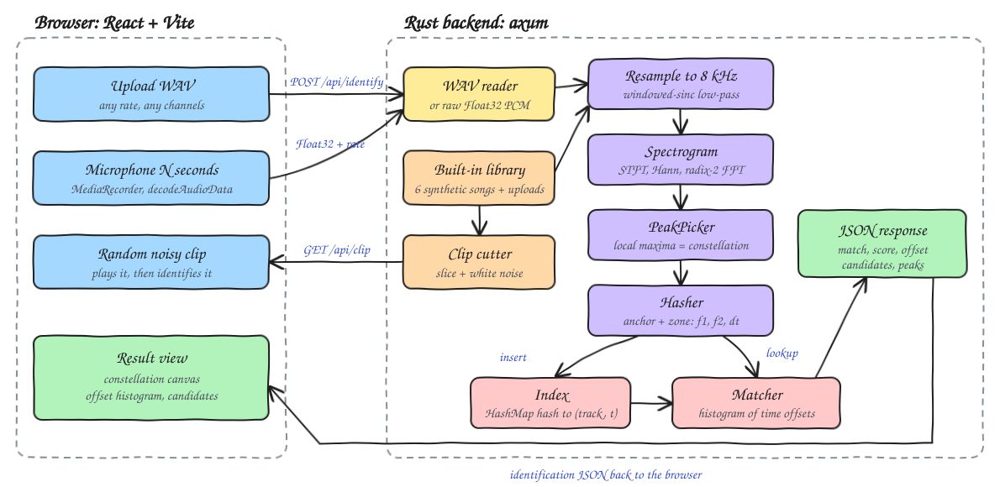
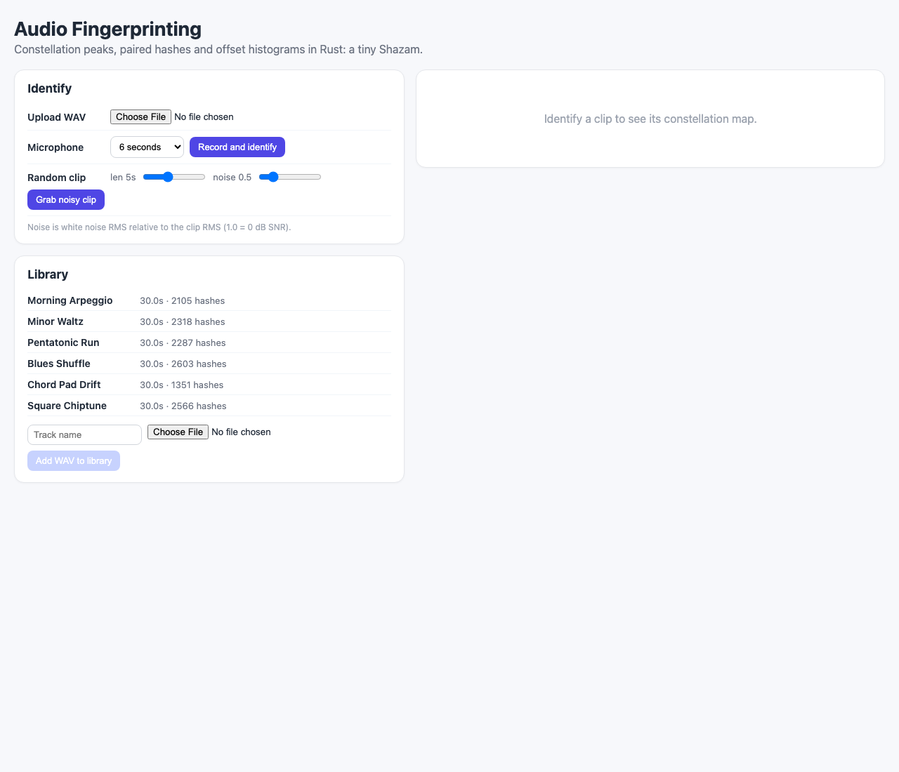
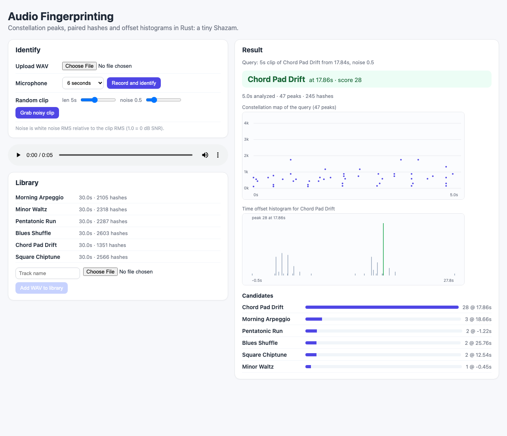

# Audio Fingerprinting

A mini Shazam. A Rust backend turns audio into a constellation map of spectral peaks, pairs the peaks into
hashes, stores them in an in-memory index and identifies a short (noisy) clip by voting on time offsets. It
ships with a built-in library of 6 synthetic songs so it works without any audio files. The React UI
identifies an uploaded WAV, a microphone recording or a random noisy clip cut from a library song, and shows
the query constellation, the offset histogram of the winner and the ranked candidates.

## How it Works

1. Every input (library song or query) is mixed to mono and resampled to 8 kHz with a windowed-sinc low-pass.
2. `Spectrogram`: STFT with a 1024-sample Hann window and a 256-sample hop (32 ms), hand-written radix-2 FFT, magnitudes in dB.
3. `PeakPicker`: a point is a peak when it is the maximum of its +-10 bin / +-5 frame neighborhood and at least 15 dB above the frame median. The peaks form the constellation map.
4. `Hasher`: each anchor peak is paired with up to 6 peaks in its target zone (1..40 frames later, within 120 bins). Hash = `f1 (10 bits) | f2 (10 bits) | dt (12 bits)`, stored with the anchor time.
5. `Index`: `HashMap<hash, Vec<(track_id, t)>>` holding every library hash.
6. `Matcher`: for every query hash found in the index, vote for `(track, t_library - t_query)`. A real match piles up votes in one offset bin; random hash hits scatter. The tallest bin is the score, its offset is where the clip starts in the song.
7. A score of 12 or more is a match; otherwise the answer is "no match" with the candidates still listed.

## Architecture



## Features

* Built-in library of 6 synthetic songs (different scales, tempos, meters, timbres, chords and drums) generated on startup, so the app works offline with no files.
* Add your own tracks with `POST /api/library` (raw WAV, any rate, any channel count).
* Identify by WAV upload, by microphone (N seconds, sent as Float32 PCM) or by a random noisy library clip.
* Noise slider: white noise relative to the clip RMS, to see how robust constellation hashing is (it still matches at 0 dB SNR).
* Constellation canvas of the query, offset histogram of the winner (the spike is the alignment) and ranked candidates with scores.
* Hand-written WAV reader/writer (8/16/24/32-bit PCM and 32-bit float), FFT, Hann window, resampler, synthesizer: no audio crates.

## Stack

* Rust 1.99.1, edition 2024: fast DSP with traits for each pipeline stage.
* axum + tokio: small HTTP API with raw binary bodies.
* serde / serde_json: JSON responses.
* tower-http: CORS layer.
* React 19.3.1 + TypeScript strict + Vite: UI and canvas plots.
* bun: install, dev server, tests and build.

No other libraries are used.

## API

| Method | Path | Body | Response |
|---|---|---|---|
| GET | `/api/health` | - | `{status, tracks, index_size}` |
| GET | `/api/library` | - | `[{id, name, duration_sec, hashes, builtin}]` |
| POST | `/api/library?name=My%20Song` | raw WAV bytes | the new track `{id, name, duration_sec, hashes, builtin}` |
| POST | `/api/identify` | raw WAV bytes | identification |
| POST | `/api/identify?rate=48000` | raw little-endian Float32 PCM | identification |
| GET | `/api/clip?track=0&start=12.5&len=5&noise=0.5` | - | `audio/wav` 8 kHz mono clip, `noise` = noise RMS / clip RMS |

Identification:

```json
{
  "match": { "track_id": 4, "name": "Chord Pad Drift" },
  "score": 28,
  "offset_sec": 17.86,
  "candidates": [{ "track_id": 4, "name": "Chord Pad Drift", "score": 28, "offset_sec": 17.86 }],
  "peaks": [{ "t": 0.03, "hz": 523.4 }],
  "histogram": [{ "offset_sec": 17.86, "count": 28 }],
  "duration_sec": 5.0,
  "hash_count": 245,
  "min_score": 12
}
```

`match` is `null` when the best score is below `min_score`. Errors return `{ "error": "..." }` with 400/404/500.

## Key Data Structures and Design Decisions

* Pipeline traits: `Spectrogram` (`Stft`), `PeakPicker` (`NeighborhoodPeakPicker`), `Hasher` (`PairHasher`), `Index` (`MemoryIndex`), `Matcher` (`OffsetHistogramMatcher`). `Pipeline` composes the first three; `Library` owns the pipeline, the index, the matcher and the tracks.
* `Peak { t: frame, f: bin }`, `Fingerprint { hash: u32, t: anchor frame }`, `Candidate { track, score, offset }`.
* Hashes encode only relative time (`dt`), so they are identical wherever the clip starts; absolute time is recovered by the offset histogram.
* The peak threshold is relative to the frame median, so added white noise raises the floor without flooding the constellation with noise peaks that would steal target-zone slots.
* 8 kHz analysis rate: melodic content lives below 4 kHz and the index stays small. Offset resolution is one hop (32 ms), well inside the +-0.1 s target.
* Song synthesis and noise use a seeded xorshift RNG, so the library and its hashes are deterministic across restarts.
* Errors are a single `FingerprintError` enum implementing `std::error::Error`; no `unwrap()` outside tests.
* Microphone capture uses the browser (MediaRecorder + decodeAudioData) only to get PCM; all DSP runs in Rust.

## Tests

Backend (`cargo test`, 37 tests), highlights:

* A 5 s clip from the middle of each of the 6 songs identifies the right song with the offset within +-0.1 s and a winning margin over 3x the runner-up.
* A 6 s clip with white noise at 0 dB SNR still identifies the right song and offset.
* White noise and an unrelated chirp are not identified (score below the threshold).
* Hashing is deterministic, order independent and time-shift invariant; every hash field changes the hash.
* A query at 16 kHz is resampled and still matches; an uploaded track becomes identifiable.
* FFT puts a bin-16 sine in bin 16 and preserves energy (Parseval); the resampler keeps a 440 Hz pitch and removes tones above the new Nyquist.

Frontend (`bun test`, 7 tests): Float32 little-endian encoding matches the backend decoder, random clips always fit inside a track, the histogram downsampler never hides the alignment spike.

## How to Run

```bash
./scripts/setup.sh
./scripts/start-all.sh
./scripts/ui.sh
./scripts/test-all.sh
./scripts/stop-all.sh
```

Backend on port 8112, UI on port 5112. Manual run: `cd backend && cargo run`, `cd frontend && bun install && bun run dev`.

## Printscreens

Startup view: the built-in library of 6 songs with their hash counts, and the three ways to query.



After "Grab noisy clip": a 5 s clip of Chord Pad Drift starting at 17.84 s with noise 0.5 was identified at 17.86 s with score 28. The constellation map shows the query peaks, the histogram shows one tall spike at the true offset over scattered random votes, and the other songs score 1 to 3.



## Scripts

All scripts live in `scripts/` and run from any directory of the repository.

| Script | What it does |
|---|---|
| `./scripts/setup.sh` | Installs dependencies and prepares the app |
| `./scripts/start-all.sh` | Starts every service and prints the full link of each one |
| `./scripts/status.sh` | Shows every service port as UP or DOWN |
| `./scripts/test-all.sh` | Runs every test suite |
| `./scripts/ui.sh` | Opens the UI in the browser |
| `./scripts/stop-all.sh` | Stops every service |

Ports are declared in `scripts/ports.env`.

```bash
./scripts/setup.sh
./scripts/start-all.sh
./scripts/status.sh
./scripts/ui.sh
./scripts/stop-all.sh
```
