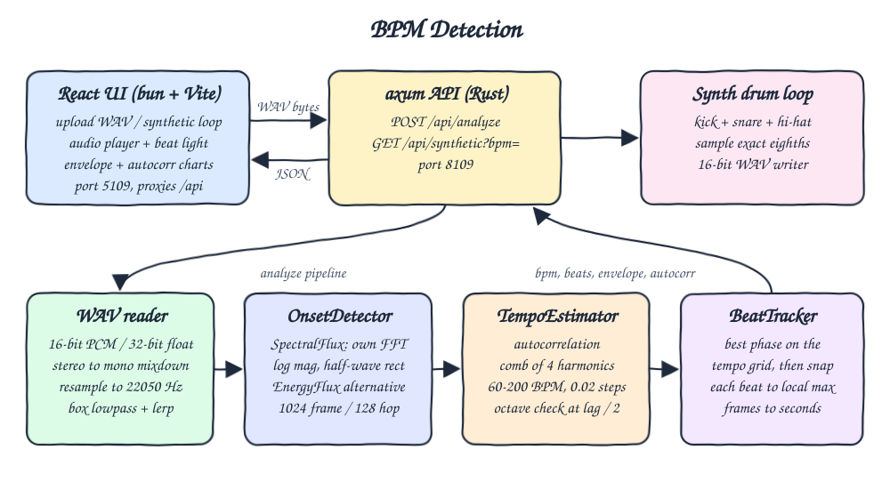
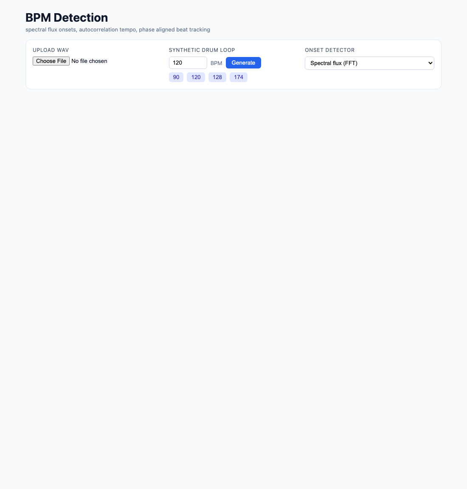
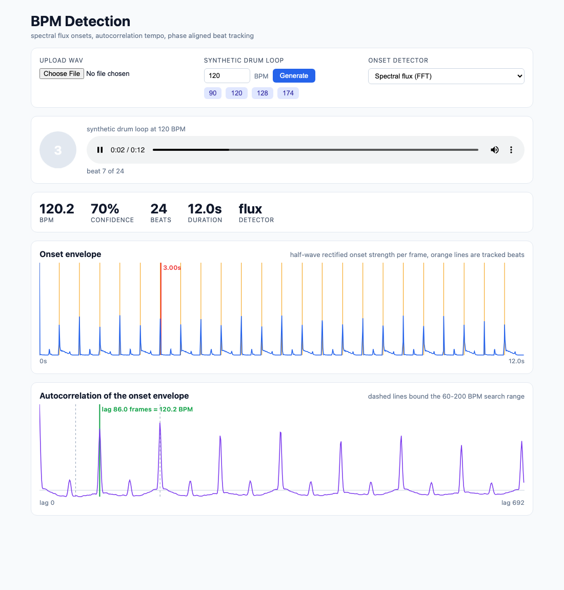
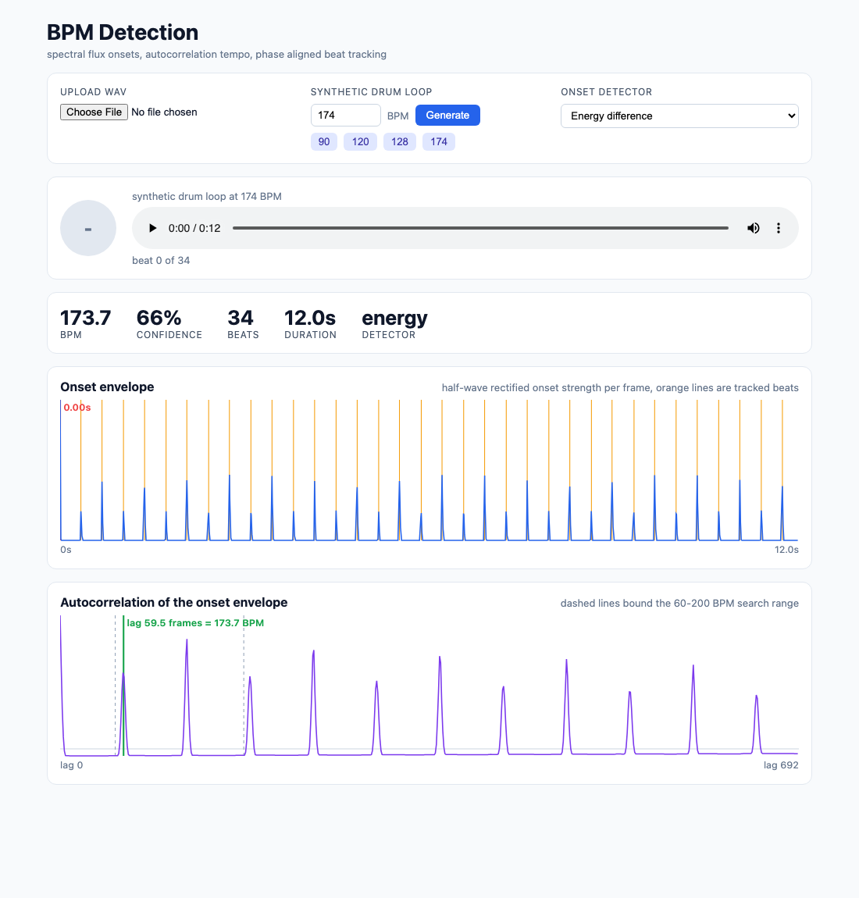
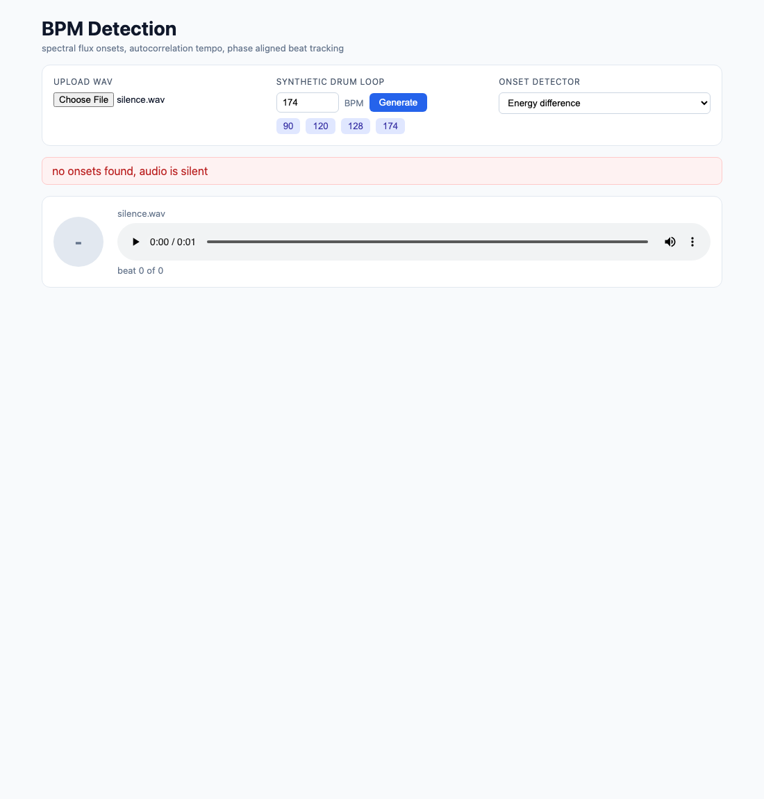

# BPM Detection

Beat and tempo detection for WAV audio. A Rust backend reads the WAV by hand, builds an onset envelope with a hand-written FFT, estimates the tempo by autocorrelation and places beats on the tempo grid. A React UI plays the audio with a beat light that flashes on every detected beat and charts the onset envelope and the autocorrelation curve. A built-in synthetic drum loop generator means it works without any audio file.

## How it Works

1. The WAV bytes are parsed by a hand-written RIFF reader (16-bit PCM or 32-bit float, any channel count, mixed down to mono).
2. Audio is resampled to 22050 Hz (box lowpass plus linear interpolation when decimating) and padded by half a frame so frame `i` is centered at `i * hop`.
3. The onset detector slides a 1024 sample Hann window with a 128 sample hop (172 frames per second). Spectral flux takes a radix-2 FFT, log-compresses the magnitudes and sums only the positive bin increases (half-wave rectified). The energy alternative does the same on log frame energy.
4. The tempo estimator autocorrelates the mean-removed envelope and scores every BPM from 60 to 200 in 0.02 steps with a comb over 4 harmonics of the lag, read with linear interpolation so the result is not limited to integer lags.
5. Octave errors are handled explicitly: when the autocorrelation at half the chosen lag is at least half as strong as at the chosen lag, the tempo is doubled and refined. This turns a "kick-only" 87 BPM reading into the real 174 BPM, while weak hi-hat eighth notes do not turn 90 into 180.
6. The beat tracker finds the phase (in quarter frame steps) whose tempo grid collects the most onset strength, then snaps each grid point to the strongest frame within 3 frames.
7. The response carries the BPM, a confidence (mean normalized autocorrelation at the chosen harmonics), the envelope, the beat times and the autocorrelation curve.

## Architecture



## Features

* Upload any 16-bit or float WAV, mono or stereo, any sample rate: real files work, not only the generated loop.
* Synthetic drum loop at any BPM from 40 to 300: lets the pipeline be checked against a known ground truth.
* Two onset detectors (spectral flux and energy difference): shows why frequency-aware flux is more robust than plain loudness.
* Sub-integer lag tempo resolution: a 172 fps envelope alone would give about 3 BPM steps at 174 BPM, the harmonic comb gets within a fraction of a BPM.
* Octave error handling: avoids the classic half and double tempo mistakes.
* Beat light synced to playback: flashes on the detected beat times while the audio plays so the result can be heard and seen together.
* Onset envelope chart with beat markers and live playhead, and autocorrelation chart with the chosen lag and the search range.
* Silence and too-short audio return a clear error instead of a made up tempo.

## Stack

* Rust 1.99.1 (edition 2024): fast DSP with no audio crates, all FFT, WAV and filtering code is hand-written.
* axum + tokio: small async HTTP server for the JSON and WAV endpoints.
* serde: request query parsing and JSON responses.
* React 19.3.1 + TypeScript strict: typed UI with components for controls, player and charts.
* Vite + bun: fast dev server with the `/api` proxy, `bun test` for the pure TS logic.
* Plain SVG charts: no chart library needed for two line plots.

## API

| Method | Path | Body / Query | Response |
|---|---|---|---|
| `POST` | `/api/analyze?detector=flux\|energy` | raw WAV bytes, `detector` optional (default `flux`) | `200` JSON analysis, `400` invalid WAV, `422` silence or too short |
| `GET` | `/api/synthetic?bpm=120` | `bpm` between 40 and 300 | `200` `audio/wav`, 12 s, 44.1 kHz, 16-bit mono drum loop |

Analysis response:

```json
{
  "bpm": 120.18,
  "confidence": 0.79,
  "detector": "flux",
  "frame_rate": 172.27,
  "lag": 86.0,
  "duration_sec": 12.0,
  "onset_envelope": [0.0, 0.92, 0.31],
  "beats_sec": [0.0, 0.499, 0.998],
  "autocorr": [1.0, 0.83, 0.52]
}
```

Errors are `{"error": "no onsets found, audio is silent"}` with the matching status code.

## Key Data Structures and Design Decisions

* `trait OnsetDetector` (`SpectralFlux`, `EnergyFlux`), `trait TempoEstimator` (`AutocorrTempo`) and `trait BeatTracker` (`PhaseAlignedTracker`) are composed by `Analyzer`, so each stage can be swapped independently.
* `Audio { sample_rate, samples }` is always mono `f32`, the reader does the mixdown once.
* `AudioError` is a plain enum implementing `std::error::Error`, mapped to HTTP status codes in `api.rs`. No `unwrap` outside tests.
* The autocorrelation is biased (divided by `n`), which slightly favors shorter lags and keeps the slower octave from winning ties.
* The synthetic loop places each eighth note at a rounded sample position computed from the start, so there is no timing drift and the ground truth is exact.
* All heavy DSP lives in Rust. The frontend only does display math (binary search for the current beat, max-per-bucket downsampling so narrow onset peaks survive in the chart).

## How to Run

```bash
./scripts/setup.sh
./scripts/start-all.sh
./scripts/ui.sh
```

Open `http://localhost:5109`, press one of the BPM presets or upload a WAV, then press play.

Tests:

```bash
./scripts/test-all.sh
```

This runs `cargo test` (36 tests: FFT against a naive DFT, WAV round trip and mixdown, resampler anti-aliasing, flux rectification, tempo at 90/120/128/174 BPM within 1 BPM for both detectors, beat alignment, octave handling, silence errors), `cargo clippy -D warnings`, `bun test` (9 tests) and `bun run build`.

## Printscreens

Empty state, ready for an upload or a synthetic loop.



The 120 BPM synthetic loop playing. The beat light is lit on beat 3 of the bar, the red playhead sits on a tracked beat in the onset envelope, and the green marker in the autocorrelation chart is the chosen lag of 86 frames (120.2 BPM). Taller envelope peaks are kicks and snares, small ones are hi-hats.



The 174 BPM loop analyzed with the energy detector. The autocorrelation peak at twice the lag (87 BPM, kick to kick) is taller, but the octave check sees a strong peak at the beat lag and reports 173.7 BPM.



A silent WAV upload: the backend refuses to invent a tempo and the UI shows the error.



## Scripts

All scripts live in `scripts/` and run from any directory of the repository.

| Script | What it does |
|---|---|
| `./scripts/setup.sh` | Installs dependencies and prepares the app |
| `./scripts/start-all.sh` | Starts every service and prints the full link of each one |
| `./scripts/status.sh` | Shows every service port as UP or DOWN |
| `./scripts/test-all.sh` | Runs every test suite |
| `./scripts/ui.sh` | Opens the UI in the browser |
| `./scripts/stop-all.sh` | Stops every service |

Ports are declared in `scripts/ports.env`.

```bash
./scripts/setup.sh
./scripts/start-all.sh
./scripts/status.sh
./scripts/ui.sh
./scripts/stop-all.sh
```
