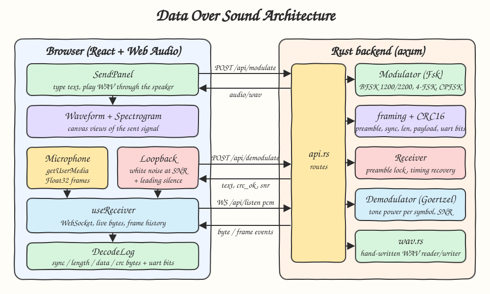
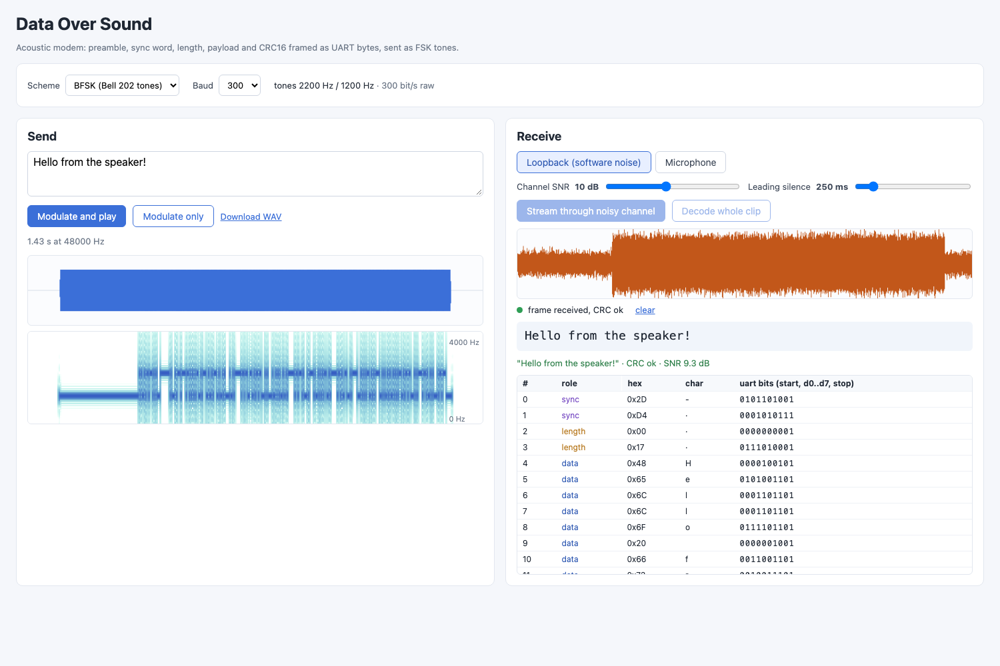
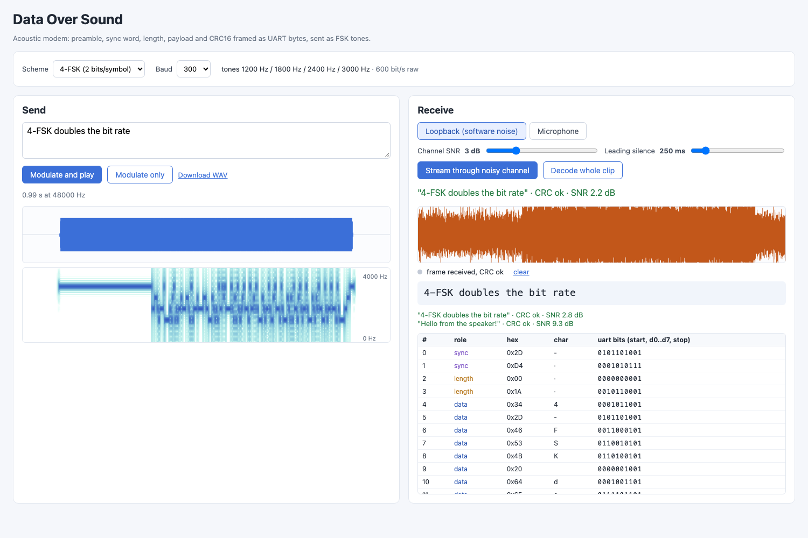

# Data Over Sound

An acoustic modem. Type a message, the Rust backend turns it into FSK tones (Bell 202 style BFSK or a faster 4-FSK), the browser plays it through the speaker, and a receiver listening on a microphone, or a software loopback channel with added noise, decodes the bytes live and checks the CRC16.

## How it Works

1. The text becomes a frame: `sync word (0x2D 0xD4) | length (u16 BE) | payload | CRC16-CCITT (u16 BE)`.
2. Each byte is sent UART style: start bit `0`, 8 data bits LSB first, stop bit `1`.
3. A preamble of idle tone (mark for BFSK, top tone for 4-FSK) is sent before the frame, at least 24 symbols long.
4. The bit stream is mapped to symbols (1 bit for BFSK, 2 bits for 4-FSK) and synthesized as continuous-phase FSK at 48 kHz.
5. The receiver slides a one-symbol window in 1/8-symbol steps and uses Goertzel tone powers to find a run of at least 6 preamble symbols.
6. Timing recovery: the first window where the idle tone falls below half the tone energy marks the preamble/data edge, and that edge sets the symbol clock.
7. Each symbol window is decided by the strongest Goertzel tone. The bits are searched for the UART-encoded sync word, then bytes, length, payload and CRC are read.
8. The SNR is estimated from the decided tone energy compared with the leftover energy in each symbol window.

## Architecture



## Features

* BFSK at 1200/2200 Hz (Bell 202 tones): robust and easy to see on a spectrogram.
* 4-FSK at 1200/1800/2400/3000 Hz: 2 bits per symbol, so the same baud gives twice the bit rate.
* Configurable baud from 50 to 600: lets you trade speed for robustness.
* Framing with preamble, sync word, length and hand-written CRC16: the receiver knows where a frame starts, how long it is, and whether it arrived intact.
* UART start/stop bits: each byte carries its own framing check, shown in the byte log.
* Goertzel demodulation with preamble detection and timing recovery: works at any offset and with leading silence.
* Live WebSocket receiver: bytes show up one at a time while the audio is still arriving.
* Loopback mode: adds white noise at a chosen SNR plus leading silence in software, so the whole path can be checked on one machine without a microphone.
* Send panel shows a waveform and spectrogram of the transmitted signal.
* Hand-written WAV reader/writer (16-bit PCM and 32-bit float, mono or multi-channel).

## Stack

* Rust 1.99.1 (edition 2024): DSP, framing and the modem live in the backend.
* axum (with `ws`) + tokio: HTTP and WebSocket API.
* serde / serde_json: JSON requests, responses and WebSocket events.
* React 19.3.1 + TypeScript (strict) + Vite: the UI.
* bun: package manager and TS test runner.
* No audio or DSP crates. Goertzel, CRC16, WAV and FSK are all written by hand.

## API

| Method | Path | Body | Response |
|---|---|---|---|
| GET | `/api/schemes` | - | `[{scheme, tones, bits_per_symbol, min_baud, max_baud}]` |
| POST | `/api/modulate` | `{"text": "hi", "scheme": "bfsk" or "4fsk", "baud": 300}` | `audio/wav` (16-bit PCM mono, 48 kHz) |
| POST | `/api/demodulate?scheme=bfsk&baud=300[&sample_rate=48000]` | raw WAV bytes, or raw Float32 LE PCM (then `sample_rate` is required) | `{"text": "hi", "crc_ok": true, "snr": 14.2}` |
| GET (WS) | `/api/listen?scheme=bfsk&baud=300&sample_rate=48000` | binary messages of Float32 LE PCM frames | text messages with JSON events |

WebSocket events:

```json
{"type": "locked", "sample": 21810}
{"type": "byte", "value": 72, "bits": "0000100101", "framing_ok": true}
{"type": "frame", "text": "Hello", "crc_ok": true, "snr": 12.5}
{"type": "lost", "reason": "sync word not found after preamble"}
```

Errors return `{"error": "..."}` with 400 for bad input or bad WAV, and 422 when no frame could be decoded.

## Key Data Structures and Design Decisions

* `trait Modulator` (`bits_per_symbol`, `modulate`) and `trait Demodulator` (`symbol_len`, `idle_symbol`, `tone_powers`, default `decide`). The `Fsk` struct implements both, and BFSK and 4-FSK are just different tone tables (`Fsk::bfsk`, `Fsk::four_level`).
* `Receiver<D: Demodulator>` is a streaming state machine (`Searching` or `Locked`). The batch `/api/demodulate` endpoint feeds the whole clip into the same receiver the WebSocket uses, so live and offline decoding cannot drift apart.
* `framing::parse(bits, search_limit)` is a pure function that returns the decoded bytes, a status (`NeedMore`, `NoSync`, `TooLong`, `Complete`) and the bit index to resume from. Because of that resume index, two frames sent back to back in one stream are both decoded.
* Preamble detection uses tone concentration, `goertzel_power / (window_energy * N / 2)`, which is close to 1 for a clean tone and close to 0 for noise whatever the volume. The receiver therefore needs no gain setting.
* Decoding starts 2 symbols before the detected edge and searches for the sync word, so a small timing error does not break framing.
* Continuous-phase FSK with 2 ms fades avoids clicks that would spread energy into the other tone bins.
* The spectrogram, white-noise generator and WAV parsing for display live in TypeScript. They are only for display and for the loopback channel, while all modem DSP runs in Rust.
* The receiver follows the strongest Goertzel tone, so the SNR reported for a clean signal is limited by symbol timing (about 15-20 dB) rather than by the signal itself.

## Tests

Backend (`cargo test`, 31 tests):

* round trip at 100/150/300/600 baud for both schemes
* round trip with white noise at 6 dB SNR
* round trip with leading silence at offsets that do not line up with symbols (1, 37, 12345, 50001 samples) plus noise
* the CRC catches corruption added before modulation, and catches every single-bit flip
* Goertzel picks the right tone (BFSK and all four 4-FSK tones)
* streaming in 512-sample chunks emits bytes live and the same frame
* two consecutive frames in one stream are both decoded, and pure noise never yields a frame
* the SNR estimate drops when more noise is added, and 4-FSK takes about half the airtime of BFSK
* WAV round trip, float stereo mixdown, truncated and invalid files are rejected

Frontend (`bun test`, 12 tests): the noise generator hits the requested SNR, leading silence, byte role and live text extraction, WAV parsing, the spectrogram puts 1200 Hz in the right row, and the Nyquist cap.

## How to Run

```bash
./scripts/setup.sh
./scripts/start-all.sh
./scripts/ui.sh
./scripts/test-all.sh
./scripts/stop-all.sh
```

UI: http://localhost:5111, API: http://localhost:8111/api/schemes

To use a real acoustic link, open the UI on two machines, or in two tabs with speaker and microphone, then press "Listen on microphone" on one and "Modulate and play" on the other. Keep the volume moderate and use 100-300 baud.

## Printscreens



BFSK at 300 baud. The Send panel shows the waveform and the spectrogram: the long 1200 Hz preamble line, then data hopping between 1200 and 2200 Hz. In the Receive panel the clip was streamed through the loopback channel at 10 dB SNR with 250 ms of leading silence. The live text, the received frame with CRC ok, and the byte log with every UART frame appeared while the audio was streaming.



4-FSK at 300 baud (600 bit/s raw) through a much noisier channel at 3 dB SNR. The spectrogram shows four tone rows. Both the live WebSocket stream and "Decode whole clip" (`POST /api/demodulate`) recovered the text with a valid CRC. The byte log marks the sync, length, data and crc bytes.

## Scripts

All scripts live in `scripts/` and run from any directory of the repository.

| Script | What it does |
|---|---|
| `./scripts/setup.sh` | Installs dependencies and prepares the app |
| `./scripts/start-all.sh` | Starts every service and prints the full link of each one |
| `./scripts/status.sh` | Shows every service port as UP or DOWN |
| `./scripts/test-all.sh` | Runs every test suite |
| `./scripts/ui.sh` | Opens the UI in the browser |
| `./scripts/stop-all.sh` | Stops every service |

Ports are declared in `scripts/ports.env`.

```bash
./scripts/setup.sh
./scripts/start-all.sh
./scripts/status.sh
./scripts/ui.sh
./scripts/stop-all.sh
```
