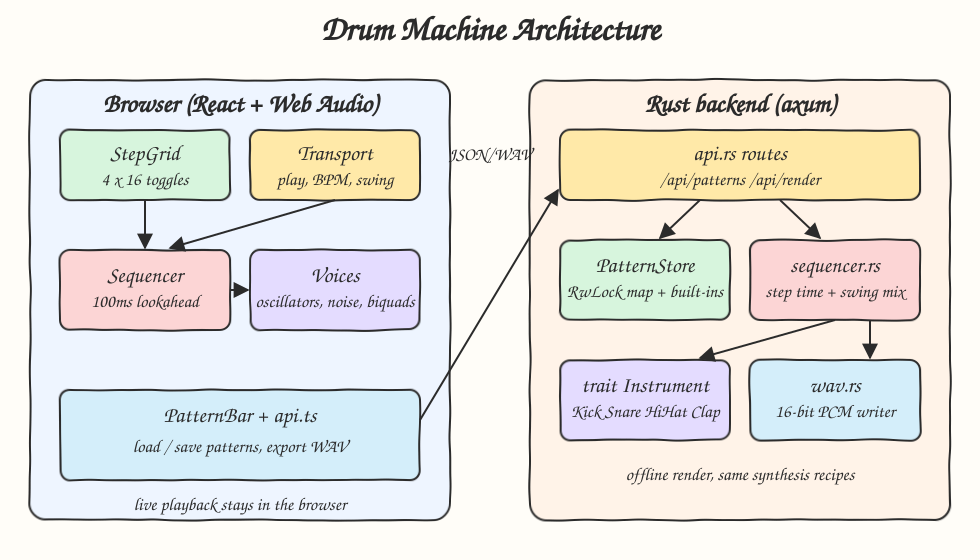
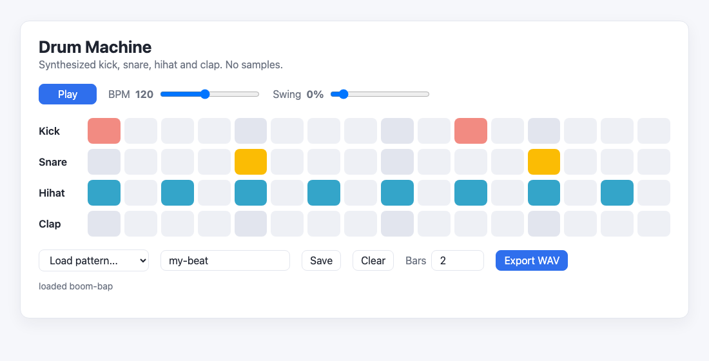
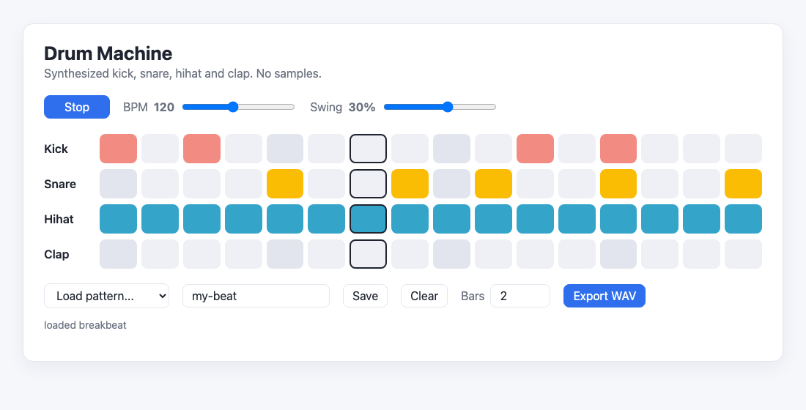
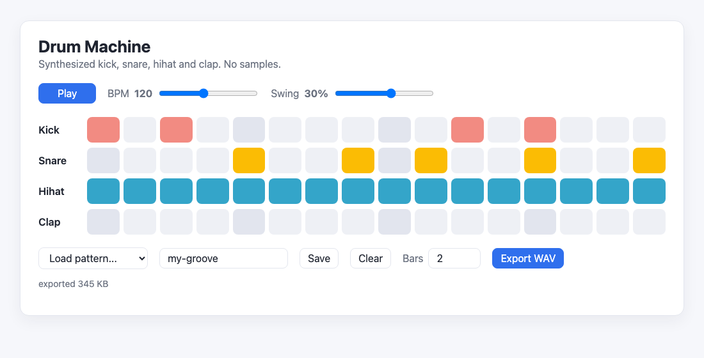

# Drum Machine

A 16-step drum machine with no samples. Kick, snare, hihat and clap are synthesized from oscillators, noise and filters,
both live in the browser (Web Audio) and offline in Rust, which renders the pattern to a WAV file written by hand.

## How it Works

1. The grid holds one 16-step row per instrument. A step is a sixteenth note: `60 / bpm / 4` seconds.
2. Press Play and a lookahead scheduler wakes every 25 ms and books every step that falls inside the next 100 ms on the
   `AudioContext` clock, so timing never depends on the JS event loop.
3. Swing delays odd steps by `swing * stepDuration`. The cursor advances on straight time, so swing never drifts the grid.
4. Each scheduled hit builds a few short-lived Web Audio nodes (oscillator with pitch sweep, noise buffer through a biquad).
5. Patterns are saved to and loaded from the Rust backend (in-memory store with three built-in grooves).
6. Export WAV posts the pattern, BPM, bars and swing to Rust. Rust renders each instrument once through `trait Instrument`,
   mixes the hits at their swung sample offsets, soft-clips with `tanh`, and writes 16-bit PCM mono at 44.1 kHz.

## Architecture



## Features

* Synthesized kit, no samples: kick (sine sweep 150 to 45 Hz + amp decay), snare (band-passed noise + 185 Hz tone),
  hihat (double high-passed noise, 18 ms decay), clap (three noise bursts + tail).
* 4 x 16 step grid with current-step highlight, so you see where the playhead is.
* Lookahead scheduling on the audio clock, so playback stays tight even when React re-renders.
* BPM (60 to 200) and swing (0 to 50%) applied live while playing.
* Save and load named patterns through the API, so grooves survive a page reload while the backend runs.
* Export WAV rendered by Rust for any number of bars (1 to 16), using the same synthesis recipes as the browser.

## Stack

* Rust 1.99.1 (edition 2024): DSP, offline render and WAV writer with no audio crates.
* axum + tokio: small async HTTP API.
* serde: JSON for patterns and render requests.
* React 19.3.1 + TypeScript (strict): the grid UI.
* Web Audio API: instant live playback in the browser (synthesis must be in the browser for zero latency).
* Vite + bun: dev server with `/api` proxy, build and `bun test`.

## API

| Method | Path | Body | Response |
|---|---|---|---|
| GET | `/api/patterns` | - | `{"names": ["boom-bap", "breakbeat", "four-on-the-floor"]}` |
| GET | `/api/patterns/:name` | - | `Pattern` or 404 `{"error": "..."}` |
| PUT | `/api/patterns/:name` | `Pattern` | saved `Pattern`, or 400 when invalid |
| POST | `/api/render` | `{"pattern": Pattern, "bpm": 120, "bars": 2, "swing": 0.2}` | `audio/wav` bytes, or 400 |

`Pattern` is `{"tracks": {"kick": [16 booleans], "snare": [...], "hihat": [...], "clap": [...]}}`.
Validation: every track must name a known instrument and have exactly 16 steps; names are `[A-Za-z0-9_-]{1,40}`;
`bpm` 40..300, `bars` 1..16, `swing` 0..0.5.

## Key Data Structures and Design Decisions

* `trait Instrument { fn name(&self) -> &'static str; fn render(&self, sample_rate: u32) -> Vec<f32>; }` with
  `Kick`, `Snare`, `HiHat`, `Clap`. Adding an instrument is one struct plus one entry in `instruments::all()`.
* `Pattern { tracks: BTreeMap<String, Vec<bool>> }` validated on every write and render.
* `PatternStore` is an `RwLock<BTreeMap<String, Pattern>>` seeded with built-ins. No persistence on purpose.
* Hand-written RBJ `Biquad` (high-pass, band-pass) with the cutoff clamped below Nyquist, and a xorshift noise source
  with fixed seeds so renders and tests are deterministic.
* One hit buffer per instrument is rendered once per request and mixed at each step offset, instead of re-synthesizing.
* `step_time(step, bpm, swing)` is shared logic in Rust (`sequencer.rs`) and TS (`audio/timing.ts`), both unit tested.
* Errors use a single `AppError` enum mapped to HTTP status codes. No `unwrap` outside tests.

## Tests

* Rust (`cargo test`, 28 tests): step length is `60/bpm/4`, swing moves only odd steps and a swung hit lands at the right
  sample, kick energy sits below 250 Hz while hihat energy sits above 5 kHz (tiny DFT), hihat zero-crossing rate is over
  10x the kick, kick pitch sweeps down, every instrument decays to silence, pattern validation rejects non-16-step rows
  and unknown instruments, the mix never exceeds full scale, the filter stays stable above Nyquist, WAV header sizes match.
* Frontend (`bun test`, 8 tests): step timing, odd-step swing, lookahead window contents and wrap, no drift with swing,
  pattern toggle immutability and normalization.

## How to Run

```bash
./scripts/setup.sh
./scripts/start-all.sh
./scripts/test-all.sh
./scripts/stop-all.sh
```

Frontend: http://localhost:5108, backend: http://localhost:8108/api/patterns.

## Printscreens

Built-in `boom-bap` pattern loaded on start. Each instrument has its own color, beat columns are slightly darker.



`breakbeat` playing at 120 BPM with 30% swing. The outlined column is the current step, moved by the scheduler.



Pattern saved as `my-groove` and exported: Rust rendered two bars to a WAV file that the browser downloaded.



## Scripts

All scripts live in `scripts/` and run from any directory of the repository.

| Script | What it does |
|---|---|
| `./scripts/setup.sh` | Installs dependencies and prepares the app |
| `./scripts/start-all.sh` | Starts every service and prints the full link of each one |
| `./scripts/status.sh` | Shows every service port as UP or DOWN |
| `./scripts/test-all.sh` | Runs every test suite |
| `./scripts/ui.sh` | Opens the UI in the browser |
| `./scripts/stop-all.sh` | Stops every service |

Ports are declared in `scripts/ports.env`.

```bash
./scripts/setup.sh
./scripts/start-all.sh
./scripts/status.sh
./scripts/ui.sh
./scripts/stop-all.sh
```
