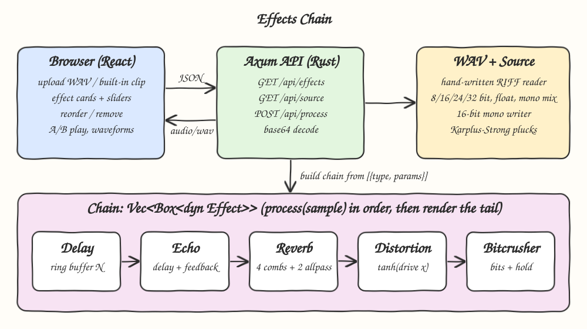
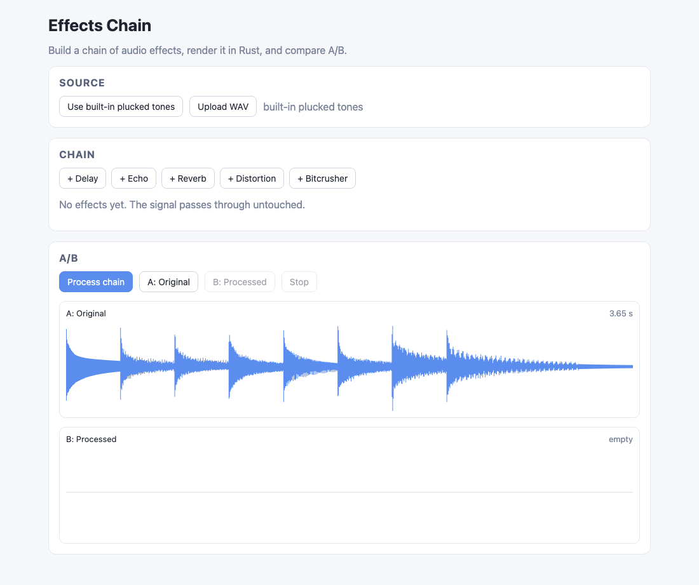
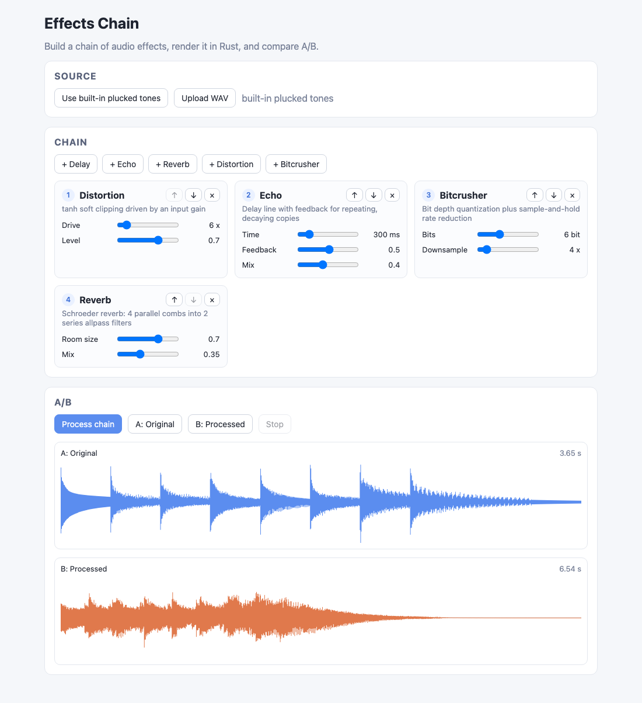

# Effects Chain

A guitar-pedalboard style audio effects chain. Pick a source (upload a WAV or use the built-in plucked tones),
stack Delay, Echo, Reverb, Distortion and Bitcrusher cards in any order, render the chain in Rust and compare
the original (A) against the processed result (B) with playback and waveforms.

## How it Works

1. The backend generates a source clip with Karplus-Strong plucked strings and serves it as `audio/wav`.
2. The UI decodes the WAV with Web Audio for playback and draws its waveform on a canvas.
3. Each effect card holds the parameters advertised by `GET /api/effects` (min, max, default, step).
4. Pressing "Process chain" sends the WAV as base64 plus the ordered `[{type, params}]` list to `POST /api/process`.
5. Rust parses the WAV by hand, mixes it to mono, validates every parameter against its range and builds a `Chain`.
6. The chain runs every sample through each `Effect::process` in order, then keeps feeding silence for the
   reverb and echo tails so they ring out instead of being cut off; trailing silence is trimmed.
7. The result is written as a 16-bit mono WAV and played back as B. A/B switching keeps the playback position.

## Architecture



## Features

* Five effects behind one `Effect` trait: new effects only need a struct and a registry entry.
* Delay: single delayed copy, exact sample offset, wet/dry mix.
* Echo: delay line with feedback, so repeats decay geometrically.
* Reverb: classic Schroeder design, 4 parallel comb filters into 2 series allpass filters; room size drives comb feedback.
* Distortion: `tanh` soft clipping with drive and output level, always bounded in `[-1, 1]`.
* Bitcrusher: bit depth quantization plus sample-and-hold rate reduction for lo-fi grit.
* Ordered chain: reorder cards with arrows because order changes the sound (distortion after reverb saturates the tail).
* Tail rendering: output grows to fit reverb and echo decay, capped at 10 seconds per effect.
* Strict validation: unknown effects, unknown params and out-of-range values return `400` with a message.
* Built-in source clip so the app works without any file.
* A/B playback with position kept when switching and side-by-side waveforms.

## Stack

* Rust 1.99.1 (edition 2024): DSP, WAV and base64 are hand-written, no audio crates.
* axum 0.8: small HTTP router for the JSON and WAV endpoints.
* tokio: async runtime; processing runs in `spawn_blocking` to keep the reactor free.
* serde: request and response (de)serialization.
* React 19.3.1 + TypeScript strict: typed UI state for the chain editor.
* Vite: dev server with `/api` proxy to the backend, reading ports from `scripts/ports.env`.
* bun: package manager, script runner and test runner.
* Web Audio API: decoding and playback only; all DSP lives in Rust.

## API

| Method | Path | Request | Response |
|---|---|---|---|
| GET | `/api/effects` | - | JSON list of effects and parameter ranges |
| GET | `/api/source` | - | `audio/wav`, 44.1 kHz mono plucked tones (about 3.6 s) |
| POST | `/api/process` | JSON `{ wav_base64, chain }` | `audio/wav` processed 16-bit mono, or `400 {"error": "..."}` |

`GET /api/effects` item:

```json
{
  "type": "echo",
  "label": "Echo",
  "description": "Delay line with feedback for repeating, decaying copies",
  "params": [
    { "name": "time_ms", "label": "Time", "min": 1, "max": 2000, "default": 300, "step": 1, "unit": "ms" },
    { "name": "feedback", "label": "Feedback", "min": 0, "max": 0.95, "default": 0.5, "step": 0.01, "unit": "" },
    { "name": "mix", "label": "Mix", "min": 0, "max": 1, "default": 0.4, "step": 0.01, "unit": "" }
  ]
}
```

`POST /api/process` body (missing params use their default, `wav_base64` may carry a `data:` prefix):

```json
{
  "wav_base64": "UklGR...",
  "chain": [
    { "type": "distortion", "params": { "drive": 10, "level": 0.7 } },
    { "type": "reverb", "params": { "room_size": 0.8, "mix": 0.4 } }
  ]
}
```

| Effect | Params |
|---|---|
| `delay` | `time_ms` 1..2000, `mix` 0..1 |
| `echo` | `time_ms` 1..2000, `feedback` 0..0.95, `mix` 0..1 |
| `reverb` | `room_size` 0..1, `mix` 0..1 |
| `distortion` | `drive` 1..50, `level` 0..1 |
| `bitcrusher` | `bits` 1..16, `downsample` 1..32 |

Accepted WAV input: PCM 8/16/24/32-bit integer or 32-bit float, any channel count (mixed to mono), any sample rate.

## Key Data Structures and Design Decisions

* `trait Effect { fn process(&mut self, sample: f32) -> f32; fn tail_samples(&self) -> usize }`: per-sample
  processing keeps every effect stateful and composable; `tail_samples` lets the chain know how long to keep ringing.
* `DelayLine`: fixed ring buffer whose `read` returns the sample written exactly `len` steps ago. Delay, Echo,
  comb and allpass filters are all built on it.
* `Chain { effects: Vec<Box<dyn Effect>> }`: folds a sample through effects in order; `render` appends the summed
  tail of silence and trims the trailing part below `1e-4`.
* `registry::SPECS`: one static table is both the `GET /api/effects` payload and the validation source, so the UI
  sliders and the backend limits can never drift apart.
* Schroeder reverb uses comb delays of 29.7, 37.1, 41.1 and 43.7 ms (mutually non-harmonic) and allpass delays of
  5 and 1.7 ms with gain 0.7; room size maps to comb feedback `0.7 + 0.28 * room_size`.
* The built-in clip removes the mean of each Karplus-Strong noise burst: a DC offset would be amplified by the
  comb filters into a slow hump in the processed output.
* JSON with base64 was chosen over multipart to avoid an extra multipart dependency; the decoder is hand-written.
* `AppError` enum implements `std::error::Error` and maps to HTTP status codes; no `unwrap` outside tests.

## How to Run

```bash
./scripts/setup.sh
./scripts/start-all.sh
./scripts/ui.sh
./scripts/test-all.sh
./scripts/stop-all.sh
```

Tests:

* Backend `cargo test` (36 tests): delay shifts an impulse by exactly N samples, echo repeats decay
  geometrically, reverb tail rings far beyond the input and longer for bigger rooms, distortion stays in `[-1, 1]`,
  bitcrusher reduces distinct levels and holds samples, chain order changes the output, WAV and base64 round trips,
  parameter validation, source clip has no DC offset.
* Frontend `bun test` (10 tests): chain editing (defaults, reorder, bounds, removal, payload), waveform peaks and
  base64 encoding.

## Printscreens

Source loaded: the built-in plucked tones are fetched on start, decoded in the browser and drawn as the A waveform.
The chain is empty, so processing would return the signal untouched.



Chain processed: Distortion, Echo, Bitcrusher and Reverb cards were added and the Bitcrusher was moved above the
Reverb. After "Process chain" the B waveform shows the saturated, crushed signal with echo repeats and a reverb tail
that makes the clip almost twice as long as the original.



## Scripts

All scripts live in `scripts/` and run from any directory of the repository.

| Script | What it does |
|---|---|
| `./scripts/setup.sh` | Installs dependencies and prepares the app |
| `./scripts/start-all.sh` | Starts every service and prints the full link of each one |
| `./scripts/status.sh` | Shows every service port as UP or DOWN |
| `./scripts/test-all.sh` | Runs every test suite |
| `./scripts/ui.sh` | Opens the UI in the browser |
| `./scripts/stop-all.sh` | Stops every service |

Ports are declared in `scripts/ports.env` (backend 8107, frontend 5107).

```bash
./scripts/setup.sh
./scripts/start-all.sh
./scripts/status.sh
./scripts/ui.sh
./scripts/stop-all.sh
```
