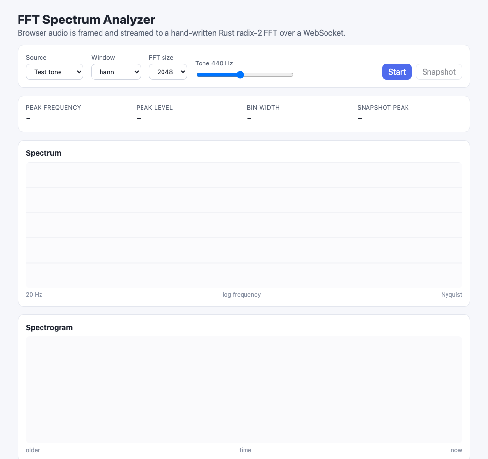
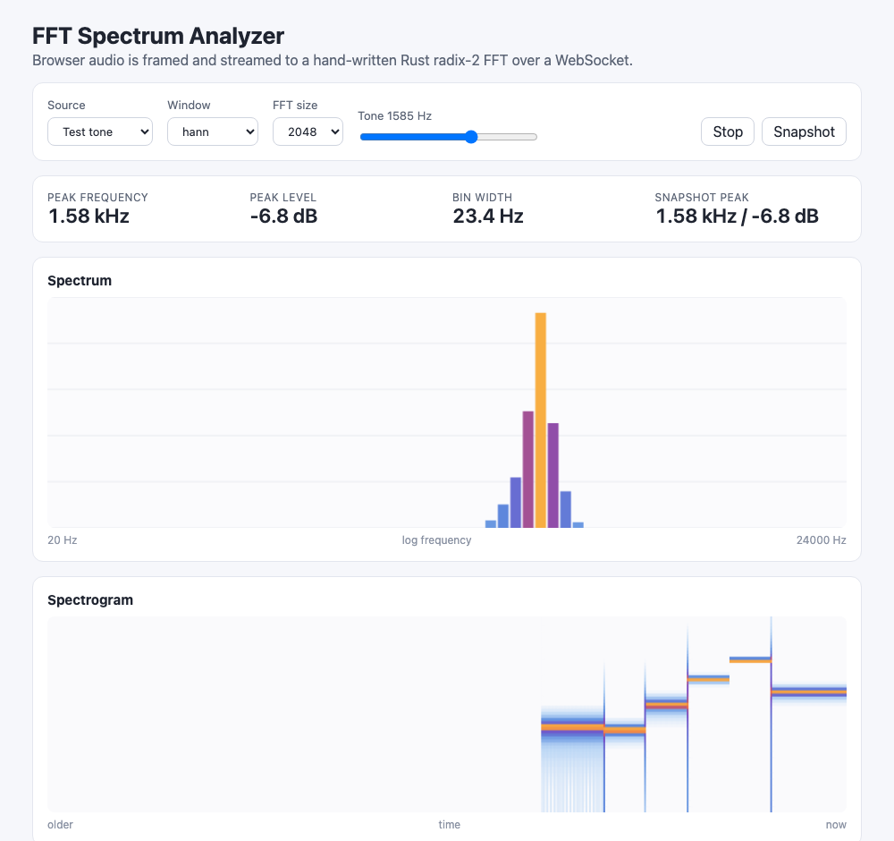
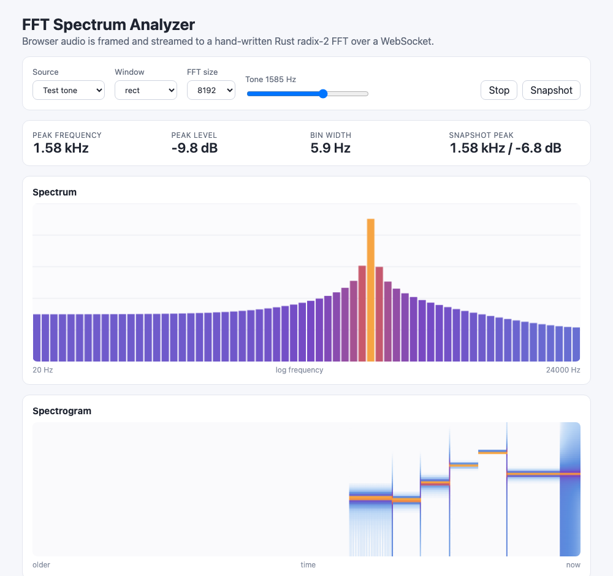

# FFT Spectrum Analyzer

A live audio spectrum analyzer. The browser captures the microphone (or a built-in test tone), cuts the
signal into fixed-size PCM frames and streams them over a WebSocket to a Rust backend that runs a
hand-written radix-2 Cooley-Tukey FFT. The backend answers each frame with a log-binned magnitude
spectrum in dB, which the UI draws as live bars and a scrolling spectrogram, with a peak frequency readout.

## How it Works

1. A source node (OscillatorNode test tone or `getUserMedia` microphone) feeds an AudioWorklet tap
   (ScriptProcessor fallback when AudioWorklet is missing) that posts 128-sample blocks to the main thread.
2. `Framer` regroups blocks into frames of exactly the selected FFT size (512 to 8192 samples).
3. Each frame is sent as raw little-endian Float32 bytes over `/api/stream`. Window type, sample rate and
   bar count travel once in the WebSocket query string; changing a setting reopens the stream.
4. The backend decodes the bytes, applies the chosen `Window`, runs `Radix2Fft::forward`, converts the
   one-sided spectrum to dB (a full-scale sine reads 0 dB), groups bins into log-spaced bars from 20 Hz to
   Nyquist, and finds the peak with parabolic interpolation.
5. The JSON `SpectrumFrame` comes back; bars, spectrogram column and readout update per frame.
6. `Snapshot` posts the last captured frame to `POST /api/spectrum` for a one-shot analysis.

## Architecture


## Features

* Hand-written radix-2 FFT: iterative, in-place, bit-reversal plus butterflies; no FFT crate, so the math is visible and tested.
* Window selector (Hann, Hamming, Rect): shows spectral leakage live; Rect smears an off-bin tone across every bar.
* FFT size selector (512 to 8192): trades time resolution for frequency resolution; bin width is shown in the readout.
* Log-binned bars: 64 bars spaced by equal frequency ratio so octaves get equal width, like human hearing.
* Scrolling spectrogram: each frame becomes a 2 px column, so pitch changes over time are visible.
* Peak readout with sub-bin accuracy: parabolic interpolation over the dB peak and its neighbours.
* Test tone source: an OscillatorNode with a log frequency slider, so the app works without a microphone.
* WebSocket streaming with backpressure: frames are dropped when the socket buffer exceeds 1 MB instead of piling latency.
* One-shot REST endpoint: same analysis as the stream, useful for scripting and for the Snapshot button.

## Stack

* Rust 1.99.1, edition 2024: DSP core and HTTP server, with traits for the transform and the windows.
* axum (with `ws` feature): HTTP routing and WebSocket upgrade in one small dependency.
* tokio: async runtime required by axum.
* serde and serde_json: JSON request and response bodies.
* React 19.3.1 + TypeScript strict: typed UI state and components.
* Vite: dev server on its own port with a proxy (including WebSocket) to the backend.
* bun: package manager, script runner and test runner for the pure TS logic.
* Web Audio API (AudioWorklet, OscillatorNode, getUserMedia): browser-native capture and test signal, no audio libraries.

No other crates or npm runtime dependencies are used. `tower-http` is not needed because the Vite proxy keeps
everything same-origin.

## API

### `GET /api/health`

Returns `ok`.

### `POST /api/spectrum`

Request:

```json
{ "samples": [0.0, 0.12, 0.25], "sample_rate": 48000, "window": "hann", "bars": 64 }
```

`samples` length must be a power of two. `window` is one of `hann`, `hamming`, `rect`. `bars` is 1 to 512.

Response `200`:

```json
{
  "fft_size": 2048,
  "sample_rate": 48000,
  "bars": [-118.2, -97.4, -6.7],
  "edges": [20.0, 22.3, 24000.0],
  "peak_hz": 999.6,
  "peak_db": -6.6
}
```

`bars[i]` is the loudest bin (in dBFS, floor -120) between `edges[i]` and `edges[i+1]` Hz.

Response `400`: `{ "error": "frame length 3 is not a power of two" }`

### `GET /api/stream?sample_rate=48000&window=hann&bars=64` (WebSocket)

* Client sends binary messages: one frame of little-endian Float32 PCM, power-of-two length.
* Server replies with one text message per frame: the same `SpectrumFrame` JSON as above, or `{ "error": "..." }`.
* An unknown window in the query string is rejected with `400` before the upgrade.

## Key Data Structures and Design Decisions

* `trait Transform { forward, inverse }` with `Radix2Fft`: callers depend on the trait, so another transform
  could replace it without touching the spectrum code. `inverse` reuses the same butterflies with the opposite
  twiddle sign and a 1/N scale.
* `trait Window { weight, coefficients }` with `Hann`, `Hamming`, `Rect`, chosen by `window_by_name`.
  Windows are periodic (divide by N), the form that suits spectral analysis.
* `Complex` is a tiny hand-written `f64` type. Samples arrive as `f32` but the FFT runs in `f64` so Parseval
  and round-trip errors stay around 1e-12.
* Amplitude normalisation `2 * |X[k]| / sum(window)` makes a full-scale sine read 0 dB with any window, so
  switching windows does not shift the level of a tone.
* `SpectrumFrame` carries bars plus their Hz edges, so the UI never re-derives the binning.
* Errors are a `DspError` enum (implements `std::error::Error`) mapped to HTTP 400; no `unwrap` outside tests.
* `Framer` (TS) keeps a partially filled buffer between blocks and hands out a fresh `Float32Array` per frame,
  so a frame already queued on the socket is never overwritten.
* A generation counter in `useAnalyzer` drops audio graphs that finish starting after a newer start was
  requested, so fast setting changes never leave two captures feeding one stream.
* Framing stays in TS because it is buffering, not DSP; all transform, windowing and binning work runs in Rust.

## Tests

Backend (`cargo test`, 16 tests), each encoding why the behaviour matters:

* A sine with exactly k cycles peaks at bin k with amplitude N/2 and no leakage.
* The FFT matches a naive O(N^2) DFT, proving butterflies and twiddles.
* Parseval: time energy equals frequency energy / N.
* Inverse of forward returns the original signal.
* Hann and Hamming cut far-from-peak leakage of an off-bin sine far below Rect.
* A 1 kHz tone is read within one bin; a full-scale sine reads 0 dB and half amplitude reads -6 dB.
* Bars are log-spaced from 20 Hz to Nyquist and the tone lands in the loudest bar.
* Invalid sizes, rates, bar counts, window names and misaligned PCM payloads are rejected.

Frontend (`bun test`, 9 tests): framing of worklet blocks into FFT frames, colormap clamping and continuity,
frequency formatting, and the WebSocket URL scheme.

## How to Run

Requirements: Rust 1.99.1 (picked by `rust-toolchain.toml`) and bun.

```bash
./scripts/setup.sh
./scripts/start-all.sh
./scripts/ui.sh
./scripts/test-all.sh
./scripts/stop-all.sh
```

Open http://localhost:5105, keep `Test tone` selected and press `Start`. Move the slider to sweep the tone.
Switch the source to `Microphone` to analyse live input (the browser asks for permission).

## Printscreens

### Idle



The app before `Start`: source, window, FFT size and tone controls on top, empty readout, bars and spectrogram.

### Live test tone with Hann window



The test tone was swept across several frequencies and stopped at 1585 Hz. The bars show a narrow Hann peak,
the readout reports 1.58 kHz at 2048 points (23 Hz bins), the snapshot from `POST /api/spectrum` agrees, and the
spectrogram shows each step of the sweep as a horizontal line moving up and down over time.

### Rect window at 8192 points



Same tone with the Rect window and an 8192-point FFT. The bin width drops to 5.9 Hz, but because the tone is
not on an exact bin the Rect window leaks energy into every bar, lifting the whole spectrum. The newest
spectrogram columns on the right show the same smear compared with the clean Hann lines before them.

## Scripts

All scripts live in `scripts/` and run from any directory of the repository.

| Script | What it does |
|---|---|
| `./scripts/setup.sh` | Installs dependencies and prepares the app |
| `./scripts/start-all.sh` | Starts every service and prints the full link of each one |
| `./scripts/status.sh` | Shows every service port as UP or DOWN |
| `./scripts/test-all.sh` | Runs every test suite |
| `./scripts/ui.sh` | Opens the UI in the browser |
| `./scripts/stop-all.sh` | Stops every service |

Ports are declared in `scripts/ports.env` (backend 8105, frontend 5105).

```bash
./scripts/setup.sh
./scripts/start-all.sh
./scripts/status.sh
./scripts/ui.sh
./scripts/stop-all.sh
```
