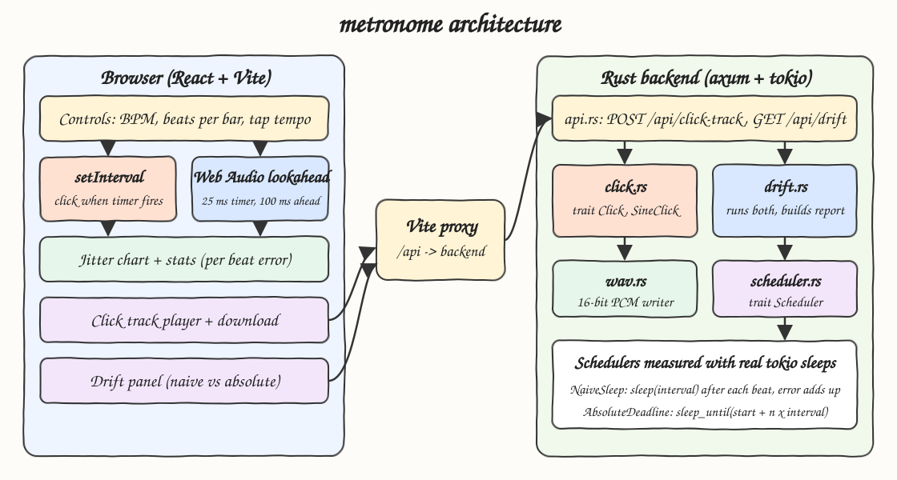
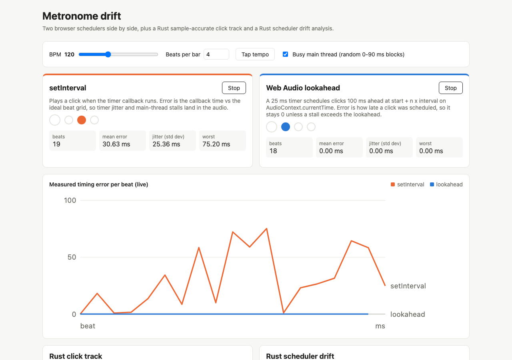
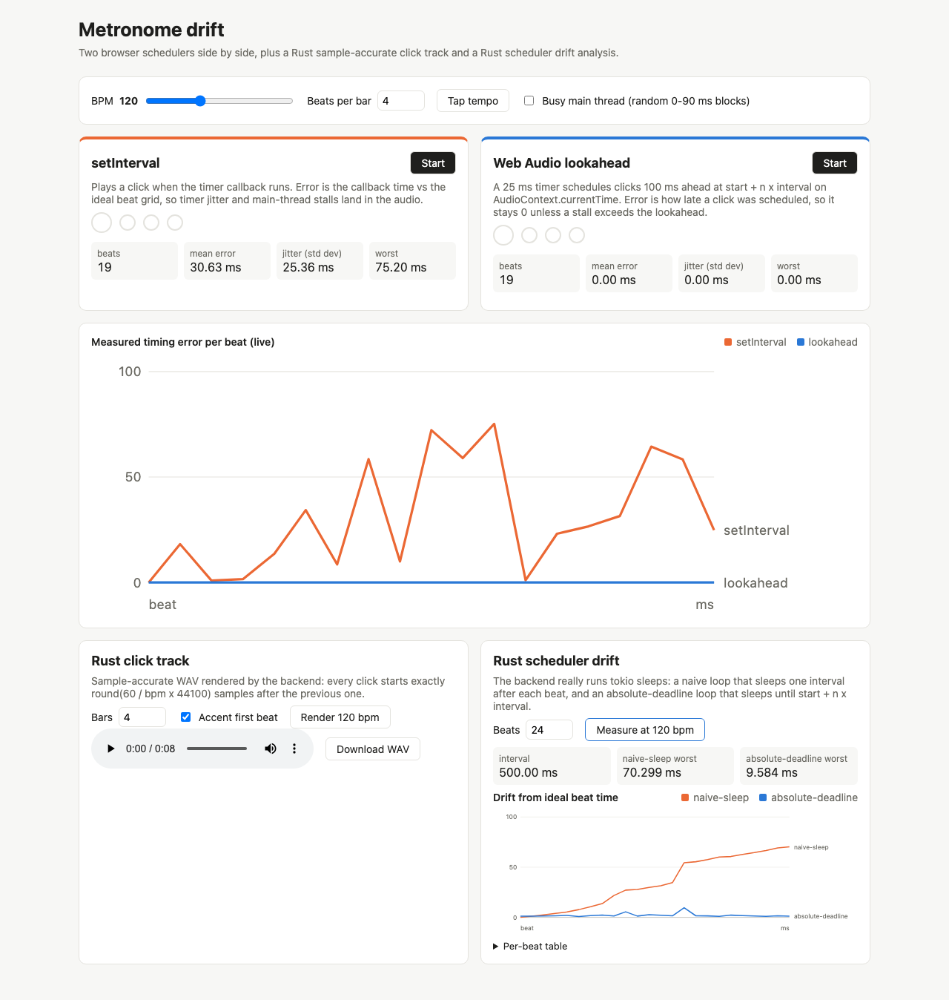

# Metronome

A metronome that makes timing drift visible. The browser runs two schedulers side by side (`setInterval` vs Web Audio lookahead) and charts the measured error of every beat. The Rust backend renders a sample-accurate click track WAV and measures real tokio schedulers (naive accumulating sleep vs absolute deadline) to show how drift builds up.

## How it Works

1. The `setInterval` metronome plays a click whenever the timer callback runs. Its error is `performance.now()` at the callback minus the ideal grid time `n x interval`, so timer jitter and main-thread stalls go straight into the audio.
2. The lookahead metronome wakes every 25 ms and schedules every beat that falls inside the next 100 ms at `start + n x interval` on `AudioContext.currentTime`. Its error is how late a click was scheduled, which stays 0 unless a stall is longer than the lookahead.
3. The "Busy main thread" toggle blocks the main thread for random 0-90 ms chunks to make the difference obvious.
4. `POST /api/click-track` renders a mono 16-bit WAV in Rust. Every onset is exactly `round(60 / bpm x 44100)` samples after the previous one, and the first beat of each bar uses a higher pitched click.
5. `GET /api/drift` really runs two tokio loops at the same time: `NaiveSleep` sleeps one interval after each beat (error adds up every beat), `AbsoluteDeadline` sleeps until `start + n x interval` (error stays bounded). It returns per-beat ideal vs measured times and drift in ms.

## Architecture



## Features

* **Side by side browser schedulers**: hear and see `setInterval` jitter against sample-accurate Web Audio scheduling.
* **Live jitter chart and stats**: per-beat error, mean, std dev and worst case for each mode.
* **Busy main thread toggle**: simulates UI work so the gap between the two strategies is easy to spot.
* **Tap tempo**: averages the last taps, resets after a 2 s pause.
* **Rust click track**: sample-accurate WAV with an accented downbeat, playable in the page and downloadable.
* **Rust scheduler drift analysis**: real tokio sleeps, not a simulation, with a chart and a per-beat table.

## Stack

* **Rust 1.99.1, edition 2024**: DSP, WAV writer and schedulers, all hand-written.
* **axum**: small HTTP router for the two endpoints.
* **tokio**: async runtime and the timers that are being measured.
* **serde**: JSON request and response types.
* **React 19.3.1 + TypeScript (strict) + Vite**: UI, built and tested with bun.
* **Web Audio API**: oscillator clicks scheduled on the audio clock. The metronome logic lives in TS because it must run on the browser audio clock to be meaningful.

## API

### `POST /api/click-track`

Request:

```json
{ "bpm": 120, "beats_per_bar": 4, "bars": 4, "accent": true }
```

Response: `audio/wav`, mono, 16-bit PCM, 44100 Hz. Limits: bpm 20-300, beats_per_bar 1-16, bars 1-64, total length at most 300 s.

### `GET /api/drift?bpm=120&beats=32`

Runs both schedulers concurrently for `beats` beats (2-64, run at most 30 s) and returns:

```json
{
  "bpm": 120,
  "interval_ms": 500,
  "naive": "naive-sleep",
  "absolute": "absolute-deadline",
  "naive_max_drift_ms": 40.68,
  "absolute_max_drift_ms": 2.86,
  "beats": [
    { "index": 1, "ideal_ms": 500, "naive_ms": 501.7, "naive_drift_ms": 1.7, "absolute_ms": 502.1, "absolute_drift_ms": 2.1 }
  ]
}
```

Errors return HTTP 400 with `{ "error": "..." }`.

### `GET /api/health`

Returns `ok`.

## Key data structures and design decisions

* `trait Click` with `SineClick`: a decaying cosine burst (1000 Hz normal, 1600 Hz accent). It starts at full amplitude so the onset sample is exact and testable.
* `TrackSpec` + `render_track`: validates input and copies the click into a zeroed buffer at `n x round(60 / bpm x sr)`. Integer sample offsets mean no floating point error accumulates across beats.
* `trait Scheduler` with `NaiveSleep` and `AbsoluteDeadline`: both return the measured elapsed time of each beat, `drift_ms` compares them with the ideal grid.
* `wav::encode_mono_16`: hand-written 44 byte RIFF header plus clamped little-endian samples.
* `AppError` enum implements `std::error::Error` and maps to HTTP 400.
* Frontend `dueBeats` is a pure function that computes beat times from the absolute grid, so a late timer wakeup never shifts a beat.

## How to run

```bash
./scripts/setup.sh
./scripts/start-all.sh
./scripts/ui.sh
./scripts/test-all.sh
./scripts/stop-all.sh
```

Frontend at `http://localhost:5103`, backend at `http://localhost:8103/api`.

Tests:

* Backend (`cargo test`): onsets land exactly on `round(60 / bpm x sr)` sample intervals (checked both by position and by detecting audible onsets), accent is higher pitched, absolute scheduler drift stays bounded, naive scheduler is never early, WAV header sizes match the payload, input limits.
* Frontend (`bun test`): lookahead window and absolute grid scheduling, late-schedule measurement, tap tempo averaging and reset, jitter statistics.

## Printscreens

### Live metronomes under main-thread load



Both metronomes are running at 120 bpm with the busy main thread toggle on. `setInterval` (orange) lands up to about 75 ms late with about 25 ms of jitter, while the lookahead scheduler (blue) stays at 0 ms because every click was already scheduled on the audio clock before the stall.

### Rust click track and scheduler drift



The left card rendered a 4 bar click track in Rust, ready to play or download as WAV. The right card ran 24 beats of real tokio timers: the naive sleep loop drifts steadily upward beat after beat, while the absolute-deadline loop stays within a few milliseconds of the ideal grid.

## Scripts

All scripts live in `scripts/` and run from any directory of the repository.

| Script | What it does |
|---|---|
| `./scripts/setup.sh` | Installs dependencies and prepares the app |
| `./scripts/start-all.sh` | Starts every service and prints the full link of each one |
| `./scripts/status.sh` | Shows every service port as UP or DOWN |
| `./scripts/test-all.sh` | Runs every test suite |
| `./scripts/ui.sh` | Opens the UI in the browser |
| `./scripts/stop-all.sh` | Stops every service |

Ports are declared in `scripts/ports.env`.

```bash
./scripts/setup.sh
./scripts/start-all.sh
./scripts/status.sh
./scripts/ui.sh
./scripts/stop-all.sh
```
