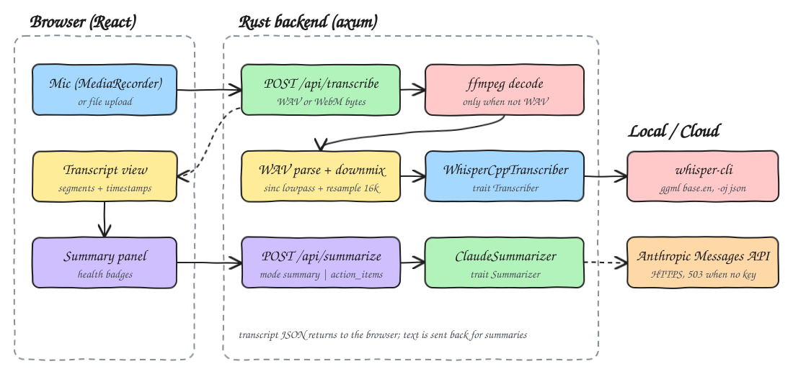
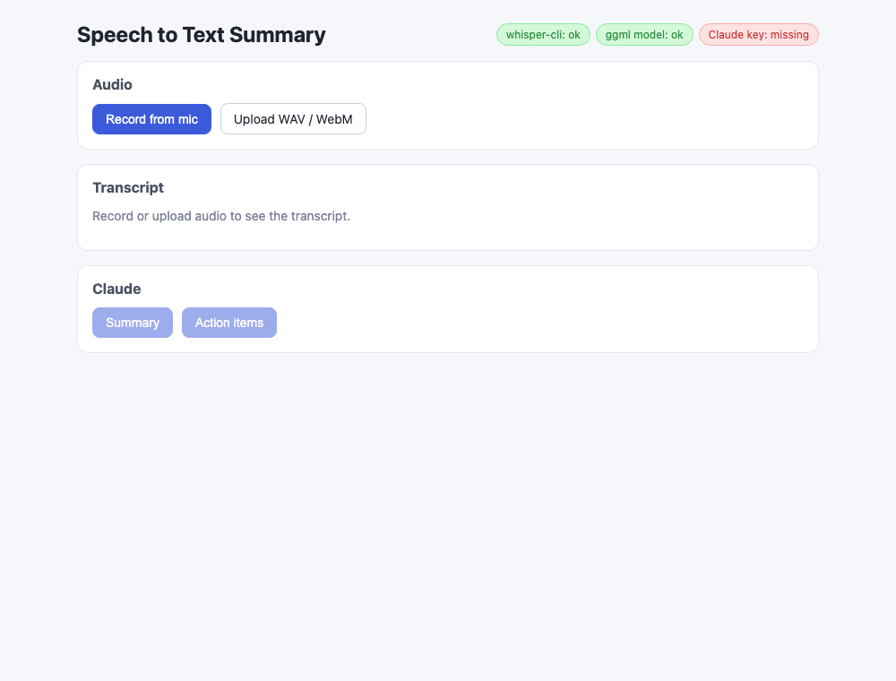
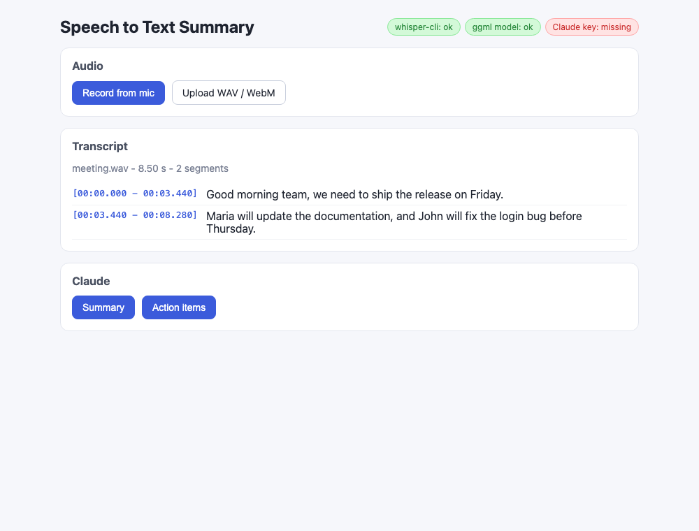
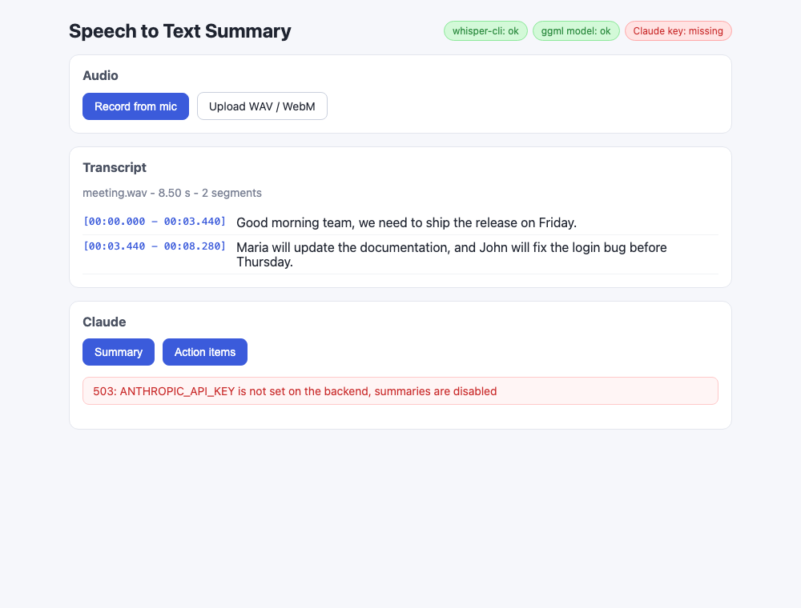

# Speech to Text Summary

Record from the microphone or upload an audio file, get a timestamped transcript from a local
whisper.cpp model, then ask Claude for a short summary or a list of action items.

## How it Works

1. The browser records with `MediaRecorder` (WebM/Opus) or takes an uploaded WAV/WebM file and POSTs the raw bytes to `/api/transcribe`.
2. The Rust backend checks the magic bytes: WAV goes straight to the hand-written RIFF parser, anything else is decoded to PCM WAV by `ffmpeg`.
3. Channels are averaged to mono, a 63-tap windowed-sinc low-pass removes content above the new Nyquist, and a linear interpolator resamples to 16 kHz.
4. A hand-written WAV writer produces 16 kHz mono 16-bit PCM, the exact input whisper.cpp expects.
5. `WhisperCppTranscriber` runs `whisper-cli -m models/ggml-base.en.bin -oj`, and the JSON output is parsed into segments (millisecond offsets become seconds).
6. For summaries, `ClaudeSummarizer` calls the Anthropic Messages API over HTTPS (rustls) with the transcript and asks for a JSON object `{summary, action_items}`.
7. Without `ANTHROPIC_API_KEY` the summary endpoint answers `503` with a clear error JSON, the UI shows it, and transcription keeps working.

## Architecture



## Features

* **Mic recording and file upload** - capture speech live or reuse existing WAV/WebM files.
* **Local transcription** - whisper.cpp with the `base.en` ggml model, audio never leaves the machine for transcription.
* **Timestamped segments** - each line shows `[mm:ss.mmm - mm:ss.mmm]` so text maps back to the audio.
* **Hand-written resampler and WAV writer** - any sample rate and channel count is normalized to 16 kHz mono without audio crates.
* **Summary and Action items** - one click each, the model returns structured JSON that the UI renders as a paragraph or a numbered list.
* **Health badges** - shows whether `whisper-cli`, the ggml model and the Claude key are available before you try.
* **Graceful missing key** - `503` with an explanation instead of a crash, the key value is never logged or returned.

## Stack

* **Rust 1.99.1 + axum + tokio** - small HTTP API, blocking work (ffmpeg, whisper, HTTPS) runs on `spawn_blocking`.
* **reqwest (blocking, rustls)** - the only extra crate, needed for HTTPS to the Anthropic API without OpenSSL.
* **whisper.cpp (`whisper-cli`)** - fast local speech recognition, installed with Homebrew by `setup.sh`.
* **ffmpeg** - decodes browser WebM/Opus recordings to PCM, the only decoding not done by hand.
* **Claude `claude-fable-5-1`** - the most capable current model, overridable with `CLAUDE_MODEL`.
* **React 19.3.1 + TypeScript + Vite + bun** - typed UI, `bun test` for pure helpers.

## API

| Method | Path | Body | Response |
|---|---|---|---|
| `GET` | `/api/health` | - | `{"whisper": bool, "model": bool, "claude_key": bool}` |
| `POST` | `/api/transcribe` | raw WAV or WebM bytes (`Content-Type: audio/wav` or `audio/webm`) | `{"text": string, "segments": [{"start": s, "end": s, "text": string}], "duration": s}` |
| `POST` | `/api/summarize` | `{"text": string, "mode": "summary" \| "action_items"}` | `{"summary": string, "action_items": [string]}` |

Errors are `{"error": string}` with status `400` (bad or undecodable audio, empty text), `503` (`ANTHROPIC_API_KEY` not set),
`502` (Claude API error or refusal) or `500` (whisper failure).

Claude request built by the backend:

```http
POST https://api.anthropic.com/v1/messages
x-api-key: <from ANTHROPIC_API_KEY>
anthropic-version: 2023-06-01
anthropic-beta: server-side-fallback-2026-07-01

{"model": "claude-fable-5-1", "max_tokens": 16000, "fallbacks": "default",
 "output_config": {"effort": "low"}, "system": "...reply with only JSON...",
 "messages": [{"role": "user", "content": "<instruction>\n\n<transcript>...</transcript>"}]}
```

## Key Data Structures and Design Decisions

* `trait Transcriber { transcribe(&Path) -> Result<Vec<Segment>>, binary_available, model_available }` with `WhisperCppTranscriber`; tests use a fake that inspects the WAV it receives.
* `trait Summarizer { summarize(&str, Mode) -> Result<SummaryResult>, has_key }` with `ClaudeSummarizer`; `build_request` and `parse_response` are pure functions, so tests cover the request body and response parsing with no network.
* `Audio { sample_rate, channels: Vec<Vec<f32>> }` is the decoded form; parser supports PCM 8/16/24/32 bit and 32-bit float, including `WAVE_FORMAT_EXTENSIBLE`.
* Low-pass before decimation: without it a 12 kHz tone at 48 kHz would alias to 4 kHz, right in the speech band. A test asserts it is attenuated.
* `fallbacks: "default"` lets the API retry a refused request on a recommended model; a `refusal` stop reason that still comes back is turned into a `502`.
* The response parser keeps only `text` blocks and extracts the outer JSON object, falling back to plain text as the summary if the model does not return JSON.
* Each request gets its own temp directory, removed on drop, so concurrent transcriptions never share files.
* Models live in `models/` (gitignored), downloaded once by `setup.sh`.

## How to Run

```bash
./scripts/setup.sh
export ANTHROPIC_API_KEY=...
./scripts/start-all.sh
./scripts/ui.sh
```

Summaries need `ANTHROPIC_API_KEY` exported in the shell that runs `start-all.sh`; everything else works without it.

Tests:

```bash
./scripts/test-all.sh
```

Backend tests cover the resampler (length, pitch kept, anti-aliasing, upsampling, downmix), WAV writer and parser,
whisper JSON parsing, Claude request building and response parsing, missing key behaviour and the transcription flow with a fake transcriber.
Frontend tests cover timestamp formatting, error message extraction and recorder MIME selection.

## Printscreens

**Idle with health badges** - whisper-cli and the model are installed, the Claude key is missing (red badge).



**Transcript** - a speech WAV generated with macOS `say` (44.1 kHz stereo) was uploaded, resampled to 16 kHz mono and transcribed by whisper.cpp into two timestamped segments.



**Missing key** - clicking Action items without `ANTHROPIC_API_KEY` shows the backend `503` error while the transcript stays available.



## Scripts

All scripts live in `scripts/` and run from any directory of the repository.

| Script | What it does |
|---|---|
| `./scripts/setup.sh` | Installs whisper.cpp when missing, downloads the ggml model, builds the backend and installs frontend dependencies |
| `./scripts/start-all.sh` | Starts every service and prints the full link of each one |
| `./scripts/status.sh` | Shows every service port as UP or DOWN |
| `./scripts/test-all.sh` | Runs every test suite |
| `./scripts/ui.sh` | Opens the UI in the browser |
| `./scripts/stop-all.sh` | Stops every service |

Ports are declared in `scripts/ports.env` (backend 8114, frontend 5114).

```bash
./scripts/setup.sh
./scripts/start-all.sh
./scripts/status.sh
./scripts/ui.sh
./scripts/stop-all.sh
```
