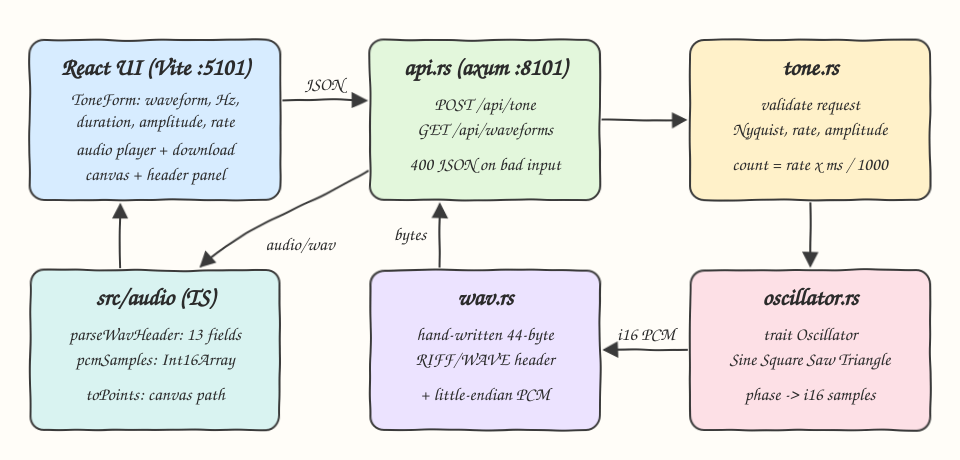
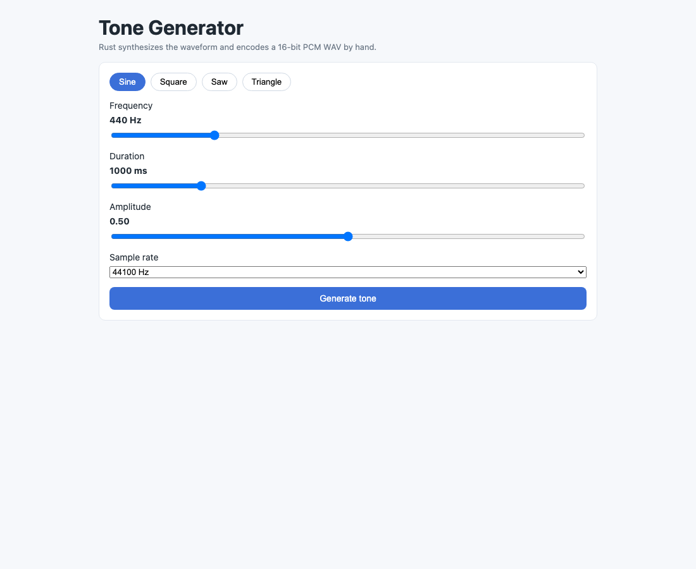
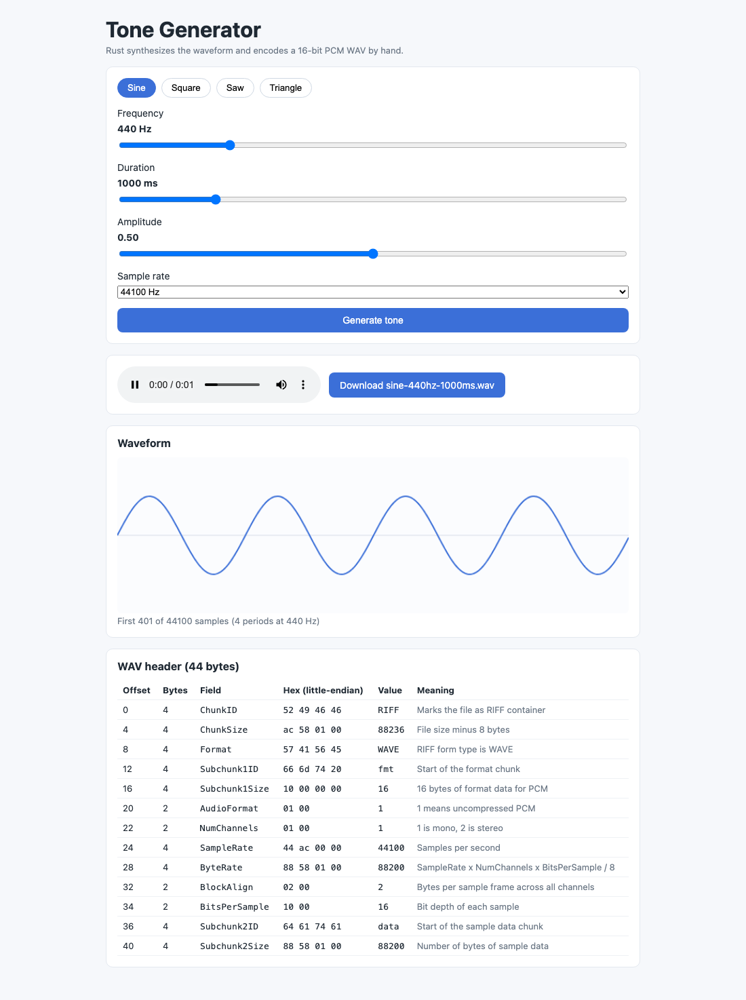
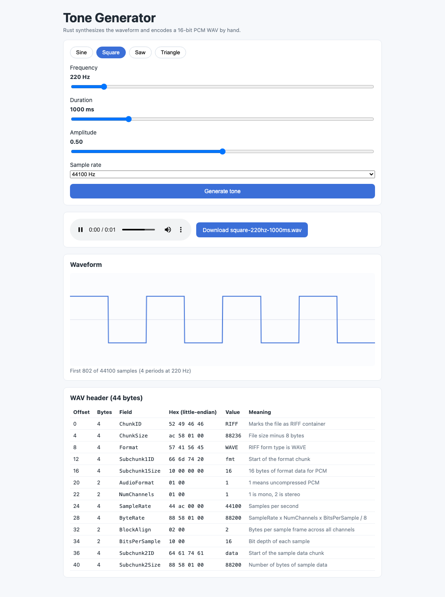
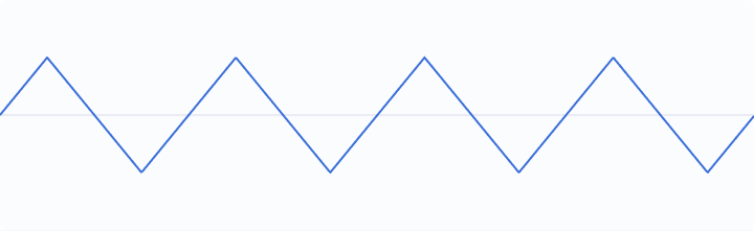

# Tone Generator

A tone generator that synthesizes sine, square, saw and triangle waves in Rust and returns them as 16-bit PCM WAV files encoded with a hand-written RIFF/WAVE header. The React UI plays the tone, draws the waveform on a canvas, offers a download, and decodes the 44-byte header field by field so you can learn the WAV format.

## How it Works

1. The UI sends `{waveform, frequency, duration_ms, amplitude, sample_rate}` to `POST /api/tone`.
2. `tone.rs` validates the request: known waveform, supported sample rate, 20 Hz up to (but not including) Nyquist, 1 to 10000 ms, amplitude 0 to 1.
3. It computes `sample_count = sample_rate * duration_ms / 1000`.
4. `oscillator.rs` picks the `Oscillator` impl for the waveform and evaluates it at phase `fract(i * frequency / sample_rate)` for each sample, scaled by amplitude to `i16`.
5. `wav.rs` writes the 44-byte RIFF/WAVE header byte by byte (little-endian) and appends the PCM samples.
6. The browser receives `audio/wav`, plays it from a Blob URL, parses the header with a `DataView`, decodes the samples and draws 4 periods on a canvas.

## Architecture



## Features

* Four waveforms behind one `Oscillator` trait: adding a waveform is one struct and one `impl`.
* Hand-written WAV encoder: no audio crates, so every byte of the format is visible in `wav.rs`.
* Header panel: shows offset, size, hex bytes, decoded value and meaning of all 13 header fields.
* Waveform canvas: draws exactly 4 periods regardless of pitch, so shapes are always comparable.
* Playback and download: the same WAV bytes are played in the browser and saved as a file.
* Input validation: frequencies at or above Nyquist are rejected because they would alias.

## Stack

* Rust 1.99.1, edition 2024: fast, safe DSP and byte-level encoding.
* axum + tokio: minimal async HTTP server for the two endpoints.
* serde: request and response JSON (de)serialization.
* React 19.3.1 + TypeScript strict: typed UI components.
* Vite: dev server with `/api` proxy to the backend.
* bun: package manager, script runner and test runner for the TS helpers.

No other crates are used. CORS is not needed because Vite proxies `/api`.

## API

### `GET /api/waveforms`

```json
{ "waveforms": ["sine", "square", "saw", "triangle"], "sample_rates": [8000, 16000, 22050, 44100, 48000] }
```

### `POST /api/tone`

Request:

```json
{ "waveform": "sine", "frequency": 440, "duration_ms": 1000, "amplitude": 0.5, "sample_rate": 44100 }
```

Response `200`: `Content-Type: audio/wav`, body is `44 + 2 * sample_count` bytes.

Response `400`: `{ "error": "frequency 4000 Hz must be between 20 Hz and half the sample rate" }`

## WAV Header Layout

| Offset | Bytes | Field | Value for mono 16-bit |
|---|---|---|---|
| 0 | 4 | ChunkID | `RIFF` |
| 4 | 4 | ChunkSize | `36 + data bytes` |
| 8 | 4 | Format | `WAVE` |
| 12 | 4 | Subchunk1ID | `fmt ` |
| 16 | 4 | Subchunk1Size | `16` |
| 20 | 2 | AudioFormat | `1` (PCM) |
| 22 | 2 | NumChannels | `1` |
| 24 | 4 | SampleRate | request rate |
| 28 | 4 | ByteRate | `rate * 2` |
| 32 | 2 | BlockAlign | `2` |
| 34 | 2 | BitsPerSample | `16` |
| 36 | 4 | Subchunk2ID | `data` |
| 40 | 4 | Subchunk2Size | `samples * 2` |

## Key Data Structures and Design Decisions

* `trait Oscillator { fn sample(&self, phase: f64) -> f64 }`: each waveform is a pure function of phase in `[0, 1)` returning `[-1, 1]`. Rendering, amplitude and quantization live once in `render`.
* `enum Waveform`: maps API strings to oscillators with `FromStr`, so unknown names become a typed `AppError::UnknownWaveform`.
* `enum AppError`: implements `std::error::Error` and `IntoResponse`, so validation errors become `400` JSON. No `unwrap()` outside tests.
* `encode_header(sample_rate, sample_count) -> [u8; 44]`: fixed-size array, so the header length is checked at compile time.
* The triangle wave is phase-shifted to start at zero, avoiding a click at the start of playback.
* Ports live only in `scripts/ports.env`: the backend reads `PORT` from the environment set by `start-all.sh`, and `vite.config.ts` reads the same file.
* Header parsing and sample decoding run in TS because they are tiny and exist to explain the bytes the Rust backend produced.

## Tests

Backend (`cargo test`, 16 tests) encodes why behaviour matters, for instance:

* the header matches the canonical 44-byte layout byte for byte
* RIFF size equals file length minus 8
* sample count equals `rate * duration`
* a 440 Hz sine has about 880 zero crossings per second, and doubling frequency doubles them
* a square wave has only two levels and spends half the time high
* a saw drops once per cycle, a triangle turns twice per cycle
* frequencies at or above Nyquist are rejected

Frontend (`bun test`, 7 tests) checks header parsing, that the 13 fields tile all 44 bytes, PCM decoding, the visible window and canvas mapping.

## How to Run

```bash
./scripts/setup.sh
./scripts/start-all.sh
./scripts/ui.sh
./scripts/test-all.sh
./scripts/stop-all.sh
```

Manual:

```bash
cd backend && PORT=8101 cargo run
cd frontend && bun install && bun run dev
cd backend && cargo test
cd frontend && bun test src && bun run build
```

## Printscreens

Initial screen: pick a waveform, frequency, duration, amplitude and sample rate.



A 440 Hz sine at 44100 Hz: the audio player, download button, 4 periods drawn on the canvas, and the decoded header.



A 220 Hz square wave: the canvas shows only two levels, and the header panel shows `ChunkSize` 88236 and `Subchunk2Size` 88200 for 44100 samples of 2 bytes.



A triangle wave starting at zero and turning twice per cycle.



## Scripts

All scripts live in `scripts/` and run from any directory of the repository.

| Script | What it does |
|---|---|
| `./scripts/setup.sh` | Installs dependencies and prepares the app |
| `./scripts/start-all.sh` | Starts every service and prints the full link of each one |
| `./scripts/status.sh` | Shows every service port as UP or DOWN |
| `./scripts/test-all.sh` | Runs every test suite |
| `./scripts/ui.sh` | Opens the UI in the browser |
| `./scripts/stop-all.sh` | Stops every service |

Ports are declared in `scripts/ports.env`.

```bash
./scripts/setup.sh
./scripts/start-all.sh
./scripts/status.sh
./scripts/ui.sh
./scripts/stop-all.sh
```
