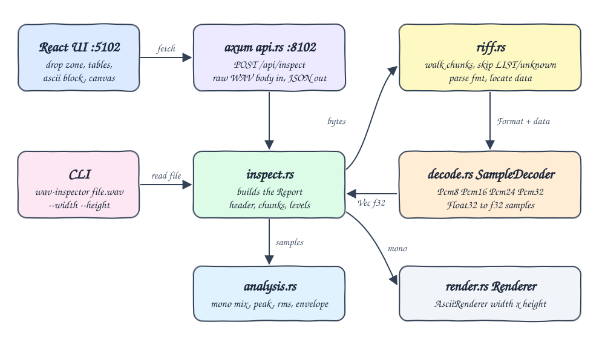
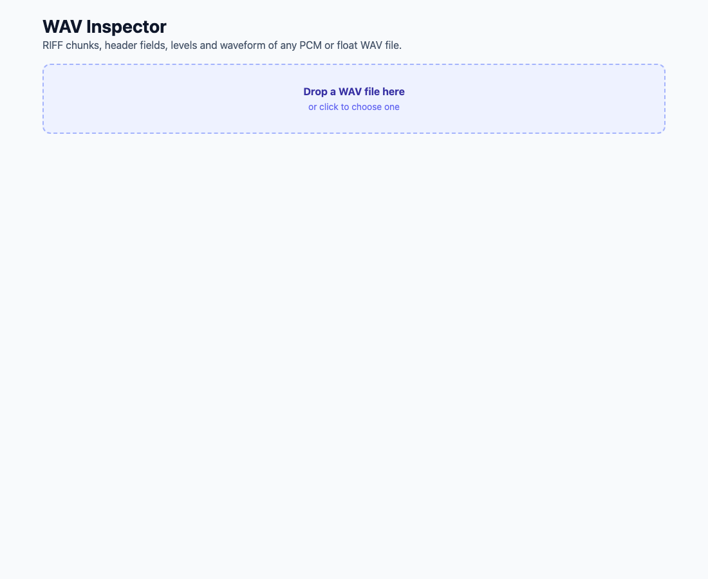
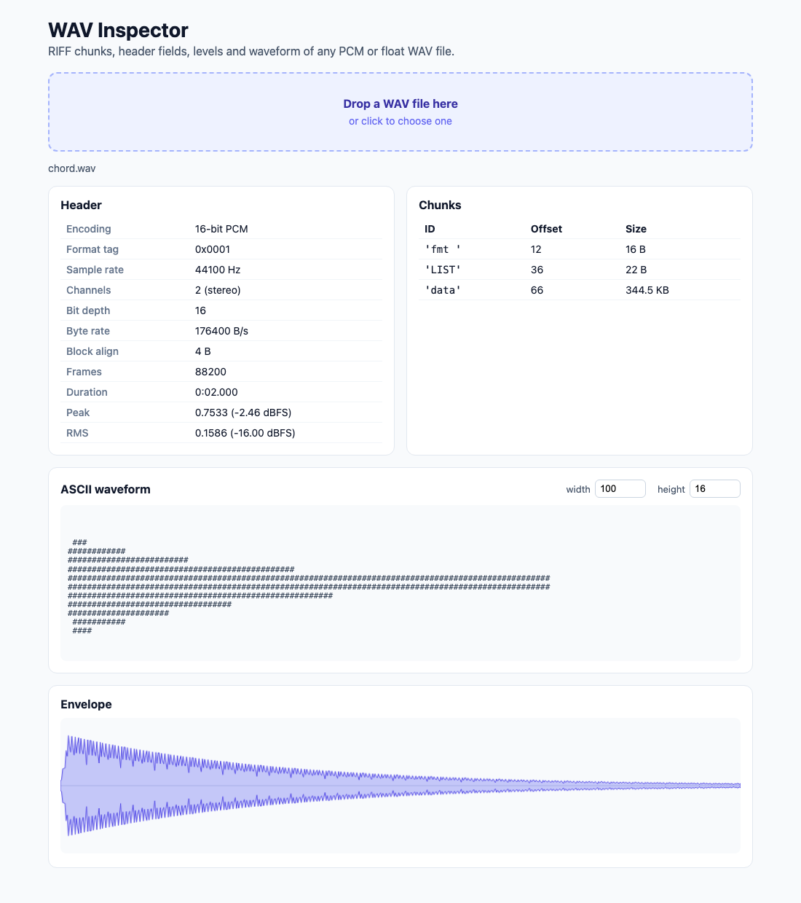
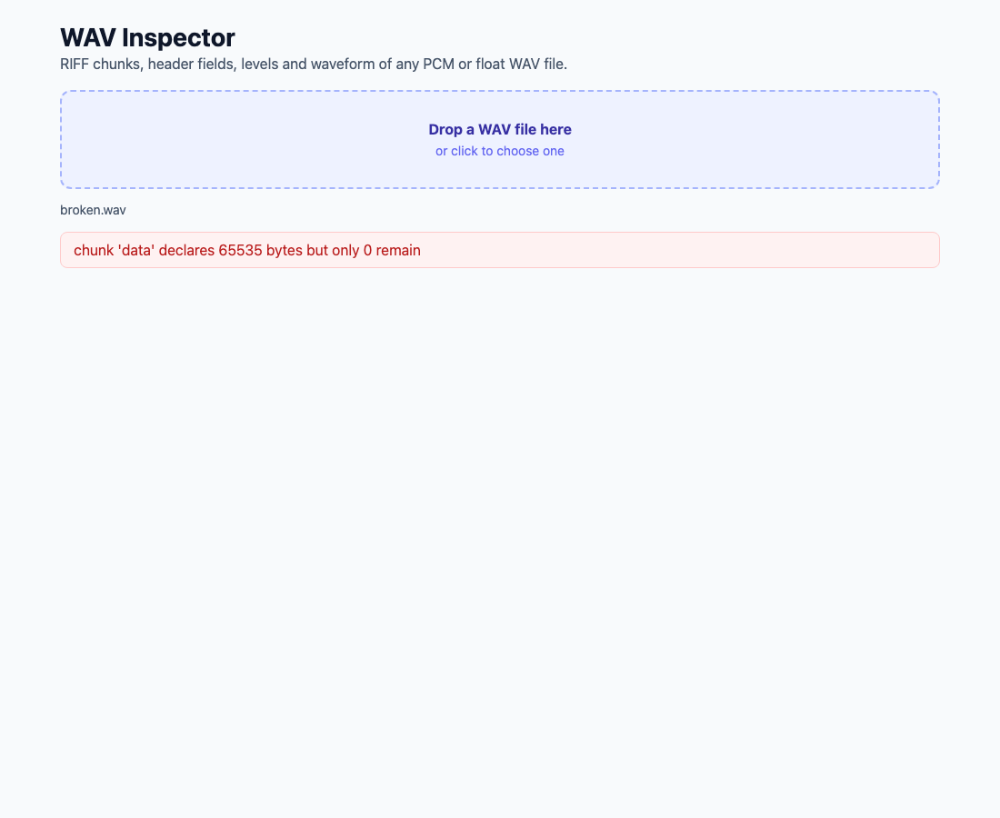

# WAV Inspector

A WAV file inspector with a hand-written RIFF parser in Rust. It runs as a CLI that prints the header, chunk list, peak/RMS levels and an ASCII waveform in the terminal, and as an HTTP server that a React UI uses to show the same report with an envelope canvas.

## How it Works

1. The RIFF walker reads the 12-byte `RIFF....WAVE` header, then every chunk (`id`, `size`, body, pad byte for odd sizes) until the end of the file.
2. Unknown chunks such as `LIST`, `junk` or `bext` are listed and skipped; `fmt ` and `data` can appear in any order.
3. `fmt ` is validated (non-zero rate and channels, `block_align == channels * bytes per sample`). `WAVE_FORMAT_EXTENSIBLE` resolves to its sub format.
4. A `SampleDecoder` is picked per format (8/16/24/32-bit PCM, 32-bit float) and turns the `data` bytes into interleaved `f32` samples in `[-1, 1]`.
5. Peak and RMS are computed over all samples; stereo is mixed to mono for the envelope and the waveform.
6. An `AsciiRenderer` buckets the mono signal into `width` columns and fills each column from its min to its max over `height` rows.
7. Any malformed input (bad magic, truncated chunk, missing `fmt `/`data`, unsupported format, partial frame) returns a typed `WavError`: exit code 1 in the CLI, HTTP 400 with `{ "error": ... }` in the API.

## Architecture



## Features

* **Hand-written RIFF chunk parser**: no audio crates, every byte offset is visible and tested.
* **Unknown chunk skipping**: real files carry `LIST`/`INFO` metadata; they are reported but never break parsing.
* **8/16/24/32-bit PCM and 32-bit float, mono/stereo**: covers the encodings produced by DAWs and recorders.
* **Peak and RMS in linear and dBFS**: quick loudness and headroom check.
* **ASCII waveform with configurable width/height**: see the shape of a file straight from a terminal.
* **Envelope canvas**: 600-point peak envelope drawn in the browser.
* **Clear errors for malformed files**: truncated or corrupted files say exactly which chunk or field is wrong.

## Stack

* **Rust 1.99.1 (edition 2024)**: parser, decoders, analysis and renderer, all hand-written.
* **axum + tokio**: small async HTTP server for the API.
* **serde / serde_json**: JSON report serialization.
* **tower-http (CORS)**: lets the API be called from other origins during development.
* **React 19.3.1 + TypeScript (strict) + Vite**: UI with drag and drop, tables and canvas.
* **bun**: package manager, dev server runner and test runner for the frontend.

No other libraries are used.

## API

`POST /api/inspect?width=100&height=16`

* Body: raw WAV bytes (`Content-Type: audio/wav`), up to 64 MB.
* `width` (8..400, default 100) and `height` (3..100, default 16) size the ASCII waveform.

`200 OK`

```json
{
  "header": {
    "encoding": "16-bit PCM",
    "format_tag": 1,
    "sample_rate": 44100,
    "channels": 2,
    "bits_per_sample": 16,
    "byte_rate": 176400,
    "block_align": 4,
    "frames": 88200
  },
  "chunks": [
    { "id": "fmt ", "offset": 12, "size": 16 },
    { "id": "LIST", "offset": 36, "size": 22 },
    { "id": "data", "offset": 66, "size": 352800 }
  ],
  "duration": 2.0,
  "peak": 0.7533,
  "rms": 0.1586,
  "ascii": "...\n...",
  "envelope": [0.01, 0.42, 0.75]
}
```

`400 Bad Request`

```json
{ "error": "chunk 'data' declares 65535 bytes but only 0 remain" }
```

## CLI

```bash
cd backend
cargo run -- path/to/file.wav --width 60 --height 9
cargo run -- serve --port 8102
```

```
encoding     16-bit PCM
sample rate  44100 Hz
channels     2
bit depth    16
byte rate    176400
block align  4
frames       88200
duration     2.000 s
peak         0.7533 (-2.46 dBFS)
rms          0.1586 (-16.00 dBFS)
chunks
  'fmt ' offset 12 size 16
  'LIST' offset 36 size 22
  'data' offset 66 size 352800
waveform


#########
#############################
############################################################
###################################
##############
####
```

## Key Data Structures and Design Decisions

* `riff::Chunk { id, offset, size }`: every chunk found, in file order, including unknown ones.
* `riff::Format`: the decoded `fmt ` fields; the extensible sub format replaces the format tag so decoders only see PCM or float.
* `trait SampleDecoder { bytes_per_sample, decode }` with `Pcm8`, `Pcm16`, `Pcm24`, `Pcm32`, `Float32`. `decoder_for` is the only place that maps format tag + bit depth to an implementation.
* `trait Renderer { render(&[f32]) -> String }` with `AsciiRenderer`; the CLI and the API share it.
* `WavError` is a plain enum implementing `std::error::Error`; no `unwrap`/`expect` outside tests.
* Strict parsing: a chunk that claims more bytes than the file has is an error instead of a silent truncation, because an inspector should expose broken files, not hide them.
* Test fixtures are generated in code by `fixture::WavBuilder` (any format, extra chunks, chunk order, missing chunks, raw data), so there are no binary files in the repo.
* The frontend only formats and draws; all parsing and DSP is in Rust. `src/audio/envelope.ts` turns the envelope into a mirrored outline for the canvas.

## How to Run

```bash
./scripts/setup.sh
./scripts/start-all.sh
./scripts/ui.sh
./scripts/test-all.sh
./scripts/stop-all.sh
```

Tests: `cargo test` (52 tests covering parser, decoders, analysis, renderer, report, API handler and CLI, including malformed files) and `bun test src` (12 tests for formatting and envelope geometry). `test-all.sh` also runs `cargo clippy -D warnings` and `bun run build`.

## Printscreens

Empty state: drop zone waiting for a file.



Report for a 2 second 16-bit stereo file with a `LIST` chunk: header table, chunk list (the `LIST` chunk is listed and skipped), ASCII waveform showing the attack and decay, and the envelope canvas.



A truncated file whose `data` chunk declares more bytes than exist: the backend returns 400 and the UI shows the parser error.



## Scripts

All scripts live in `scripts/` and run from any directory of the repository.

| Script | What it does |
|---|---|
| `./scripts/setup.sh` | Installs dependencies and prepares the app |
| `./scripts/start-all.sh` | Starts every service and prints the full link of each one |
| `./scripts/status.sh` | Shows every service port as UP or DOWN |
| `./scripts/test-all.sh` | Runs every test suite |
| `./scripts/ui.sh` | Opens the UI in the browser |
| `./scripts/stop-all.sh` | Stops every service |

Ports are declared in `scripts/ports.env`.

```bash
./scripts/setup.sh
./scripts/start-all.sh
./scripts/status.sh
./scripts/ui.sh
./scripts/stop-all.sh
```
